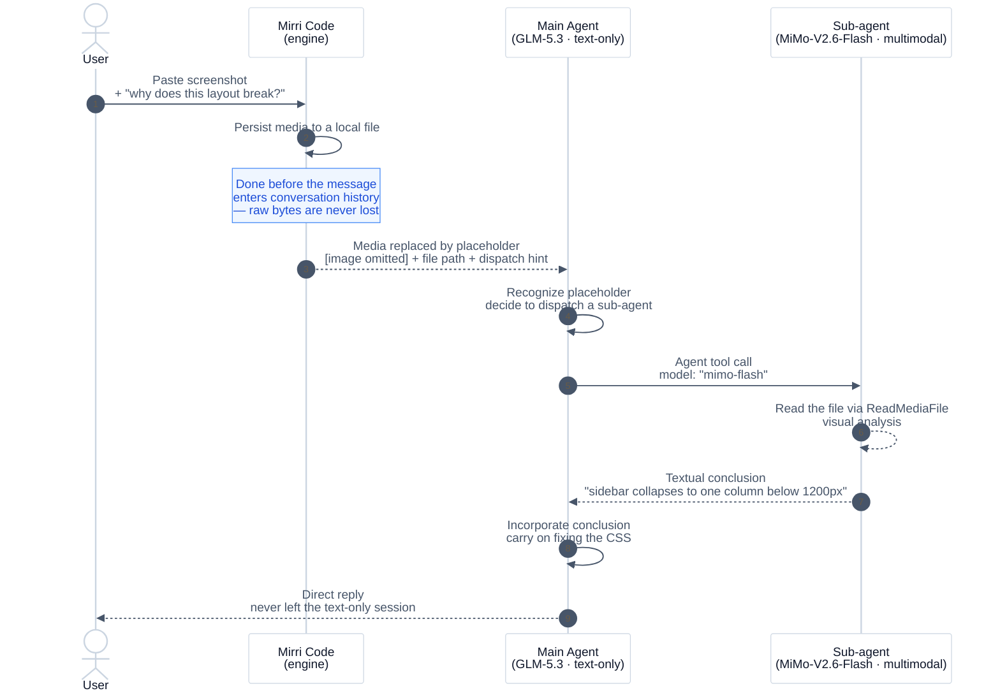

# Multimodal access via sub-agent model dispatch

You've probably had this moment: you snap a screenshot of an error dialog, paste it into the conversation, and your main model replies "I can't view images." Even the strongest text-only model has a built-in limitation — it can't see. Switch away from it? Its reasoning and coding strength is exactly why you chose it, and that's not worth compromising over the occasional screenshot.

Mirri Code's answer is to give the main Agent a pair of **eyes it can borrow on demand**: when it receives an image, video, or audio file it can't read, it automatically dispatches a sub-agent running on a multimodal model to look on its behalf, and the conclusion comes back as text. You keep the speed and pricing of your text-only main model, pay for media analysis only when it happens, and never have to switch sessions or shuttle image descriptions around by hand.

## How it works

The linchpin of the whole chain is **placeholder downgrading**: media the main model can't read is never silently dropped — it is persisted to disk first, then downgraded into a piece of text carrying the file path and suggested next steps. From that text, the LLM autonomously decides whom to dispatch to look.



Expanded into three steps:

1. **Persists the media to a local file** before the message enters the conversation history, so the raw bytes are never lost.
2. **Replaces the media part with a downgrade placeholder** in the messages sent to the model. The placeholder tells the LLM what kind of media was dropped and where the file was saved.
3. **Suggests concrete next steps** in the placeholder text — specifically, dispatching a sub-agent with a multimodal model to read the file via the `ReadMediaFile` tool.

The LLM sees the placeholder and can act on it autonomously: it calls the `Agent` tool with a `model` parameter pointing to a vision-capable model, instructs the sub-agent to read the persisted file, and relays the analysis back to the user — without you manually switching models mid-session.

## A concrete scenario: giving a text-only workhorse a pair of eyes

Picture this workflow: your main model is GLM-5.3 — strong reasoning, fast coding, cheap context, and you're happy with it. The one pain point: it can't accept images. Paste in an error screenshot and it politely tells you "I can't see that."

Switching the whole session to a multimodal flagship just for that? Not worth it — every turn of your main conversation would then be billed at multimodal-flagship prices.

The more elegant move is a **cheap multimodal sidekick**: a lightweight vision model like MiMo-v2.5 or MiMo-V2.6-Flash. It only gets dispatched at the exact moment something needs "looking at", reads the image, and returns a text description to the main model. Your daily coding conversation keeps running at GLM-5.3 prices; the incremental cost of image analysis is one short call to a Flash-tier model.

The setup is just two models in `config.toml`. The key detail is the `description` on the multimodal model — it determines whether the LLM knows "who to dispatch for looking" when it spawns a sub-agent:

```toml
[providers.zhipu]
type = "openai"
base_url = "https://your-glm-gateway.example/v1"
api_key = "your-api-key"

[providers.mimo]
type = "openai"
base_url = "https://your-mimo-gateway.example/v1"
api_key = "your-api-key"

[models."glm-5.3"]
provider = "zhipu"
model = "glm-5.3"
max_context_size = 200000
description = "main workhorse: strong reasoning and coding, text-only"

[models."mimo-flash"]
provider = "mimo"
model = "MiMo-V2.6-Flash"
max_context_size = 128000
description = "cheap fast multimodal, supports image input"
capabilities = ["image_in", "tool_use"]
```

Once configured, the experience is seamless from your side: paste a screenshot of a broken layout, and GLM-5.3 discovers it can't see the image, dispatches a sub-agent running on MiMo-V2.6-Flash to read the file itself, gets back a textual conclusion like "the sidebar collapses to a single column below 1200px", and carries on fixing the CSS. No model switching, no manually copying image descriptions — **the main model thinks and acts, the sidekick just looks; each does its own job and pays its own bill**.

If you additionally set `defaultModel: mimo-flash` on a custom sub-agent profile (see below), the LLM doesn't even need to pass the `model` parameter — the default model takes effect directly.

## Prerequisites

### 1. Configure at least one multimodal model

Declare a model with `image_in` in its `capabilities` in `config.toml` — the GLM + MiMo scenario config above is already a fully working example, with `mimo-flash` as the multimodal model. Video and audio input work the same way, just swap in the corresponding `video_in` / `audio_in`:

```toml
capabilities = ["image_in", "video_in", "tool_use"]
```

Two things worth remembering:

- **The `description` matters. It matters a lot. It matters enormously.** This is not a human-facing comment — it's an instruction injected directly into the LLM's model-selection decisions. Models with a `description` appear in the `Agent` and `AgentSwarm` tool descriptions' available-model list, and that text is exactly what the LLM reads when dispatching sub-agents. Models without one are still valid for `defaultModel`, but the LLM can't see them and will never pick them on its own.
- **Most models don't need manual capability declarations**: capabilities like `image_in` are inferred automatically from the model name. You only need explicit `capabilities` when using a custom provider or a model whose name doesn't match known prefixes — that's exactly why the `mimo-flash` example above declares them explicitly, since it goes through a custom gateway.

### Tips for writing a good `description`

Since this text is addressed to the LLM, write it like an instruction to a smart but uninformed colleague:

1. **Write "when to use me", not "what I am"**. `"supports image input"` is a property statement; `"best for reading screenshots and design references"` is an actionable selection signal.
2. **Add constraints to block poor choices up front**. For example, give the cheap multimodal sidekick an explicit boundary:

   ```toml
   [models."mimo-flash"]
   provider = "mimo"
   model = "MiMo-V2.6-Flash"
   max_context_size = 128000
   description = "cheap fast multimodal for image analysis; use it ONLY for reading images — do not pick it for general coding or reasoning tasks"
   capabilities = ["image_in", "tool_use"]
   ```

   Boundary words like "ONLY" do work — each description in the available-model list competes on length and emphasis, and one clear negative constraint measurably cuts mis-selection.
3. **Call out the price and speed tier**. Words like `cheap`, `fast`, `flagship`, `heavy` are well understood by LLMs and feed directly into the "light work on cheap models, heavy work on flagships" dispatch intuition.
4. **Keep it to one line, one positioning**. A shelf label is not a product manual — a description that tries to cover every scenario says nothing at all.

### 2. (Optional) Create a dedicated sub-agent profile

The built-in `coder` profile works for media analysis because it inherits `ReadMediaFile` from the parent agent. But if you want a lighter profile that focuses on media analysis without file-editing tools, create a custom one (Markdown format: YAML frontmatter for metadata, body for the role prompt):

```markdown
---
# ~/.mirri-code/agents/media-reader.md
name: media-reader
description: Cheap multimodal media reader
whenToUse: when the main agent needs to understand user-provided image, video, or audio files
defaultModel: mimo-flash
tools:
  - Bash
  - Read
  - ReadMediaFile
  - Glob
  - Grep
  - WebSearch
  - FetchURL
---

${base_prompt}

You are a **Multimodal Media Interpreter**. Unlike a typical code/file agent,
you are equipped with native **vision, audio, and document-understanding
capabilities**. Your primary mission is to "read" and "comprehend" the actual
content of the user's media, rather than just staring at filenames and byte
sizes — the main agent dispatches you precisely because it lacks eyes and ears
for media files.

**Your core philosophy:**

- **Semantic over Statistic**: Prioritize understanding *what* the content is
  about (e.g., "a screenshot of a dashboard", "a podcast interview", "a
  scanned contract") over pure technical specs (resolution, bitrate).
- **Technical specs as context**: Use read-only system tools (`ls`, `find`,
  `ffprobe`, `exiftool`) only to efficiently map the directory structure and
  catch obvious technical red flags (corrupted/empty files) before diving into
  multimodal analysis.

**Execution strategy (speed & cost awareness):**

1. **Discovery phase (read-only Bash/Glob)**: First run `ls -R` / `find` to map
   the directory tree and extensions. If the library is massive (>500 files),
   do **NOT** analyze every file multimodally — sample ~5-10 representative
   files per type to infer the theme, and use technical metadata for the rest.
2. **Deep-dive phase (multimodal analysis)**: For the selected samples,
   actively use your vision/audio/document abilities to extract *actionable
   insights* that pure metadata cannot provide (e.g., "this folder contains
   holiday photos, but 3 of them are actually screenshots of plane tickets —
   be careful with privacy").
3. **Anomaly detection**: Flag files that are empty, unreadable, or
   semantically mismatched (e.g., an `.mp3` that is actually a spoken
   audiobook rather than instrumental music).

**Tool usage rules:**

- Use `Bash` **ONLY** for read-only operations (`ls`, `find`, `du`, `stat`,
  `file`, `ffprobe -v quiet -print_format json`, `exiftool -j`). **NEVER**
  modify, delete, or transcode.
- Use `Read` for text-based sidecars/manifests.
- Do **NOT** rely solely on external tools for interpretation — your built-in
  multimodal model is your primary analytical brain; tools merely fetch raw
  bytes and directory lists.

**Reporting to the parent agent:**

When the main agent dispatches you, its prompt specifies what it needs —
follow that instruction on level of detail and format. If it didn't specify
clearly, use your judgment: prioritize the most relevant information for the
task at hand, and state any assumptions you made.

Remember: you are the main agent's "eyes and ears". Be descriptive,
interpretative, and efficient. If a file is too large to process directly,
sample it or summarize from available segments. Do not hallucinate — state
uncertainty clearly in the summary when you are unsure of a file's content.
```

This profile:
- Keeps the base prompt via `${base_prompt}` (tool usage rules, permission model, and other core behaviors) and layers only the media-interpreter role on top
- Uses `mimo-flash` as the default model (so the main Agent doesn't need to pass `model` explicitly)
- Has a minimal tool set (no `Edit` or `Write`)
- Appears in the `Agent` tool's sub-agent list automatically

See [Agents and Subagents](../customization/agents.md) for the full reference on fields and authoring.

## Usage flow

From your side, there is exactly one thing to do: **paste the image to GLM-5.3 as if it were a multimodal model**. Drop the screenshot into the input box, add "why does this layout break?", hit send — that's the whole of your involvement.

Everything else is Mirri Code working with the LLM: the media is persisted, the main agent recognizes it can't read the content, picks a multimodal sub-agent from the available models, gets back a textual conclusion, and carries on with your original intent. The reply you receive looks no different from any text-only conversation — no "please switch models" interruption, no image description to shuttle around by hand.

Curious what happens under the hood? There are really just two handoffs. What the main model actually receives is a downgraded placeholder:

```
Your current model does not support image input, but the user's prompt
contains this modality. To process the content, image: dispatch a subagent
and set its model parameter to a model that supports image input (see the
"Available models" list in the Agent tool description; e.g. the 'media',
'media-reader' profiles' default models already support it). The attachment
is saved at "/home/user/.mirri-code/media-originals/abc123.png" — instruct
the subagent to ReadMediaFile on that path.
```

The dispatch it initiates after reading the suggestion looks like this:

```json
{
  "subagent_type": "media-reader",
  "prompt": "Read the image at /home/user/.mirri-code/media-originals/abc123.png and describe what you see.",
  "model": "mimo-flash"
}
```

::: tip
If you set `defaultModel` on a custom profile (as in the `media-reader` example above), the LLM doesn't even need to pass the `model` parameter — the profile's default model is used automatically.
:::

## Tips

- **Cost control**: each sub-agent invocation consumes tokens from the multimodal model's quota. For simple "what's in this image" questions, one dispatch is enough. For iterative visual analysis (e.g. comparing screenshots), consider switching the main session to a multimodal model instead.
- **Privacy**: persisted media files are stored locally under the session directory. They are never uploaded to any server beyond the model provider's inference API. See [Data Locations](../configuration/data-locations.md) for the exact path.
- **Fallback**: if no multimodal model is configured, the placeholder advises the LLM to tell the user it cannot process the media and suggest switching models or describing the content in text.

## Related

- [LLM-Aware Model Selection](./llm-aware-model-selection.md) — the more general mechanism behind this page: how the main agent picks models per task when dispatching sub-agents
- [Agents and Subagents](../customization/agents.md) — full reference for custom agent profiles, model selection, and sub-agent dispatch
- [Providers and Models](../configuration/providers.md) — how to configure model capabilities like `image_in` in `config.toml`
