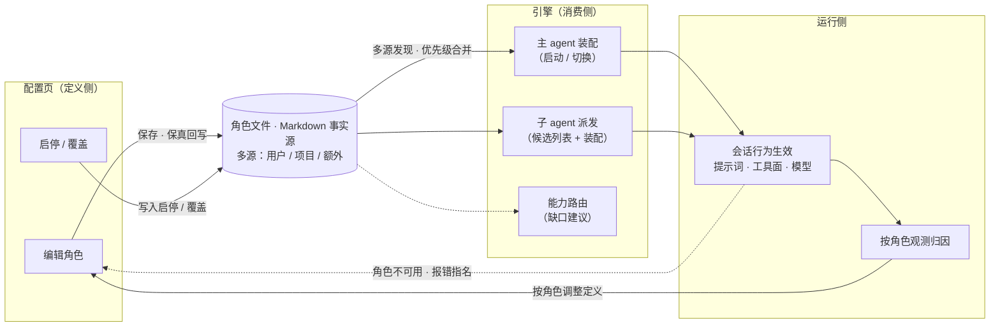

# Agent Profile 设置页需求文档（User Stories）

> 状态：v6（v5 基线 + 2026-10-22 提示词语义两项裁决并入，见文末 SDR-014–015；待用户评审） ·
> 本文是 agent profile 配置页需求侧的唯一事实源（内部规格文档，不进文档站构建，中文单语）。
> 契约基准为 TS v2 引擎（agent-core-v2 + kap-server）；各域现状依据见 context 文档。
> 运行时消费侧（主 agent 装配与切换、子 agent 派发、能力路由、用量归因、角色最小声明集）见 [agent-profile-consumption-requirements.md](agent-profile-consumption-requirements.md)（下称「使用域文档」）。
> 现状盘点（字段矩阵、发现机制、双内核差异、主 agent 选择入口证据）见 [agent-profile-settings-page-context.md](agent-profile-settings-page-context.md)（下称「context 文档」），本文不重复。
> 验收标准统一 Given-When-Then；优先级 P0 > P1 > P2。
> 本文只定义页面与数据面的呈现、交互、契约语义；技术形状（接口方法、存储格式、序列化机制）归 `agent-profile-settings-page-architecture.md`（待需求确认后撰写）。

## 功能闭环（本文的需求骨架）

配置页不是孤立的文件管理器——它与 agent 运行构成一个闭环：**页面上的每一处配置，都必须在运行侧产生可感知的效果；运行侧的每一次消费，都必须能在页面上追溯与调整**。闭环上任何一环「只写不读」或「只读不写」，即为缺陷（不允许「存在但无效」的功能；断线例证见 context 文档 §6.8 的启停断层——页面上写了启停，引擎侧无人消费）。

概要说明——闭环的三段两回线：

1. **定义（配置页 → 角色文件）**：编辑与启停以保真回写落盘为事实源（N1）；多来源合并与优先级语义见 context 文档 §1
2. **消费（角色文件 → 引擎三类消费方）**：主 agent 装配（启动/切换）、子 agent 派发（候选列表与装配）、能力路由（缺口建议）——消费时刻全景见使用域文档 §1
3. **运行与反馈（运行侧 → 配置页，两条回线）**：观测回线——按角色用量归因（US-U5.1）驱动用户回到配置页调整定义；异常回线——角色不可用时报错指名（US-U2.5），可定位回配置页补齐
4. **生效边界**：定义变更对进行中的装配是快照、对下一次消费即生效（US-U2.4）；页面与运行侧状态同源一致（N4）

**接线表**（闭环不变量的操作化——每个可写配置项必须有至少一个运行侧消费方与对应验收条款；新增配置项时必须同步扩本表，无消费方的配置项不得进入页面）：

| 配置项 | 运行侧消费方 | 验收条款 |
|---|---|---|
| 描述（含使用时机） | 子 agent 派发候选列表 | US-A4 / US-U2.1 |
| 行为提示词（角色附加文本，SDR-014） | 主 agent 装配 / 子 agent 派发装配 | US-U2.4 / US-A4 |
| 共享系统提示词（独立设置面，SDR-015） | 所有组合装配角色的系统提示词基座 | US-A8 |
| 工具面 | 激活工具集（派发装配、能力路由） | US-A4 |
| 默认模型 | 派发模型解析链 | US-U2.3 |
| 用途标记（主 / 子 / 两者） | 主 agent 选择器 / 派发列表过滤 | US-U1.1 / US-B6 |
| 可派发子角色 | 派发白名单 | US-U2.2 |
| 启停 | 派发候选移除 + 主 agent 选择器排除（引擎消费） | US-A5 / US-U2.1 / US-U1.1 |
| 职责 / 产出契约（协作域） | 团队组建与完成判定 | US-U4.1 / US-U4.2 |
| 团队模板（协作域） | 团队组建展开 | US-D3 |

## 0. 角色定义（Personas）

| 角色 | 场景 | 核心诉求 |
|---|---|---|
| **角色使用者**（自己不写角色、只用现成角色的用户） | 搞清每个角色是干什么的；关掉用不上的 | 一眼看清有哪些角色、各自能干什么；不想用的能安全关掉，不怕弄坏 |
| **角色作者**（创建与维护自定义角色的用户） | 编写可复用的角色 | 用声明式配置（职责描述、工具面、模型）创建角色，不必手写文件 |
| **主 agent 使用者**（想换主 agent 的用户） | 为不同类型任务或工作模式切换主 agent | 不同任务用不同的「开号」主 agent，而不是全局只有一套默认 |
| **团队角色定义者**（协作域，随协作 spec E1；对齐 collaboration spec 同名 persona） | 定义团队中的角色 | 声明职责与产出契约，而不只是配工具白名单（指向 [collaboration-requirements.md](collaboration-requirements.md)） |

## 1. 术语与范围分组（全文唯一口径）

本文统一用「**角色**」指代 agent profile（用户文档中亦称 agent）；「**主 agent**」指会话中直接对用户负责的 agent；「**子 agent**」指由主 agent 通过工具派发的 agent。

本节为 `glossary.md`「A. 角色域」条目的域内视图，规范定义以术语表为准（同批登记，见 SDR-004；A16 角色附加文本 / A17 共享系统提示词随 SDR-014/015 同批登记——本文的「系统提示词编辑框」即 A16 角色附加文本，「共享系统提示词」指 A17 基座本身）。

需求分四组。各组的现状依据与差距见 context 文档（§1 配置面现状、§1.4 消费时刻对照、§4 双内核差异）；时序先后由 §7 的优先级与依赖表达：

| 组 | 范围 | 依赖 |
|---|---|---|
| **Epic A：配置页基线能力** | 角色的浏览、详情、创建、编辑、启停与删除的页面要求；不引入新的引擎行为，但包含「启停」既有断线的引擎侧修复（存量缺陷：页面的启停在引擎消费侧不生效，见 context 文档 §6.8；v1 与 rust 引擎均有可参照的消费实现） | 无前置 |
| **Epic B：主 agent 相关的页面呈现与编辑** | 使用域文档 Epic U1（主 agent 装配与切换）在配置页侧的呈现与编辑要求 | 使用域文档 Epic U1 |
| **Epic C：双引擎一致** | 任一引擎模式下配置页呈现同一份角色集合；两套引擎配置互不互通的问题依据见 context 文档 §4 | 引擎侧统一实现（SDR-002；白名单引用形态已定——角色名引用，SDR-007） |
| **Epic D：协作域扩展** | 角色职责、产出契约、团队模板的配置面入口 | [collaboration-requirements.md](collaboration-requirements.md) E1 |

**In scope**：设置页 Agent Profiles 面板的全部能力、主 agent 选择入口的页面语义、双引擎一致后的页面受益语义、协作域字段的编辑入口。
**Out of scope**：协作执行机制本体（任务板、消息、交接——归 collaboration spec）；主 agent 选择的运行时语义（归使用域文档 Epic U1）；rust 侧格式统一的引擎实现本身（本文只定义达成后页面的可见语义）；角色/模板市场（协作 spec 亦列为 out of scope）；v1 遗留引擎；移动端。

## 2. Epic A：配置页基线能力

> 角色以 Markdown 文件为事实源（头部配置区 Frontmatter + 正文即系统提示词）；文件形态、来源分层与优先级语义的依据见 context 文档 §1，内置缺省角色的锁定约束见 N3。

### US-A1 浏览角色列表（P0）

作为角色使用者，我想看到全部角色及其来源与状态，以便知道当前有哪些角色可用、正在生效的是哪一份。

- Given 设置页打开 Agent Profiles 标签，When 加载完成，Then 列出全部角色，每行含：名称、描述、来源徽章（内置 / 用户 / 项目 / 额外目录）、内置锁定标记、启用状态
- Given 角色用途为主 agent 或两者皆可，When 列表呈现，Then 该角色带醒目的主 agent 徽章；列表支持按用途筛选（主 agent / 子 agent）
- Given 内置缺省角色，When 列表呈现，Then 标注其「兜底」身份——未选择专用主 agent 的会话回退于它（使用域 SDR-008）
- Given 同名角色存在多份（如项目目录与用户目录各一份），When 列表呈现，Then 显示正在生效的一份及其胜出来源，被压制的候选可展开查看（来源与差异）
- Given 某来源目录下存在无法解析的角色文件，When 列表加载，Then 该文件被跳过且给出可读的警告，不影响其余角色呈现

### US-A2 查看角色详情（P0）

作为角色使用者，我想查看单个角色的完整定义，以便判断它是否适合我的任务。

- Given 打开一个自定义角色，Then 详情展示全部可编辑字段：描述（含使用时机）、默认模型、工具面、用途标记（主 agent / 子 agent / 两者皆可）、可派发的子角色列表、角色附加文本（提示词编辑框）
- Given 打开任一带提示词的角色（内置或自定义），Then 附带以最终生效形态渲染的完整提示词预览（合并内置基座引用后的完整文本），作为只读参考与编辑内容并排呈现（SDR-013）
- Given 文件正文为完整替换形态（无基座引用的全量文本），When 查看详情，Then 明示该文件为完整替换形态（区别于组合形态）（SDR-014 ④）
- Given 角色的工具面以能力包方式声明，When 查看详情，Then 以人类可读的能力说明呈现该工具组（能力标签是工具面的「按能力选择」视图，见使用域文档 SDR-001）

### US-A3 创建角色（P0）

作为角色作者，我想在页面上创建角色，以便不必手写 Markdown 文件。

- Given 填写合法名称（小写字母或数字与连字符，如 `code-reviewer`）与非空描述，When 保存，Then 生成角色文件写入用户级目录并即时生效，无需重启
- Given 创建时提示词编辑框留空，When 保存，Then 该角色保存后行为与默认完全一致（提示词以基座引用形态落盘，见 SDR-014 ②），无占位文本出现
- Given 名称不合法或描述为空，When 提交，Then 前端拦截并指明具体字段问题
- Given 名称与既有角色重复，When 提交，Then 拒绝并提示冲突对象的名称与来源
- Given 以任一现有角色（含内置）为起点创建新角色，When 保存，Then 新角色整体复制起点定义，此后两者完全独立——起点仅是模板、复制一次，不是持续联动（「从现有角色开始」取代继承，SDR-005）
- P0 的创建仅落用户级目录；项目级创建入口随协作域团队功能同批交付（SDR-011）

### US-A4 编辑角色（P0）

作为角色作者，我想编辑既有自定义角色，以便迭代角色定义。

- Given 编辑并保存，Then 文件往返保真：头部配置区与正文的用户手写内容不被破坏、未被页面管理的字段原样保留
- Given 编辑工具面，Then 以单一概念编辑：可直接勾选具体工具（含按 MCP 服务器整组选择），也可按能力包选择（能力标签作为工具组视图呈现，见使用域文档 SDR-001）；留空即全部工具
- 角色用途的编辑随使用域 U1.1 同批交付（US-B6）；在其交付前，本 US 的页面不呈现用途编辑项（接线表约束：无消费方的配置项不得进入页面）
- Given 编辑可派发的子角色列表，Then 以当前启用角色的名称供勾选
- Given 页面无未保存编辑，When 角色文件被外部修改，Then 列表与详情自动刷新为最新（零操作，SDR-009）
- Given 页面存在未保存编辑且角色文件被外部修改，When 保存，Then 拦截并并排展示差异（外部改动 vs 页面编辑），由用户定夺（采用文件版 / 坚持页面版 / 逐项选择），不得静默覆盖任何一边
- 页面可编辑的字段以角色模型的字段全集为上限，不得出现模型不认识的字段（清单依据 context 文档 §1.1）
- Given 保存时提示词编辑框留空（未填写或清空），When 保存，Then 该角色保存后行为与其默认完全一致（内置角色附角色原有文本），无占位文本出现（SDR-014）
- Given 编辑的文件正文为完整替换形态（无基座引用的全量文本），When 保存，Then 保持替换语义，详情标注该文件为完整替换形态；清空编辑框保存则回落为基座引用（SDR-014 ④）
- Given 角色文件此前被占位文本写坏（正文恰为占位原文，内置覆盖与自定义角色、任一发现根下的角色文件同规则），When 加载该角色，Then 自动修复为基座引用形态，页面详情展示修复后的真实提示词语义，不展示占位文本（SDR-014）

### US-A5 启用、禁用与删除（P0）

作为角色使用者，我想控制角色的可用性，以便收敛模型可派发的选择面。

- Given 禁用一个角色，When 保存，Then 该角色从 Agent 派发工具的候选角色中移除（候选列表内嵌于该工具面向模型的说明，参数校验同时拒绝该角色），并从新会话的主 agent 选择器中排除（使用域 US-U1.1），下一轮派发即生效——启停状态在引擎消费侧与配置页同源一致
- Given 删除一个自定义角色，Then 对应文件被删除；内置角色不可删除，只能禁用
- Given 内置缺省角色 `agent`，Then 不可禁用、不可删除（页面呈现为锁定态）；其内容可被编辑覆盖（SDR-012）

### US-A6 覆盖内置角色的引导（P1）

作为角色作者，我想安全地定制内置角色（例如调整 explore 角色的工具面）。

- Given 创建或保存与内置角色同名的角色，When 保存，Then 直接生效——存在同名文件即视为覆盖意图，无需额外声明或确认步骤（SDR-012）
- Given 覆盖生效，Then 角色标注「已覆盖内置」，并提供一键恢复内置定义
- Given 对内置缺省角色 `agent` 发起覆盖，Then 生效——提示词、模型、工具面均可自定义，但兜底保护不变：不可删除、文件内声明的禁用不生效（页面在编辑时附带其兜底身份的警告提示，SDR-012）

### US-A7 终端与设置页的对等（P1）

作为终端用户，我想在终端界面获得与设置页一致的角色启停能力，以便不离开终端调整角色。

- Given 终端会话中，When 查看角色列表，Then 呈现与设置页一致的角色集合与启用状态
- 终端提供角色列表与启停（SDR-010），完整编辑留在设置页；无论范围为何，两端呈现的状态必须同源一致

### US-A8 系统提示词的独立设置面（P1）

作为进阶用户，我想查看并自定义当前生效的共享系统提示词，以便控制所有角色的行为基座。

- Given 打开系统提示词设置面，Then 可视化当前生效的完整系统提示词（最终渲染形态）
- Given 用户设置了自定义系统提示词，Then 所有以「共享系统提示词 + 角色附加文本」组合装配的角色均改用该自定义版本，无需逐个角色调整（SDR-015）
- Given 用户要求恢复默认，When 确认重置，Then 自定义覆盖被移除（覆盖文件删除），共享系统提示词回到引擎内置默认，下一次装配即生效——恢复操作需二次确认，且明确告知影响范围（所有角色回到默认基座）
- Given 存在自定义覆盖时，When 打开设置面，Then 可视化区明示「当前为自定义覆盖」状态，与默认状态可区分
- **细化增补（R6 追加批次，2026-10-23）**：
  - 设置面为**单一内容区**（占据页面大部分高度），提供「预览 / 编辑」两种视图切换：预览展示渲染后的生效提示词（Markdown 呈现），编辑提供等高的文本编辑区
  - 编辑区的种子内容：存在覆盖时为覆盖原文；**无覆盖时为产品默认模板原文**（含占位符原样）——用户在默认模板基础上直接修改后保存即建立覆盖
  - Given 无覆盖且编辑内容与默认模板相同（含空白归一），When 查看保存操作，Then 保存不可用（不产生与默认相同的覆盖文件，默认随产品更新）
  - Given 无覆盖且用户修改了默认模板，When 保存，Then 以修改后内容建立覆盖
  - 种子使用模板原文而非渲染结果的原因（设计裁决）：渲染结果在无会话上下文时动态值为空，以其为种子会让保存把空白日期/目录固化进覆盖——原文的占位符在装配时仍会被实时替换，保真度最高

## 3. Epic B：主 agent 相关的页面呈现与编辑

> 本组定义使用域文档 Epic U1（主 agent 装配与切换）在配置页侧的呈现与编辑要求。

### US-B5 「全局替换默认」与「按会话选择」两条路径的呈现（P1）

作为主 agent 使用者，我想在配置页分清「全局替换默认主 agent」（SYSTEM.md / 项目级 agent.md / 同名覆盖）与「可选的专用主 agent」两条路径，以免误以为改了 SYSTEM.md 就拥有了多套主 agent。

- Given 用户同时配置了全局替换文件与专用主 agent 角色，When 查看配置页，Then 两条路径分区呈现，各自标注生效范围：前者「影响所有未选择专用角色的会话」，后者「仅在被选择的会话生效」
- Given 全局替换文件存在，When 查看其详情，Then 说明「仅替换提示词，工具面沿用内置默认」的语义，并列出优先于它的来源

### US-B6 编辑角色用途（P1）

作为主 agent 使用者，我想编辑角色的用途标记（主 agent / 子 agent / 两者皆可），以便主 agent 选择器与派发列表各自干净。

- Given 编辑并保存角色用途，Then 可设置三值之一（主 agent / 子 agent / 两者皆可），缺省仅子 agent（使用域 US-U1.1、SDR-002）
- Given 使用域 U1.1 尚未交付，When 页面呈现，Then 不出现用途编辑项（接线表约束：无消费方的配置项不得进入页面）

## 4. Epic C：双引擎一致

> 动机：同一台机器上切换引擎时，用户在一边精心配置的角色在另一边完全不可见（差异依据见 context 文档 §4.3）。文件格式以 Markdown 为事实源（SDR-002）；本组以 Q1 裁决与引擎侧统一实现为前置。

### US-C1 双引擎同一份角色集合（P1）

作为用户，我在 TS 引擎与 rust 引擎之间切换时，想在配置页看到同一份角色集合。

- Given 双引擎角色配置已统一，When 在任一引擎模式下打开配置页，Then 呈现相同的角色集合、相同的来源分层与优先级语义
- Given 存在另一引擎历史格式的角色文件，When 加载，Then 按裁决 Q1 确定的转换策略处理或提示，不静默丢弃任何角色

### US-C2 进阶字段取舍得展示（P2）

作为进阶用户，我想在统一后的配置页维护进阶字段（供应商选择、权限模式、轮次上限、思考力度）。

- Given 统一字段集裁决为「并集」，When 编辑角色，Then 进阶字段可配置且标注适用范围
- Given 裁决为「保持 TS 字段面」，Then 页面不呈现这些字段——页面跟随裁决，不自行发明字段

### US-C3 项目级角色的双引擎可见（P2）

作为团队仓库维护者，我想项目目录下的共享角色在两种引擎下都生效。

- Given 仓库含项目级角色，When 用任一引擎打开配置页，Then 项目级角色可见且标注「项目」来源
- 本 US 以引擎侧补齐 rust 的多来源发现为前置；页面只要求呈现语义一致

## 5. Epic D：协作域扩展

> 对齐 [collaboration-requirements.md](collaboration-requirements.md) E1（团队组建）。协作域约束：角色 = agent profile 扩展，协作域单向依赖角色域。本组以协作 spec 对应条目为前置。

### US-D1 声明角色职责与产出契约（P0×协作域，对齐协作 spec US1.1）

作为团队角色定义者，我想在角色中声明职责（负责什么）与产出契约（完成任务时必须产出什么），以便团队成员按职责边界工作而不是共享全部上下文。

- Given 角色的行为提示词正文声明了职责与产出契约，When 保存，Then 作为正文的一部分存储，不设独立字段（使用域 SDR-009）；团队组建与完成判定从正文读取
- Given 角色未声明职责内容，When 组建团队，Then 该角色仍可加入（向后兼容，视为通用执行者）
- Given 职责（正文）与工具白名单（字段）并存，Then 职责引导行为、白名单约束能力面，两者独立生效

### US-D2 角色团队就绪度展示（P1）

作为团队发起人，我想一眼看出哪些角色已进入团队使用。

- Given 角色列表，When 开启「团队视角」筛选，Then 按「被团队模板引用 / 未被引用」分组，并展示影响团队调度的关键信息（默认模型、可派发子角色）——职责声明在提示词正文中自由撰写，不做结构化筛选（使用域 SDR-009）

### US-D3 团队模板管理（P1，对齐协作 spec E1.3）

作为团队发起人，我想在配置页维护团队模板（角色组合 + 协作规则），以便不必每次手写角色搭配。

- Given 模板引用的角色都存在，When 保存模板，Then 校验通过并可选用
- Given 模板引用的角色缺失，When 保存或使用，Then 报错并指名缺失的角色
- Given 模板存放于项目目录或用户目录，Then 页面按「项目 / 个人」标注归属，两层语义与配置分层一致

## 6. 非功能需求（NFR）

| # | 需求 | 指标/约束 |
|---|---|---|
| N1 | 写入保真 | 页面任何写操作不破坏文件中用户手写的内容与页面未管理的字段（round-trip 保真） |
| N2 | 即时生效 | 启停、创建、编辑、删除在下一轮对话或下一次派发时生效，无需重启会话或服务 |
| N3 | 锁定语义 | 内置缺省角色 `agent` 的不可删/不可禁约束由数据面强制，页面锁定态只是呈现，不是唯一防线；其内容可被编辑覆盖（页面附兜底警告提示，SDR-012）；其定位为「未选择专用主 agent 时的兜底」，锁定与兜底并存（使用域 SDR-008、SDR-011） |
| N4 | 双端一致 | 设置页与终端呈现的角色集合、启用状态同源一致（终端范围为列表 + 启停，SDR-010） |
| N5 | 引擎一致 | 任一引擎模式下页面行为一致；页面明示当前引擎模式及其角色来源 |
| N6 | 单向依赖 | 页面与数据面对协作域字段的依赖单向（协作域依赖角色域），页面不为协作域发明角色域字段 |
| N7 | 闭环完整 | 页面每个可写字段至少有一个运行侧消费方（「功能闭环」接线表全覆盖），运行侧每个消费变化在下一轮与页面同源可见 |

## 7. 优先级与依赖

| Epic | 优先级 | 说明 |
|---|---|---|
| A1–A5 | P0 | 配置页基线能力（含启停的引擎侧断线修复，SDR-004），无其他前置 |
| A6–A7 | P1 | 覆盖引导、终端对等（终端范围已定：列表 + 启停，SDR-010） |
| A8 | P1 | 系统提示词独立设置面（SDR-015，细化与实现同批；前置：SDR-014 组合语义落地） |
| B5–B6 | P1 | 页面呈现与用途编辑；前置：使用域文档 Epic U1（U1.1/U1.2 为其 P0） |
| C1 | P1 | 前置：引擎侧统一实现（SDR-002；引用形态已定，SDR-007） |
| C2–C3 | P2 | 同上 |
| D1 | P0×协作域 | 与协作 spec US1.1 同批交付；前置：协作 spec E1 |
| D2–D3 | P1 | 前置：协作 spec E1.3 |

## 8. 裁决点（均已裁决，详见文末对应 SDR）

| # | 问题 | 裁决 |
|---|---|---|
| Q1 | 可派发子角色的引用方式 | 已裁决：只写角色名，引用既有角色，关联定义按需读取（SDR-007） |
| Q2 | 职责/产出契约的承载 | 已裁决：写进行为提示词正文，不设独立字段（使用域 SDR-009） |
| Q3 | 主 agent 与协作域 lead 角色的关系 | 已裁决：同一机制——团队 lead 即团队会话的主 agent（使用域 SDR-010） |
| Q4 | 配置页部署面 | 已裁决：桌面端复用设置页同一面板与服务端接口（SDR-008） |
| Q5 | 页面与外部同时修改的冲突规则 | 已裁决：实时同步（无未保存编辑时自动刷新）+ 冲突时人定（保存拦截并展示差异）（SDR-009） |
| Q6 | 终端侧能力范围 | 已裁决：列表 + 启停，完整编辑留在设置页（SDR-010） |
| Q7 | 项目级角色的创建入口 | 已裁决：随协作域团队功能同批交付，当前仅个人目录（SDR-011） |

## 附录：需求决策记录（SDR）

### SDR-001 拆分运行时消费语义到使用域文档（2026-09-08）

1. **背景与动机**：v1 将「专用主 agent」需求整体放在配置页文档，但选择、切换、模式绑定本质是运行时消费语义（发生在会话与派发时刻），页面只是入口与呈现——两者的验收主体、消费方、裁决点不同，混排导致「唯一事实源」边界模糊。
2. **决策**：US-B1–B4 与裁决点 Q7–Q10 移入 [agent-profile-consumption-requirements.md](agent-profile-consumption-requirements.md)（对应其 Epic U1 与裁决点 QU1–QU3、QU7）；本文保留 US-B5（页面呈现），裁决点重新编号（原 Q11/Q12 → Q7/Q8），新增 Q9（工具面单一概念）。消费侧文档同时承接子 agent 派发语义、能力路由、用量归因与角色最小声明集分析。
3. **被否决的备选方案**：a) 保留在本文——否决，页面验收与运行时验收混排，评审与排期互相耦合；b) 为「主 agent 域」单独立文档——否决，主 agent 选择只是消费时刻之一（使用域文档 §1 全景的 M1/M2），单独立域过碎。
4. **影响范围**：本文 §1 分组表、§3 Epic B、§7 优先级表、§8 裁决点；原 Epic B 验收条款内容不变，仅变更归属。

### SDR-002 角色文件格式以 Markdown 为事实源（2026-09-08）

1. **背景与动机**：双引擎的角色配置格式互不互通（TS 为 Markdown 头部配置区，rust 为 TOML/JSON），同一台机器切换引擎时用户配置完全不可见。
2. **决策**：以 `.md`（头部配置区 + Markdown 正文）为唯一事实源；rust 侧补齐解析与多来源发现，不引入第二格式。迁移成本落在尚无用户生态的 rust 侧（需往 rust roadmap 增补格式对齐工作项）。
3. **被否决的备选方案**：a) TOML 为事实源——TS 用户存量文件失效、双语文档重写、需数据迁移，破坏性最大；b) 双格式长期并存 + 转换层——永久维护双解析，角色集合在两套格式间漂移，「双引擎一致」名存实亡。
4. **影响范围**：Epic C 全组、裁决点 Q1（原编号）关闭。

### SDR-003 rust 独有字段处置（2026-09-08）

1. **背景与动机**：rust 角色定义含五个 TS 没有的字段，处置影响统一字段集的形态；用途调查见 context 文档 §4.5（其中供应商字段是 rust 绕过模型别名机制的产物，非必要配置项）。
2. **决策**：统一 schema 采纳「模型别名（供应商由模型目录解析，不设供应商字段）+ 思考力度（既有 agent 级概念进 schema）」；轮次上限、每轮步数上限、权限模式**不进字段面**——无用户故事驱动，待具体需求再评估，rust 引擎能力可保留但不作为用户概念。工具面单一概念已随使用域文档 SDR-001 裁决，原 Q9 关闭。
3. **被否决的备选方案**：a) 五字段全收进统一 schema——字段面膨胀，与最小声明集方向冲突；b) 全部弃用（思考力度也不进）——思考力度是既有概念，暴露无争议。
4. **影响范围**：Epic C 字段集、使用域文档 §7；原 Q2、Q9 关闭，剩余裁决点重新编号（原 Q3–Q8 → 本文 Q1–Q6）。

### SDR-004 Epic A 范围修正与用途标记编辑归属（2026-09-08）

1. **背景与动机**：Epic A 原声明「不引入引擎行为变更」，但 US-A5 的验收（启停在引擎消费侧同源一致）要求修复启停的既有断线（context 文档 §6.8），US-A4 的用途标记编辑在使用域 U1.1 交付前无运行侧消费方——两者均与接线表约束（N7：无消费方的配置项不得进入页面）冲突。
2. **决策**：Epic A 范围改述为「不引入新的引擎行为，但包含启停既有断线的引擎侧修复」（v1 与 rust 均有参照实现）；用途标记编辑从 US-A4 移至新 US-B6，随使用域 U1.1 同批交付。同批术语统一：「可委托子角色」统一为「可派发子角色」（glossary「A. 角色域」A4，禁用前者）。
3. **被否决的备选方案**：a) 仅改表述、接受「写而不读」过渡期——违反接线表约束，且用户已裁决禁用角色须即时从选择面消失；b) 用途标记保留在 Epic A 并提前消费——为单一字段提前整条 U1.1 链路，排期倒置。
4. **影响范围**：§1 分组表、US-A4、US-A5、US-B6（新增）、接线表（用途标记、启停两行）、§7、§8（新增 Q7；US-A3 明确 P0 仅落用户级目录）；glossary「A. 角色域」同批登记。

### SDR-005 「从现有角色开始」正式化，取代继承（2026-09-08）

1. **背景与动机**：使用域裁决（其 SDR-007）继承退出用户面；页面侧需将现状已有的「Start from」创建预填能力正式化为规格条款。
2. **决策**：任何现有角色（含内置）可作为创建新角色的模板：创建即整体复制、此后两者完全独立；「模板」与「继承」为不同概念（复制一次 vs 持续联动），页面与文案禁用继承表述；US-A3 增补对应验收。
3. **被否决的备选方案**：保留继承作为页面一等概念——与字段面最小方向冲突（使用域 §7）。
4. **影响范围**：US-A3；US-A2 的能力标签表述同步对齐使用域 SDR-001（同批完成）；使用域文档 §7.3、QU6 关闭（其 SDR-007）。

### SDR-006 内置缺省角色兜底身份的页面呈现（2026-09-08）

1. **背景与动机**：使用域裁决（其 SDR-008）内置缺省角色放宽为「未选择时的兜底」，页面需同步呈现该定位。
2. **决策**：US-A1 增补兜底身份标注；N3 重述为「锁定与兜底并存」——锁定（不可删/不可禁/不可覆盖）保障兜底始终存在，兜底定位说明其生效范围。
3. **被否决的备选方案**：不标注兜底身份——用户无法区分「全局替换默认」与「按会话选择」两条路径的回退关系（US-B5 的分区呈现失去语义支点）。
4. **影响范围**：US-A1、N3；使用域文档 US-U1.2、QU7 关闭（其 SDR-008）。

### SDR-007 派发白名单采用角色名引用（2026-09-08）

1. **背景与动机**：白名单条目的写法两引擎不同（一为角色名引用、一为内联完整定义），统一字段集需二选一。
2. **决策**：白名单只写角色名、引用既有角色，关联定义由引擎按需读取；与「从现有角色开始」（SDR-005）互补——创建时复制、派发时引用。引用不存在的角色在保存时报错指名（与使用域 US-U2.5 同语义）。
3. **被否决的备选方案**：内联完整定义——改一处不处处生效，N 份引用 N 份维护，文件臃肿。
4. **影响范围**：Epic C；Q1 关闭；使用域 US-U2.2 语义不变。

### SDR-008 桌面端复用设置页面板与服务（2026-09-08）

1. **背景与动机**：桌面端（mirri-desktop）的角色管理界面形态未定——复用网页设置页，或以系统原生技术单独实现。
2. **决策**：桌面端复用设置页同一面板与服务端接口；一处开发、三端（网页/桌面/终端）状态一致，维护成本最低。
3. **被否决的备选方案**：系统原生单独实现——原生感更强，但双份开发维护、能力漂移。
4. **影响范围**：Q4 关闭；部署形态细节由架构文档承接。

### SDR-009 外部编辑冲突：实时同步 + 人定冲突（2026-09-08）

1. **背景与动机**：页面与外部（编辑器/他人）并发修改角色文件的处理规则未定（原初步倾向以文件为准）。
2. **决策**：无未保存编辑时页面自动刷新为最新（零操作）；存在未保存编辑时保存被拦截并并排展示差异（外部改动 vs 页面编辑），由用户定夺（采用文件版 / 坚持页面版 / 逐项选择）——单边改动永远自动处理，只有两边同时改动才打扰人，绝不静默覆盖。文件监听与推送链路引擎侧已有（监听服务 + WebSocket 推送桥），页面侧接线即可。
3. **被否决的备选方案**：a) 仅保存时检测——实现最简，但页面可能长期显示旧内容而不自知；b) 自动三方合并——冲突本身低频，为它建整套合并机制性价比低，「差异展示 + 人定」以零头成本获九成价值。
4. **影响范围**：US-A4、Q5 关闭；N1 写入保真不变。

### SDR-010 终端能力范围为列表 + 启停（2026-09-08）

1. **背景与动机**：终端（斜杠命令）的角色管理范围未定（只读 / 启停 / 完整编辑）。
2. **决策**：列表 + 启停；完整编辑留在设置页。
3. **被否决的备选方案**：a) 只读列表——想关一个角色也得开网页，体验断裂；b) 完整编辑——终端长文本编辑体验受限，开发量与网页相当，性价比低。
4. **影响范围**：US-A7、N4；Q6 关闭。

### SDR-011 项目级创建入口随协作域（2026-09-08）

1. **背景与动机**：页面创建角色当前仅落用户级目录；项目级（随仓库团队共享）的创建入口时机未定。
2. **决策**：随协作域团队功能同批交付——那时才有完整语境（团队模板、共享角色一起设计）；此前手放文件到项目目录引擎已能识别。
3. **被否决的备选方案**：提前到近期——与团队功能分期，页面需单独处理「写入项目目录需确认」等安全细节，语境不全。
4. **影响范围**：US-A3；Q7 关闭。

### SDR-012 覆盖内置角色无需声明；缺省主 agent 内容可编辑（2026-09-10）

1. **背景与动机**：原 US-A6 要求覆盖内置角色时显式勾选「覆盖内置」，内置缺省角色 `agent` 则整体禁止覆盖（继承自使用域 SDR-008 的「不可覆盖」）。用户裁决（2026-09-10）：存在同名文件本身就是覆盖意图的表达，额外声明是多余步骤；主 agent 的自定义需求真实存在，整体禁止覆盖过度保护。两引擎现状也不一致（TS 引擎要求文件内显式声明覆盖标记、rust 引擎同名即覆盖），双引擎一致（US-C1）需要统一语义。
2. **决策**：① 任何内置角色（含缺省主 agent）：同名文件即覆盖，无需任何文件内声明或页面确认步骤——TS 引擎放弃其显式覆盖标记要求，对齐 rust 现状；② 缺省主 agent 的兜底保护收缩为「不可删除、不可禁用」——内容（提示词、模型、工具面等）可被编辑覆盖，页面在编辑时附带其兜底身份的警告提示；文件内声明的禁用对该角色不生效（兜底必须始终存在）；③ 「已覆盖内置」标注与一键恢复保留（恢复即删除覆盖文件）。
3. **被否决的备选方案**：a) rust 对齐 TS 的显式声明要求——用户明确否决（有文件即意图）；b) 维持主 agent 整体不可覆盖——自定义需求落空，且与「文件即意图」哲学冲突；c) 仅写侧自动补声明、读侧维持声明要求——手写文件在两引擎下仍行为分歧，US-C1 永久携带例外清单。
4. **影响范围**：US-A5、US-A6、N3、US-C1；使用域文档 SDR-011（其 SDR-008 修订）；架构文档 ADR-006；R4 批次落地。

### SDR-013 生效提示词预览扩展到全部角色（2026-09-10）

1. **背景与动机**：原 US-A2 仅内置角色附带「最终生效形态」的提示词只读预览（契约注释亦写明仅内置）。用户裁决（2026-09-10）：自定义角色同样需要这份渲染后预览——与编辑框内容并排对照，便于确认内置基座引用合并后的真实效果。两引擎统一为全行附带。
2. **决策**：任一带提示词的角色（内置或自定义）在详情中附带以最终生效形态渲染的完整提示词预览，作为只读参考；两引擎（TS 与 rust）同步实现，wire 契约注释同步修订。
3. **被否决的备选方案**：a) 仅内置附带（对齐 TS 现状）——用户角色失去基座合并后的效果确认面；b) rust 全行、TS 仅内置——契约文档与两引擎三方不一致，US-C1 多一条永久分歧。
4. **影响范围**：US-A2、US-C1；架构文档 ADR-007；R4 批次落地（TS 侧实现变更 + 页面展示位扩展）。

### SDR-014 设置页提示词为角色附加文本，不替换系统提示词；空提示词保存落盘基座引用（2026-10-22）

1. **背景与动机**：设置页的系统提示词编辑框语义未显式定义，且 rust 引擎的保存通道把「未填写提示词」的保存用一句占位英文落盘——文件格式要求正文非空，序列化时以占位文本充当，而该文件一旦存在即覆盖内置角色（SDR-012），占位文本成了角色的实际提示词：保存一次内置角色（哪怕只改了描述或模型），该角色运行时静默退化——角色文本丢失、完整系统提示词被一句占位话整体替换（证据矩阵见 context 文档 §7）。设置页重新读取时把占位文本当作角色提示词展示，用户无从分辨这不是自己要的内容。主 agent 与子 agent 在产品上应一致对待：设置页输入的都是「叠加在共享系统提示词之上的角色文本」，子 agent 是「系统提示词 + 自己的角色文本」，主 agent 的输入与子 agent 同为额外附加。
2. **决策**：
   - ① 设置页的系统提示词编辑框语义统一为**角色附加文本**——运行时组合为「共享系统提示词 + 角色附加文本」，主 agent 与子 agent 同构；
   - ② 页面保存的提示词（空与非空）统一以基座引用形态落盘：留空时内置角色为「基座引用 + 该角色原有文本」（内置缺省角色无角色文本，落裸基座引用）、自定义角色为「基座引用」单独成文；非空时为「基座引用 + 输入文本」（自定义角色与内置覆盖同构）；运行时基座引用展开为完整系统提示词，行为与默认完全一致，占位文本不再出现（两引擎写通道同步收敛——自定义角色的空提示词创建与更新不再落占位文本）；
   - ③ 占位文本至此在两引擎全部写通道退役，文件正文对用户永远有真实语义；
   - ④ 手写文件正文的「完整替换提示词」（无基座引用的全量文本）是文件层合法形态：页面编辑此类文件保持替换语义并在详情明示该文件为完整替换形态（区别于组合形态），用户清空编辑框保存则回落为基座引用；
   - ⑤ 既有已被占位文本写坏的文件（内置覆盖与自定义角色同规则，覆盖**全部发现根**下的角色文件）在加载时自动修复——正文恰为占位文本原文时，改写为基座引用形态（内置角色附角色文本），文件其余字段的手工编辑保留，迁移成功时用户零感知。
3. **被否决的备选方案**：a) 占位文本当哨兵——加载时把它识别回「无内联提示词」的**常驻机制**：字符串匹配长期挂在读路径，用户手写同文本即被误判；决策 ⑤ 的一次性迁移用同一匹配但仅执行改写（迁移后文件不再含占位文本，无常驻误判面），非同一机制；b) 保存时强制提示词非空——「只想改模型/工具面」的常见保存流被阻断，且启停通道仍需写文件、绕不开落盘表示问题；c) 允许空正文落盘、解析器放开非空要求——文件格式把「空正文」与「无正文」两种状态混为一谈，发现层的加载失败报告失去判据；d) 编辑完整替换文件时统一包裹为组合形态——静默改变角色语义（替换→组合），用户不知情。
4. **影响范围**：US-A2（详情形态标注）、US-A3、US-A4、接线表「行为提示词」行、US-C1；架构文档 ADR-010；术语表 A16（角色附加文本）；使用域文档经 A16 术语桥接（其「行为提示词」条款无需修订，已核验）；ROADMAP R6 批次落地。

### SDR-015 系统提示词独立可视化与设置面（2026-10-22）

1. **背景与动机**：SDR-014 裁定后，设置页的提示词编辑框是角色附加文本，用户失去了查看与调整「共享系统提示词本身」的入口——现状仅内置角色的生效预览（US-A2/SDR-013）可间接看到共享系统提示词的渲染结果（自定义角色正文为完整替换形态，不含基座），且无法编辑。用户裁决（2026-10-22）：单独准备一个系统提示词的可视化和设置功能。
2. **决策**：新增系统提示词的独立设置面：可视化当前生效的完整系统提示词（渲染后形态），并支持用户设置自定义覆盖；该覆盖作用于所有依赖共享系统提示词装配的角色（即未自带完整替换提示词的角色）。本条界定入口语义；字段面与交互细节作为本 SDR 的细化增补随 R6 交付。
3. **被否决的备选方案**：a) 并入角色编辑页一个开关——概念混叠（角色文本 vs 系统提示词），与 SDR-014 刚拆清的语义重新搅在一起；b) 仅可视化不可编辑——用户自定义系统提示词的真实需求（SDR-014 背景中已暴露）落空。
4. **影响范围**：新增 US-A8；架构文档 ADR-010 ⑤；术语表 A17（共享系统提示词）；ROADMAP R6 批次（细化与实现同批）。
