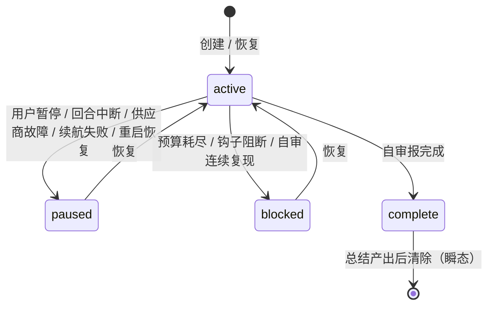
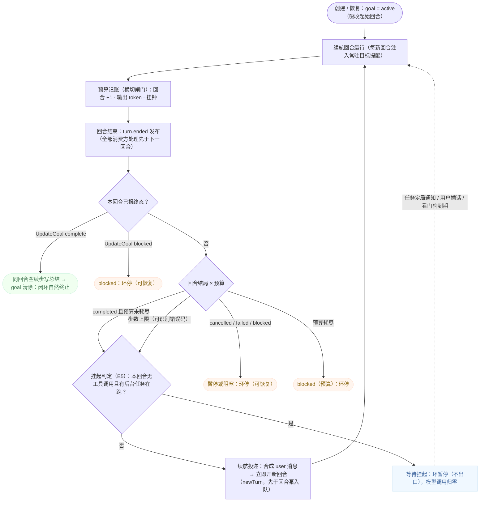
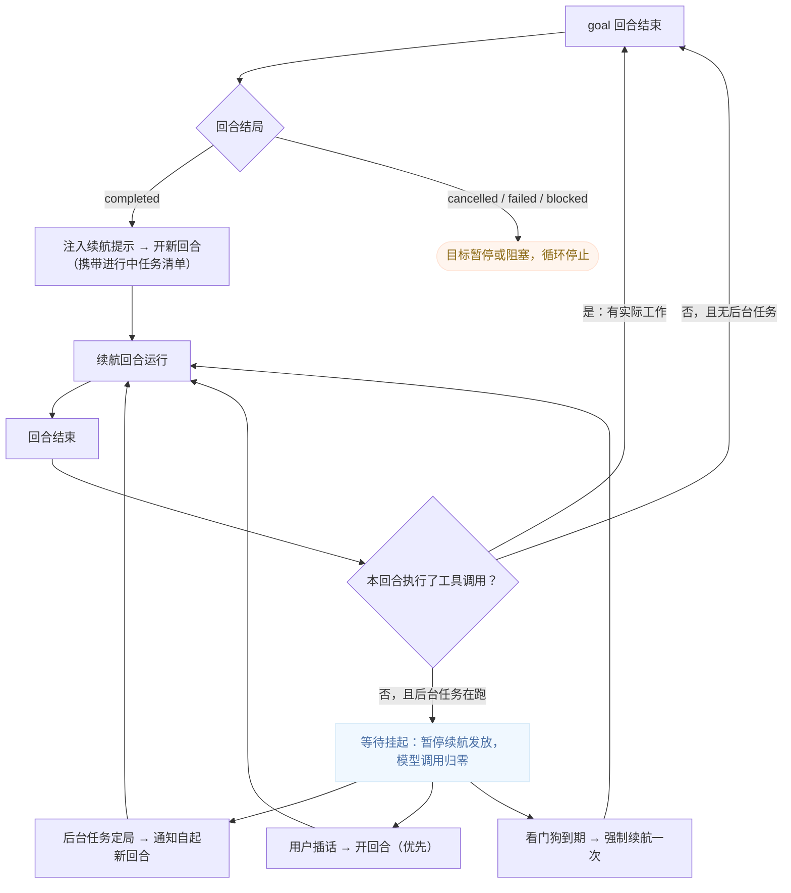

# 自治目标模式（goal）— 架构设计（面向 Rust 核心）

> 状态：v1 基线 · 2026-09-13 · 待需求评审后校准 ·
> 本文是目标域设计侧的唯一事实源（内部规格文档，不进文档站构建，中文单语）。
> 需求契约：见 [goal-requirements.md](goal-requirements.md)；现状证据见 [goal-context.md](goal-context.md)。
> 引擎分层锚点：`rust-core-design/00-overview.md`。
> 术语规范：目标（O1）、续航提示（O2）见 [glossary.md](glossary.md)。

## 1. 目标与设计原则

本设计描述**终态**：Rust 核心中目标域的完整架构（TS 引擎现行行为为参照基线）。

设计原则：

1. **机制/产品分离**：目标的续航/挂起经回合调度域的统一准入与挂起接口表达，本域不发明调度（依赖 turn-scheduling）。
2. **预算是硬闸门**：三单位任一耗尽即终局可解释、可恢复（需求 N3）。
3. **状态机封闭**：四态 + 显式的触发者（用户/系统/运行时）——每次转移可归因（需求 N2）。
4. **终态瞬态**：完成是短暂的过场（总结产出后清位），不是常驻状态（需求 N5）。
5. **与任务服务零直接耦合**：等待挂起只消费"存在未定局后台任务"这一事实与唤醒源，不依赖任务内部（需求 N7）。

## 2. 域模型

### 2.1 目标状态机（四态 + 触发者）



```
（无）
  → active（创建 / 恢复）
active
  → paused（用户暂停 / 中断 / 供应商故障 / 续航失败 / 重启恢复降级）
  → blocked（用户钩子阻断 / 预算耗尽 / 执行者自审报阻塞）
  → complete（执行者自审报完成）→（总结后清除，瞬态）
paused / blocked
  → active（恢复）
```

- 每次转移携带**触发者**（user / system / runtime）与原因——回放与诊断的归因依据。
- 重启恢复：wire 回放出的 `active` 一律降级 `paused`（"恢复后暂停"），不自动续跑；`complete` 静默清除（快照上从未落盘）。

### 2.2 目标记录（持久化模型）

- 状态经对话记录的可回放操作集持久化：`goal.create / goal.update / goal.clear`（fork 边界为 `goal.forked`——清空）。
- 字段：目标标识、目标内容、验收标准、状态、触发者/终局原因、回合数、token 数、挂钟累计、挂钟锚点（恢复时结算停机跨度）、预算上限。
- **完成是瞬态**：wire 序列为 `update(complete)` 后紧跟 `clear`。

### 2.3 预算模型

```
GoalBudget = { turnBudget? , tokenBudget? , wallClockBudgetMs? }   // 六单位输入归一为三内部量
记账：turns（每续航回合 +1）｜tokens（仅输出 token）｜wallClock（单调钟 + 持久锚点，跨停机计入）
耗尽 → blocked(runtime)，原因含三类数值
```

- 回合中段耗尽：宽限回合——注入停止提醒 + 工具调用 veto + 回合终止。
- 到点检查三处：续航启动前、步级用量记账后、挂钟定时器。

## 3. 组件结构

```
目标子系统（引擎内，main agent 专属）
 ├─ 目标服务（状态机/校验/预算/持久化）
 │   ├─ 创建：内容校验（非空/长度）、单目标守卫、replace 清旧建新、吸收起始回合
 │   ├─ 生命周期：四态转移（含触发者/原因）；重启归一化（active→paused）
 │   └─ 预算：记账、耗尽处置（宽限回合/veto/定时器）
 ├─ 续航驱动器（turn.ended 消费方——回合调度域的唯一新回合投递者）
 │   ├─ 正常续航：回合 completed → 合成 user 消息（系统触发来源）→ 立即开新回合准入
 │   ├─ 步数上限变体：识别"步数上限"错误码 → 换"接续进度"文案续航（非异常）
 │   ├─ 异常结算：blocked/cancelled/failed → 暂停或阻塞，不续航
 │   ├─ 防重入：待启动续航锁（同目标同时至多一个）
 │   └─ 挂起（E5）：见 §4
 ├─ 终态收尾：UpdateGoal 终态结果触发同回合空续步（等待下一回合准入、无消息）——执行者在本回合内写总结/阻塞说明
 ├─ 提醒注入：动态注入槽（每新回合一次）——active/blocked/paused 三模板；fork 清除提醒走独立通知
 └─ 工具面：创建/查询/设预算/报终态（main agent 注册；启动审批与 stale 调用 veto）
```

**整体闭环全景图**（闭环如何成形：goal 续航是 turn.ended 全部消费方中唯一能投递新回合者——这个唯一性使"回合结束 → 续航投递 → 新回合"成为自我维持的正反馈环；维持条件 = active 且预算未耗尽，出口四类，等待挂起是环的受控暂停而非出口）：



- **运行期追踪不入 wire**：回合跟踪、挂钟状态存代理级运行态；恢复时从 wire 重建目标状态、运行态重置。
- **遥测**：创建/预算设置/续航/状态变化/清除五事件。

## 4. 等待挂起（承接 SDR-011 的目标侧）

状态与判定在目标域，暂停的执行在回合调度域（挂起接口）：

```
挂起条件 = 目标 active ∧ 存在未定局后台任务 ∧ 续航回合结束时该回合无工具调用
挂起动作 = 续航提示暂停发放（不新增回合类型/准入类别）
唤醒源   = 后台任务定局通知（忙折入/闲自起——挂起期间无活动回合，必然走自起分支）
           ∣ 用户消息（永远优先） ∣ 看门狗定时器（到期强制续航一次）
预算口径 = 挂起期不计回合数（turn 记账点在续航回合首步，挂起期无回合）
持久化   = 不持久化（运行时态；重启后按常态重建——active 降级 paused 的既有归一化覆盖）
```

**等待挂起全流程图**（含三个唤醒源与看门狗兜底）：



- **续航提示的任务感知**：提示拼装时向任务服务查询"进行中任务快照"（数量/类型/描述），仅非空时携带 + 勿轮询指引。
- **挂起期间目标上下文在场**：唤醒回合由通知自起，每新回合的目标常驻提醒已在场——**零新增合并机制**。
- **判定时序**：判定发生在回合结束的消费链路（turn.ended 处理）中、投递续航提示**之前**——是对刚结束回合的回溯性检查（该回合从头到尾是否出现过工具调用，复用既有工具执行观察点），绝不介入运行中的回合；实现零新增钩子。
- **挂起非粘性**：挂起只在"回合结束"这一个消费点生效并被重新推导——唤醒回合结束后照常重新评估（仍有任务在跑且又空转 → 再挂起；有实际工作 → 正常续航），不存在需要显式清除的标志生命周期，也就不存在"忘记解除挂起"的故障模式。
- **终态唤醒矩阵**：完成 / 失败 / 超时 / 丢失每次终态转移都投递通知 → 均直接唤醒；**被停止**（用户主动停止，通知按既有语义被抑制——停止的应答即唯一答案）不直接唤醒 → **看门狗兜底（其存在的头号理由）**；全部任务都走抑制路径时同样由看门狗收口。
- **目标侧零耦合**：唤醒链路（任务服务 → 终态通知 → 准入自起新回合）全程不经过目标域——目标不需要知道挂起被解除。"确保解除"由三个不变量保证：挂起期间必然无活动回合（通知必走自起分支）；目标提醒注入条件（每新回合）与唤醒条件（新回合自起）天然重合；挂起无粘性生命周期（上条）。
- 与无界面模式"接力驱动"同构（等待由引擎侧事件承担，模型调用归零）。

## 5. 关键机制详设

### 5.1 续航提示文案（两变体）

- 常规：继续朝目标工作 + 有界切片选择 + 自审规范（多数续航回合不报终态；简单/已答/不可能/不安全/自相矛盾当回合即报）+ 阻塞的连续复现规则（约 3 回合）。
- 步数上限变体：说明上一回合因步数上限被截断、新回合已开、从停止处接续。
- 挂起后唤醒无需专门文案（通知自起回合 + 常驻提醒）。

### 5.2 终态同回合收尾（空续步）

UpdateGoal 报终态时，工具结果内嵌总结/阻塞提示文案（"写给用户的最终消息……"），随后同回合作一个**无消息的续步**（等待下一回合准入）——给执行者一次输出机会在本回合内写出面向用户的结论。受单回合步数余量约束。

### 5.3 提醒注入模板

- active：目标内容（标注为数据非指令，防注入）、验收标准、进度（回合/token/耗时）、预算与剩余、近预算收敛指导、自审规范。
- blocked / paused：当前未自治的说明 + 用户恢复入口；用户主动要求继续时先转 active 再干活。

### 5.4 工具面约束

- 创建：内容校验（非空/约 4000 字符上限）、单目标守卫、replace；启动审批挂权限模式。
- 报终态：仅 status 枚举（机器信号）——总结由模型随后自己写；stale 调用（目标已变）被 veto。
- 设预算：六单位归一、时间合理区间（约 1 秒–24 小时）外拒绝；已超限立即停。

## 6. 消费端架构

- **终端**：`/goal` 命令族（状态面板/暂停/恢复/取消/替换）；状态标记行；确定性完成卡片；**待办目标队列为终端客户端本地资产**（不在引擎内，接力由客户端在终局事件后驱动）。
- **网页**：目标条（状态徽章/预算进度/控制事件），经服务端协议快照。
- **无界面**：目标启动子命令持续跑到终态，输出总结；退出码 完成=0/阻塞=3/暂停=6；管理子命令不支持。

## 7. 与相邻设计的关系

- **回合调度域**：续航（立即开新回合同步入队，先于回合泵）、终态收尾（等待下一回合）、挂起（续航发放暂停接口）——本域是其最大消费方。
- **后台任务域**：等待挂起的产品契约两端之一（本域管目标侧，通知/等待入口在彼域 E10/E13）；任务清单快照的供给接口。
- **权限与审批域**：目标启动审批的交互面。
- **会话持久化域**：fork 不携带目标（`goal.forked` 清空 + 补发清除提醒）。

## 附录：架构决策记录（ADR）

### ADR-001 建域与挂起机制切分（2026-09-13）

1. **背景与动机**：目标域无规格落点；SDR-011 的等待挂起需要明确"状态与判定在目标域、暂停的执行在回合调度域"的切分，否则两侧会重复发明。
2. **决策**：本域持有挂起状态/判定/看门狗/预算口径（§4）；回合调度域持有"续航发放暂停"的执行接口与唤醒的准入路径。挂起不新增回合类型、准入类别或持久化状态。
3. **被否决的备选方案**：a) 挂起全部放回合调度域——"何时该等"是目标的产品判断（是否有后台任务、模型是否空转），调度域不该懂；b) 挂起全部放目标域——暂停续航发放是调度动作，目标域自行实现会旁路准入（违反回合调度域 N4 单一插座）。
4. **影响范围**：§4；turn-scheduling-architecture §4 挂起接口（对位）；subagent 域 ADR-008（机制侧收编确认）。

### ADR-002 等待挂起落地形态（2026-09-14）

1. **背景与动机**：E5 等待挂起为已裁决待落地项（SDR-011 承接；ADR-001 已切分状态/判定与执行）。落地按"阻塞等待入口（B）→ 续航提示携带任务清单 → 空转判定挂起 → 看门狗"四步推进，本裁决记录 TS v2 落地时的具体形态与取舍（执行状态与现状证据见 [goal-context.md](goal-context.md) §1.3）。
2. **决策**：
   - a) **挂起以"goal 服务在 turn.ended 消费点不发射续航提示"实现**——未新增回合调度域的显式挂起接口、回合类型或准入类别（比 turn-scheduling §4 设计的"续航发放暂停接口"更简，零新接入面）；挂起非粘性，只在回合结束消费点被重新推导。
   - b) **看门狗缺省 10 分钟**（Q2 定标）：远长于真实通知唤醒与用户消息、远短于死等；被用户停止的任务通知被抑制是头号兜底对象。
   - c) **工具活动观察点用 onDidExecuteTool**（含被否决/合成调用的保守口径，O7）。
   - d) **挂起期仅豁免回合数预算，wall-clock 照走**（记账点在回合首步）；唤醒回合照常计回合预算——chat 型任务群理论上可经唤醒回合消耗回合预算，为已接受取舍。
   - e) **TaskWait 的恰好一次投递**以"入口抑制 + settleTask 先 fire 后唤醒 waiters 的同步序"保证；超时/中断解除抑制（一次等待 = 一次应答；并发等待同一任务不引用计数，单等待者假设文档化）。
   - f) **任务清单上限 20 + 截断标注**（注入时刻快照语义，定局走通知不改写）。
3. **被否决的备选方案**：a) 显式挂起接口（回合调度域的暂停/恢复开关）——挂起仅在"回合结束"单一消费点生效且非粘性，消费点抑制即可达成同等终态，新接口无必要；b) 轮询型看门狗（周期探测任务状态）——会空耗模型 token，违背等待挂起"模型调用归零"的初衷；c) 抑制引用计数（并发等待同一任务时计数管理通知抑制）——单等待者假设已文档化，并发同一任务为使用错误而非支持面。
4. **影响范围**：本文件 §4；turn-scheduling-architecture §4（挂起接口对位，机制侧未新增面）；subagent-requirements E13（US13.1–13.3 契约不变，本裁决记录其 TS v2 落地形态）。

### ADR-003 停止/暂停冻结目标机器：注入回合注册、取消内核与投递门（2026-09-14）

1. **背景与动机**：Rust 引擎中"停止"与"暂停"只作用于用户派发的回合——task/cron 驱动注入的回合不在 `in_flight_turns` 注册表内，`message.abort` 取消不到它们；`goal.pause`/`goal.cancel` 只写状态与事件、不打断在跑活动；`UpdateGoal` 工具对终态转移无守卫，模型可把用户暂停覆盖为完成。TS 基线为 `packages/agent-core/src/agent/goal/index.ts` 的 `markComplete`/`markBlocked` active 守卫（非 active 一律 no-op）与工具枚举无 `paused`。现状证据见 [goal-context.md](goal-context.md) §3.1。
2. **决策**：
   - a) **注入回合以 Wait 语义注册**：task driver 的通知回合与 cron driver 的注入回合均以 `InFlightTurn::Wait`（仅注册协作式 cancel token）登记进 `in_flight_turns`（键 `{session}:{agent}:{turn-<uuid>}`，`WaitTurnGuard` Drop 移除条目、不随回合跑完残留）。回合内联 runs 于驱动 tick future 且 Ok/Err 两臂自闭合 bracket——恰为 Wait 契约，无双结算风险。注册后 `message.abort`（回合级与会话级）可取消注入回合；注入回合计入会话 busy 派生（`session.list` busy、compaction 预检）；被取消的注入回合以 wire reason `"cancelled"` 结算。挂死且不协作取消的 provider 流仍由既有 `ENGINE_TURN_TIMEOUT` 兜底（不变）。
   - b) **共享取消内核**：从 `dispatch_cancel` 提取 `cancel_in_flight_turns(session_id, turn_id, cause)` 作为取消内核——`message.abort` 传 `"the user via message.abort"`（既有文案逐字节不变），`goal.pause`/`goal.cancel` 复用同一内核（cause `"the user via goal.pause"` / `"the user via goal.cancel"`）。Wait 条目只观察 token、由回合自行结算；Fire 条目 hard-abort 并由取消方发布 `TurnFailed`。`goal.resume` 不调用内核（只解冻、不取消任何东西）。
   - c) **通知投递门在驱动入口**：`deliver_due_notifications` 入口检查会话目标——存在且 `Paused` 直接返回：due 通知保持 pending、stranded 缓冲不 flush 不 park；`goal.resume` 后下一节拍恢复投递。**cron 注入不设此门**（范围裁决：cron 是用户安排的定时机制，独立于目标机器，对应 requirements SDR-002 c）。
   - d) **UpdateGoal 工具层门禁（TS parity）**：模型状态输入移除 `paused`（只有用户能暂停）；`complete`/`blocked` 仅当目标当前为 `Active` 时接受（对齐 TS `markComplete`/`markBlocked` 守卫），`active` 从 `Paused`/`Blocked` 接受（恢复路径——paused 提醒承诺"用户要求继续时调 UpdateGoal(active)"）；被拒转移**不写 wire op、不发布 `event.goal.updated`**（拒绝必须不可重放、不可宣告）。门禁落工具执行面而非 GoalManager——状态机层保持放行终态转移，TS 同构。
   - e) **已接受边界（TOCTOU）**：① 门禁为 check-then-act 非原子，检查与转移之间可插入状态变化；② 驱动节拍抢在暂停生效前通过投递门仍可启动一个通知回合——与 `message.abort` 的同窗口语义一致。两者均为已接受时序窗口（requirements SDR-002 d）。
   - f) **turn 取消环停（TS `pauseOnInterrupt` parity，2026-09-14 实测发现后补）**：任何 turn 级取消把 Active goal 停靠为 `Paused`（reason `Paused after interruption`，可恢复）。实现点在**取消内核 `cancel_in_flight_turns` 内部、token 触发之前**——fire 型 turn 被 hard-abort 后不跑自己的结算路径（内核代发布 `TurnFailed`），在结算点分散接入会漏 fire 路径；内核单点天然覆盖 wait/fire/通知/cron 全部取消路径。`goal.pause`（先置 Paused）与 `goal.cancel`（先 clear）到达内核时均 no-op，无需 cause 分流；只有 `message.abort` 带 Active goal 进内核。事件顺序沿用 pause 既有 ordering：`goal.updated` 先于 turn 终态事件。实测动机：Interrupt 取消通知 turn 后 63ms 内任务驱动即投递下一条搁浅通知为新 turn、goal 保持 Active 自主续跑（turnsUsed 5→58）——TS 基线 `agent/turn/index.ts:446-448` 有对等守卫，本域 §2.1 状态机亦早已声明 `active --> paused : 回合中断`。
3. **被否决的备选方案**：a) 终态守卫放 GoalManager 状态机层——工具层拦截更贴近 TS 守卫位置，manager 保持与 TS 同构，另避免"状态机入参即被拒"与 wire 持久化语义纠缠；b) 注入回合以 Fire 语义注册——驱动 tick 与取消方各结算一次，双结算/悬空结算风险；c) 暂停期间丢弃通知——恢复后信息丢失，与 E5 挂起补投语义冲突；d) 通知门放回合准入侧——门在驱动入口更早、且覆盖 stranded 缓冲 flush（准入侧只拦新回合、拦不住缓冲冲刷）。
4. **影响范围**：本文件 §2.1（状态机转移守卫不变、工具面新增门禁）、§3（工具面/续航驱动器与任务驱动的取消与投递门）、§4（挂起期间任务定局不唤醒——投递门即其机制面补强）；requirements 侧见 SDR-002；现状与代码事实见 goal-context §3.1；web 契约不变（`goal.updated` 事件流不改、turn.ended 既有清 UI 路径复用）。

### ADR-004 跨回合续航：结算点直调 + 链式 spawn task（2026-10-18）

1. **背景与动机**：SDR-003 裁决的跨回合续航与异常结算需要在 rust 引擎落地。设计空间里有两种形态：全局 goal driver loop（mpsc 唤醒 + 单消费者 task）或"结算点直调自由函数 + 按需 spawn 链式 task"。
2. **决策**：采用**结算点直调 + 链式 spawn**。五个 turn 结算点（message.send wait/fire、steer、task_driver、cron_driver）在落盘 `turn.ended` 后依次调用 `settle_goal_after_turn`（异常映射 goal 终态）与 `maybe_launch_goal_chain`（判定链）；判定通过则 `tokio::spawn` 一个链式 task，task 内 try-lock TurnFlow 成功后循环注入续航 turn（复用 `run_engine_turn`，engine origin `PromptOrigin::SystemTrigger` + wire origin `{"kind":"system_trigger","name":"goal_continuation"}` 双轨），每轮结算后复查条件。链式 task 只捕获字段 Arc（`ChainResources` 快照），不捕获 `Arc<EmbeddedServer>`。
3. **被否决的备选方案**：a) 全局 driver loop——持有 server 的 Arc 造成循环引用（server 持 tx、task 持 server → 永不释放），且嵌入式 server 可能在无 tokio runtime 的上下文构造，spawn 时机有陷阱；b) TS 式事件订阅（turn.ended → goalService）——rust 侧结算点在 spawn 块内无 `&EmbeddedServer`，事件总线路由会引入额外的跨 task 通信；直调自由函数与 cron/task driver 的既有姿态一致。
4. **已知取舍与差距**：a) budget block 双层结构——engine step-level（reason "hard budget reached"）为主，settle 点的 `block_goal_on_budget`（TS parity 文案）为兜底，两层 reason 文案不一致（step-level 先触发时用户看到前者）；b) idle 判定用 `steps <= 1` 信号（裸文本 turn 即 idle）而非 TS 的 turn 级工具调用追踪；c) fire/steer 的 busy 探测在 spawn 块内直接 try-lock turn_flows map（字段 Arc 可捕获，无新增 channel）；d) 用户消息重置护栏只在 message.send 两个 user-originated 结算点（steer 是运行中注入，cron/task 是系统 turn，均不重置）；e) `goal.resume` 只切状态不立即续跑（等下一个 turn 结算，TS 的 `continueIfPaused` 立即续跑是差距）；f) states map 的 session 关闭残留条目 bounded-by-session-count（同 relay_seq_watermarks 姿态）。
5. **影响范围**：`rust/crates/mirri-embedded/src/embedded_server/goal_driver.rs`（结算/判定/链式注入）、`message_handlers.rs`/`task_driver.rs`/`cron_driver.rs`（结算点接线）；O14 的看门狗配套（`[loop_control] turnStallTimeoutMs` 配置化）见 subagent-ROADMAP O14 关闭条目与用户文档 config-files。
