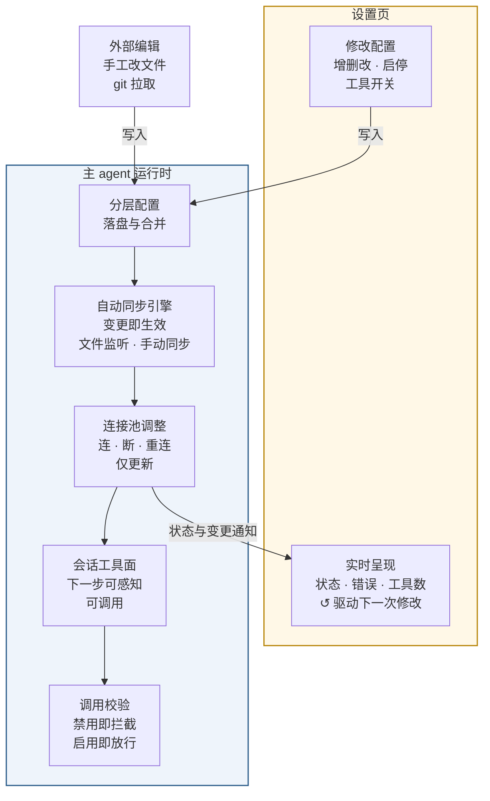

# MCP 设置页面需求文档（User Stories）

> 状态：v1（待评审） · 2026-09-08 ·
> 本文是 MCP 设置页面（web/desktop 配置界面）功能形态的唯一事实源（内部规格文档，不进文档站构建，中文单语）。
> 功能语义对齐 MCP 域需求 [mcp-requirements.md](mcp-requirements.md)（下称「域需求」）；接口的技术形状见 [mcp-architecture.md](mcp-architecture.md)（下称「架构文档」）；现状盘点见 [mcp-context.md](mcp-context.md)。
> 验收标准统一采用 Given-When-Then 格式；优先级 P0 > P1 > P2。
> 本文只定义页面层的呈现、交互与反馈；连接模型、配置分层、热更新语义不在本文重复定义。

## 功能闭环总览（先读这一节）

**定位**：MCP 设置页不是"配置文件的增删改查界面"，而是**与主 agent 运行构成完整功能闭环的控制面**——每一项配置修改都必须沿链路触达运行中的 agent（下一步可感知、可调用），并被真实运行状态回流校准；页面呈现的是**运行时事实**，不是磁盘文件的镜像。

**四条主线**：

1. **写入线**：页面操作 → 分层配置落盘（PS2.1–PS2.3、PS3.1、PS3.3）——配置是唯一事实源，一切修改以它为准
2. **生效线**：配置 → 自动同步引擎 → 连接按需调整（连/断/重连，域 US4.1/US4.2；手动同步 PS4.2，热更新/文件监听/手动同步共用同一套规则 D-S2）——"改了就生效"，不依赖重载或重启
3. **触达线**：变更必须到达**三个消费方**——活跃会话的工具面（域 US4.4）、调用校验环节（域 US4.5，以落盘的过滤规则为准）、页面呈现（PS1.3）。**三线任一未接通即为缺陷（N-S1 可用性诚实原则）**
4. **回流线**：运行状态（连接成败/错误/需授权/工具数）经变更通知回流页面（PS1.3 / 域 US4.3）；外部编辑（手工改文件、git 拉取）进入同一套同步规则，同样回流

**断链判定**：评审或实现任何一个设置功能时，沿上图逐段检查"这一段有没有真实可用的承载（后端能力/事件/呈现）"——任何一段缺失即违反 N-S1。历史断链实例（按钮无后端、工具弹窗不可用）见 mcp-context.md §6。

## 0. 角色定义（Personas）

| 角色 | 场景 | 核心诉求 |
|---|---|---|
| **管理界面用户** | 在 web/desktop 设置页管理 MCP（可能没打开任何项目） | 看得清每个服务器从哪来、什么状态；改完立即生效；操作反馈真实 |
| **项目成员** | 在某个项目上下文管理项目级 MCP | 项目配置与个人全局配置分区管理，不互相污染 |
| **外部编辑者** | 用编辑器/git 直接改配置文件的人 | 手工改完页面能确认"同步上了" |

## 1. 页面级裁决（本次评审确定的决策）

### D-S1 工具清单查询：新增专门的查询接口

工具清单（某个 server 提供哪些工具：名称/说明/启用状态）通过**新增的专门查询接口**获得。不复活旧版的"全局工具查询"，也不塞进"服务器状态"查询里——状态查询被页面之外的很多场景高频使用，每次都附带全部工具清单太重。接口的具体形状（方法名、参数、返回内容）由架构文档定义。

### D-S2 「同步配置」：只补差异，无差异时零动作

页面级"重载"动作（原 Reload all）的语义 = **只补差异**：重新读取配置文件 → 与当前运行中的连接做差异比较 → 只补差异（缺失的连上、多余的断掉、变更了的重连、上次失败的顺带重试）；无变化时什么都不做、零成本。**不采用**旧版的全杀全连（推倒全部连接重连，扰动所有 server）。

实现约束：与后台的自动文件监听共用**同一套同步规则**——自动和手动只是两个不同的触发入口，不允许出现两套规则各走各的。

### D-S3 解析值预览：保留（已同步修订域 N9/裁决 A5）

「显示真实值」预览（把配置里的 `${VAR}` 占位符替换为环境变量展开后的真实值）**保留**（用户裁决 2026-09-08）。

与域需求 N9、架构裁决 A5 的原文（"解析值不出现在任何网络响应中"）冲突，已随本裁决同步修订那两份文档，修订后的边界是：真实值**只能**通过用户主动点击「预览」获得，且不被缓存、不进通知与日志；其余一切响应只含原文占位符。

### D-S4 配置作用域：终态支持用户选择

页面当前只能写"用户全局"这一层；终态支持用户在页面上选择配置作用域（**用户全局 或 某个项目**）进行增删改，对齐域需求 E2。项目根目录的团队共享文件始终只读。

### D-S5 列表信息架构：来源 Tab 分组（2026-10-17）

设置页的 MCP 服务列表按**来源 Tab** 组织：`全部` / `用户` / `项目` / `插件` 四个 Tab（用户裁决 2026-10-17）。

- **用户**：用户全局配置，可增删改；新增服务的默认落点
- **项目**：项目根的团队共享文件（卡片标签「团队共享·只读」）与项目本地的个人文件（卡片标签「项目本地」）合并在此 Tab；团队共享条目的定义编辑/删除置灰并说明原因（对齐 PS1.2）——「团队共享」即项目根目录的 `.mcp.json`，本节统一使用前者作为用户可见文案
- **插件**：插件捆绑的 server 全部可见、可启停（server 级与工具级，偏好保存于用户个人设置，对齐域 A1）；定义编辑不可用，引导至插件管理
- **全部**：聚合视图，保留来源标注与同名遮蔽提示（对齐 PS1.1）
- **搜索与 Tab 的关系**：搜索过滤作用于**当前 Tab** 内的服务（PS1.5 的过滤范围在 Tab 存在后收窄为 Tab 内，跨 Tab 搜总计为「全部」Tab 的职责，不额外提供全局搜索）
- **Tab 行为**：默认打开「全部」；每个 Tab 标签显示该分区的服务数量；某分区为空时显示该分区的专属空态（区别于 PS1.1 的全部为空空态）；页面刷新后不要求记忆上次所在 Tab（回到默认即可）
- 不将「项目根（团队共享）」与「项目本地」拆为独立 Tab——文件路径是实现细节，用户的分区心智是"全局 vs 项目"两层；"团队共享 vs 个人"作为项目内的**次级**信息保留可见性（它决定可编辑性与是否随仓库共享）

## 2. Epic P1：服务器列表与状态呈现

### PS1.1 合并列表与来源标注（P0）

作为管理界面用户，我想看到全部 MCP 服务器的合并列表及每条的来源，以便理解"这个服务器为什么在/被谁定义"。

验收：
- Given 用户全局 / 项目根 / 项目本地 / 插件四种来源存在（含同名时高优先级覆盖低优先级），When 打开设置页，Then 列表显示合并去重后的全部 server，每条含：名称、来源标注、连接方式（本地进程/HTTP/SSE）、状态（连接中/已连接/失败/已禁用/需授权 五态）、工具数、最近错误信息
- Given 用户层与项目层存在同名 server，When 打开设置页，Then 列表显示实际生效的那条，且"被覆盖"的事实可见（分层视图可查被覆盖的原值）
- Given 全部来源为空，When 打开设置页，Then 显示空列表态而非报错

### PS1.2 只读层保护（P0）

作为管理界面用户，我想明确知道哪些 server 定义我不能改、为什么，以便不会在只读资产上白费操作。

验收：
- Given 项目根来源的 server（git 团队共享文件），When 尝试编辑其定义，Then 操作被拒绝且页面明示"团队共享资产、只读"
- Given 插件来源的 server，When 尝试编辑其定义，Then 操作被拒绝且页面明示"插件资产、只读"；When 尝试修改其工具开关或启停，Then 被接受（偏好保存在用户的个人设置里，插件自身内容不被改动）
- Given 上述不可编辑，Then 页面在操作发生前就让用户知道（按钮禁用或明确提示），而非提交后才报错

### PS1.3 页面与配置/状态的实时一致性（P0）

作为管理界面用户，任何 MCP 配置或状态的变化——无论来自我在本页的操作、其它客户端还是外部文件编辑——都应无需手动刷新即反映到页面，以便我看到的永远是当前真实状态。

具体反应（什么变了 → 页面怎么变）：

| 变化 | 页面即时反应 |
|---|---|
| 新增 server（任意来源/入口） | 列表立即出现新卡片，状态从"连接中"起播，工具数在连接完成后出现 |
| 删除 server | 对应卡片消失，其余卡片的顺序与内容不跳动 |
| 修改 server 配置 | 卡片的连接方式/来源/超时等字段更新；配置变化触发重连的，状态随之翻转 |
| 启用/禁用 server | 开关与状态徽标翻转——以服务端通知为准，不做本地乐观翻转 |
| 工具开关变化 | 卡片的工具数立即更新（启用数/总数） |
| 连接失败/恢复 | 错误信息即时显示/清除，状态徽标翻转 |
| 外部手工编辑配置文件 / git 拉取 | 变化通知到达后列表同步增删改 |
| 配置解析失败 | 页面明示失败来源与原因（PS1.4），修复后消失 |

验收：
- Given 页面已打开且不在操作中，When 变化来自外部（手工编辑文件、其它客户端、同步配置），Then 列表在变化通知到达后更新，无需手动刷新或重新进入页面
- Given 两个客户端同时打开设置页，When 一方修改，Then 另一方无需任何操作即看到相同结果
- Given 任一变化发生，Then 仅受影响的卡片局部更新——页面不整页重载、不闪烁，未涉及的 server 无任何视觉扰动
- Given 操作由本页发起（保存/删除/开关/同步），Then 页面以服务端返回的真实结果更新显示；操作失败时不残留"看似成功"的假状态
- Given 变化通知与操作返回的先后顺序不定，Then 最终显示与服务端事实一致（不出现双写竞态的中间态残留）
- Given 状态无变化，Then 页面不产生刷新动作（无噪音）

### PS1.4 配置解析失败可见（P1）

作为外部编辑者，我想在页面上看到配置文件解析失败的提示，以便知道是我改坏了文件而不是以为引擎坏了。

验收：
- Given 任一配置文件解析失败，When 打开设置页或执行同步配置，Then 页面明示失败发生在哪个来源、错误原因，且运行中的连接不受影响
- Given 解析失败被修复，When 下次读取，Then 恢复正常呈现

### PS1.5 搜索过滤（P2）

作为管理界面用户，我想按名称过滤列表，以便 server 很多时快速定位。

验收：
- Given 列表中存在多个 server，When 输入关键词，Then 列表即时只显示名称匹配该关键词的 server
- Given 清空关键词，Then 列表恢复显示全部 server

## 3. Epic P2：配置编辑

### PS2.1 新增/编辑服务器（P0）

作为管理界面用户，我想通过表单或 JSON 双模式新增/编辑 server 配置（三种连接方式、超时、环境变量/请求头），以便不必手改文件。

> 分阶段说明：作用域选择器（PS2.2，P1）就绪前，本故事在 P0 阶段的写入固定为「用户全局」作用域。

验收：
- Given 提交一份新配置，Then 按 D-S4 所选作用域写入（要么完整成功、要么失败，绝不留下半份坏文件），后续在该作用域可达的上下文中可用
- Given 编辑已存在的 server 并保存，Then 该条目被完整替换（整体替换语义，而非字段拼合）
- Given 两个界面并发编辑同一配置，When 后提交方保存，Then 提交被拒绝并明确提示冲突，而非静默覆盖

### PS2.2 作用域选择器（P1）

作为项目成员，我想在页面上选择配置作用域（用户全局 或 某个项目），以便项目专属 server 不污染我的全局配置。

验收：
- Given 页面可列出可配置的作用域，When 用户选择某项目作用域并新增 server，Then 写入该项目的本地配置层，仅在该项目内生效
- Given 所选项目内存在项目根层的同名 server，Then 按优先级呈现（项目本地 > 项目根），且来源标注区分两者
- Given 未打开任何项目，When 选择作用域，Then 仅"用户全局"可选（项目作用域不可达时禁用并说明原因）

### PS2.3 删除单个服务器（P0）

作为管理界面用户，我想删除一个 server 并确认它被干净地移除，以便配置面不留垃圾。

验收：
- Given 删除一个已连接的 server，When 确认删除，Then 其连接断开、工具从所有活跃会话移除、状态变化的通知到达、列表刷新后该项消失
- Given 删除发生，Then **只有被删的 server 受影响**——其它 server 的连接、工具与状态无任何可感知扰动
- Given 删除时某会话正在执行任务，When 该会话执行下一步，Then 被删 server 的工具已从其清单消失且调用被明确拒绝（对齐域 US4.4）
- Given 删除只读层（项目根/插件）的 server，Then 被拒绝并明示原因

### PS2.4 保存前测试连接（P1）

作为管理界面用户，我想在保存前测试一份配置能否连通，以便不保存坏配置。

验收：
- Given 一份未保存的配置，When 发起测试，Then 系统临时启动一次真实连接进行验证，返回成功（含工具数量与清单）或失败（含原因；因引用的环境变量未填写的，原因直接点名是哪个变量）；验证不留任何痕迹（临时进程退出、不写入任何配置）
- Given 启动超时，When 测试，Then 返回明确的超时失败而非挂起

### PS2.5 解析值预览（P1）

作为管理界面用户，我想预览占位符展开后的配置真实值，以便确认引用写对了。

验收：
- Given 配置含 `${VAR}` 占位符，When 点预览，Then 显示展开后的真实值
- Given 该能力只能通过用户主动点击「预览」获得——日常的列表、通知、日志里只出现原文占位符（对齐 D-S3）
- Given 变量未定义，Then 预览明确标注该变量未定义（展开为空）而非静默

## 4. Epic P3：启停与工具治理

### PS3.1 服务器级启停（P0）

作为管理界面用户，我想开关某个 server 且状态立即跟随，以便界面所见即运行时所得。

验收：
- Given server 已连接，When 切换为禁用，Then 连接在 1 秒内断开、工具从可用面移除、状态变化的通知到达、页面状态即时变为"已禁用"（以服务端通知为准，非本地乐观翻转——对齐 PS1.3）
- Given server 已禁用，When 切换为启用，Then 触发连接并广播状态（连接中 → 已连接/失败），页面即时跟随
- Given 切换时某会话正在执行任务，Then 其下一步的工具清单即时跟随（对齐域 US4.4）
- Given server 已禁用，When 任何入口调用其任一工具，Then 在调用校验环节被拦截（对齐域 US4.5）

### PS3.2 工具清单查看（P0）

作为管理界面用户，我想查看某 server 提供的全部工具及其启用状态，以便逐个治理。

验收：
- Given server 已连接，When 打开其工具清单，Then 返回全部工具（名称、说明、当前启用/禁用状态），数据来自 D-S1 定义的专门查询接口
- Given server 未连接（且非因整体禁用），When 打开工具清单，Then 明示"连接后可查看"而非空列表假象
- Given server 连接期间工具清单未变，When 再次查看，Then 不重复向 server 询问
- Given 某工具已被禁用，When 打开其所属 server 的工具清单，Then 该工具**仍然显示**（开关呈关闭状态），可再次启用——禁用不得使工具从清单中消失（SDR-S005）
- Given server 已被整体禁用，When 打开其工具清单，Then 显示其**最近一次已知的工具清单**（来自落盘的启用偏好，而非当前连接）：工具名称与开关状态可见、开关全部置灰不可操作、搜索可用——整体禁用不得失去工具级治理的查看入口（SDR-S005）。此状态优先于上一条"未连接"的呈现（整体禁用是未连接的一个已知子集，不再显示"连接后可查看"）
- Given 工具清单已打开且工具较多，When 在清单内的搜索框输入关键词，Then 清单即时过滤为名称/说明匹配的工具，清空关键词恢复全部（SDR-S005）

### PS3.3 工具级启停（P0）

作为管理界面用户，我想单独开关某个 server 的某个工具，以便屏蔽危险/无用工具而保留其余。

验收：
- Given server 提供 6 个工具，When 禁用其中一个，Then 该工具（按作用域）不可见/不可调用，其余 5 个不受影响，且**连接不断开**——仅工具可用面更新
- Given 变更时某会话正在执行任务，When 该会话执行下一步，Then 工具清单已按新开关增删（对齐域 US4.4）
- Given 工具已被禁用，When 任何调用入口尝试调用它（含绕过页面清单的直接调用），Then 在调用校验环节被拦截并返回明确拒绝原因（对齐域 US4.5）
- Given 插件来源 server，When 禁用其某个工具，Then 偏好保存在用户个人设置，插件自身内容不变（对齐域 A1）
- Given 作用域为某项目（D-S4），When 禁用某工具，Then 仅该项目受影响，用户全局的偏好不变（对齐域 US2.3）
- Given 任一来源（用户全局/项目/插件）的 server，When 在工具清单中切换其某个工具的开关，Then 均可操作——工具级控制不因来源只读而缺失（SDR-S005；只读保护仅针对**定义**编辑，对齐 PS1.2）。唯一例外：server 已被整体禁用时，其工具清单按 PS3.2 第 5 条只读呈现，重新启用 server 后方可操作

### PS3.4 工具批量操作（P2）

作为管理界面用户，我想一次启用/禁用某 server 的全部工具，以便在接入新 server 时快速收敛工具面。

验收：
- Given server 已连接且工具清单打开、未使用搜索过滤，When 点「全部启用」（或「全部禁用」），Then 该 server 的所有工具一次性切换，逐个开关状态与之一致
- Given 工具清单内有搜索过滤生效，When 点批量操作，Then 按钮文案自适应标明实际作用对象（如「禁用 3 个已筛选工具」），且点击后先弹出确认（展示将受影响的工具清单），用户确认后才执行；未确认不产生任何变更

## 5. Epic P4：运维动作

### PS4.1 手动重连（P1）

作为管理界面用户，我想对失败/需授权的 server 一键重连，以便网络恢复或授权完成后立即恢复。

验收：
- Given server 处于失败/需授权，When 点重连，Then 重走连接流程并广播结果；连续多次触发只执行一次
- Given 重连成功，Then 已缓存的工具清单作废重取、状态变化的通知到达

### PS4.2 同步配置（P0）

作为外部编辑者/管理界面用户，我想手动触发一次配置同步，以便确认页面与运行时和磁盘配置一致（手工改文件、怀疑自动同步失效、状态存疑时的逃生门）。

验收（语义见 D-S2）：
- Given 手工修改了配置文件（增/删/改），When 点同步配置，Then 重新读取配置并只补差异：缺失的连上、多余的断掉、变更了的重连、上次失败的顺带重试；未涉及的 server 零扰动
- Given 配置与运行时完全一致，When 点同步配置，Then 空操作完成，页面反馈"无差异"
- Given 任一配置文件解析失败，When 点同步配置，Then 保守保持现状（不断现有连接），页面明示失败来源与原因（PS1.4）
- Given 同步完成，Then 页面反馈同步结果摘要（新增/移除/重连/重试计数）
- Given 某运行形态没有自动文件监听，When 用户手工改配置后点同步配置，Then 仍然达成一致（手动触发不依赖自动监听存在）

### PS4.3 需授权服务器的授权引导（P1）

作为管理界面用户，当远程（HTTP）server 需要授权时，我想在页面上发起并完成授权，以便闭环恢复连接。

验收：
- Given server 处于"需授权"状态，When 查看其卡片，Then 提供"去授权"入口与说明（语义对齐域 US6.1）
- Given 点击"去授权"，Then 获得授权链接并在浏览器完成授权，完成后该 server 自动重连为"已连接"，页面状态即时跟随（对齐 PS1.3）
- Given 用户在授权页点了拒绝，Then server 保持"需授权"，错误信息可查，页面无残留的半完成状态
- Given 本地进程类 server，Then 不提供授权入口（协议不适用）

## 6. Epic P5：一致性与文案

### PS5.1 工具完整命名规则单点（P1）

作为页面/目录的维护者，我希望「服务器名__工具名」的完整命名规则只在一处维护，以便工具开关、工具弹窗、agent 配置目录三处永不漂移。

验收：
- Given 页面及其它功能需要工具的完整名称，Then 一律引用同一处规则，不存在第二处独立拼写的逻辑

### PS5.2 页面文案与配置体系一致（P2）

作为管理界面用户，我希望页面说明与真实配置体系一致，以便不被误导。

验收：
- Given 页面描述配置存储位置/作用域，Then 与分层配置体系（用户全局/项目根/项目本地/插件）一致，无过时的单文件表述
- Given 某操作需要说明生效方式，Then 文案与真实语义一致（配置驱动即时生效，不存在"下次启动生效"的表述）

## 7. 页面非功能需求（NFR）

| # | 需求 | 指标/约束 |
|---|---|---|
| N-S1 | 可用性诚实原则 | 每个可见控件必须由真实可用的后端能力支撑，或不存在；不允许"点了就报错"的占位按钮（现状见 mcp-context.md §6） |
| N-S2 | 反馈真实性 | 页面反馈与后端实际效果一致；单 server 操作不得产生其它 server 的可感知扰动 |
| N-S3 | 并发编辑安全 | 配置写入完整不落半份；并发编辑时冲突明确提示而非静默覆盖 |
| N-S4 | 秘密边界 | 真实密码/token 只能经用户主动发起的预览请求返回，其余一切响应/通知/日志只含原文占位符（对齐域需求 N9 修订版） |
| N-S5 | 状态五态全覆盖 | 连接中/已连接/失败/已禁用/需授权在列表与变化通知中如实呈现，无假状态 |

## 8. 后端配套能力依赖

页面 P0 故事依赖四项后端能力（接口的具体形状由架构文档定义）：

1. 工具清单查询（D-S1，PS3.2 的前提）
2. 手动触发同步（D-S2，PS4.2 的前提；与自动文件监听共用同一套同步规则）
3. 并发编辑的版本冲突检测（N-S3）
4. 变化通知——状态与配置变更的事件推送（PS1.3 的前提，对齐域 US4.3）

## 9. Out of Scope

- 团队/组织级配置下发与同步（对齐域文档）
- MCP server 商店/发现/推荐（对齐域文档）
- TUI 侧的 MCP 管理界面（另行立项）
- 跨进程连接共享（对齐域文档 daemon followup）

## 10. SDR 记录

### SDR-S001 页面实时一致性具体化（2026-09-08）

1. **背景与动机**：评审指出"任何 MCP 配置修改应及时反映到当前 UI 的状态/信息/渲染"在原文档中不清晰且过于抽象——原 PS1.3 仅覆盖连接状态一类变化，未覆盖条目增删、字段变化、工具数、错误显隐等配置修改的全部 UI 后果；未定义多入口（外部编辑/多客户端）行为与更新原则（乐观翻转 vs 服务端事实），渲染层面的具体要求（局部更新、不闪烁、无关卡片无扰动）空白；且优先级 P1 与"任何修改都应及时反映"的底线地位不符。
2. **决策**：PS1.3 重写为「页面与配置/状态的实时一致性」并升为 P0：以"变化→页面反应"对照表定义具体行为；明确局部更新不闪烁、多客户端一致、非乐观更新（以服务端通知为准，失败不残留假状态）、无变化无刷新四原则。
3. **被否决的备选**：维持"状态实时刷新"的抽象表述——无法验收"配置修改反映到渲染"的具体形态，实现可各自解读；乐观翻转+失败回滚——网络慢时 UI 闪动且失败残留假状态，与服务端事实脱钩。
4. **影响范围**：PS1.3 重写并升 P0；PS3.1 的"页面即时跟随"语义统一到"以服务端通知为准"；不新增域需求（域 US4.3 的事件机制已覆盖信源）。

### SDR-S002 授权引导具体化与依赖清单补全（2026-09-08）

1. **背景与动机**：按需求评审检查清单 R3/R9 复查——PS4.3 原验收只有一句"对齐域 US6.1"的引用，无页面级可验收条目（具体性不足）；§8 后端依赖清单漏列 PS1.3（P0）所依赖的变化通知能力。
2. **决策**：PS4.3 写出页面级验收（入口呈现、发起与完成、拒绝反馈、不适用类）；§8 增补"变化通知"为第四项依赖（对齐域 US4.3）。
3. **被否决的备选**：维持引用式验收——无法验收页面具体形态（与 SDR-S001 同理）。
4. **影响范围**：PS4.3、§8。

### SDR-S003 功能闭环总览显式化（2026-09-08）

1. **背景与动机**：评审指出"设置页与主 agent 运行构成完整功能闭环"这一顶层定位此前隐含在各 story 中，无总览承载——缺少它时，"配置增删改查做完了但没接上运行时"的断链不易被发现（历史断链实例见 mcp-context.md §6）。
2. **决策**：文档顶部新增「功能闭环总览」节（置于 §0 之前、不编号，避免既有节号引用漂移）：闭环示意图 + 四条主线（写入/生效/触达/回流）说明，每段标注承载的需求条目；确立断链判定法——触达线三消费方（活跃会话工具面/调用校验/页面呈现）任一未接通即为缺陷（N-S1）。
3. **被否决的备选**：不设总览、依赖评审者逐 story 拼出闭环——拼图负担留给每个读者，断链风险正来源于此。
4. **影响范围**：文档顶部新增总览节；无既有条目变更。

### SDR-S004 语言合规化与格式/分阶段说明补全（2026-09-08）

1. **背景与动机**：按评审检查清单 R8 复查本文（SDR-005 已对域需求文档做过同款处理，本文未跟上）——"幂等对账""对账内核"等未转译技术词出现在 D-S2 标题、功能闭环总览图与正文多处；PS1.5 验收未采用文档头声明的 Given-When-Then 格式；PS2.1（P0）的验收引用 D-S4 作用域选择，但作用域选择器是 PS2.2（P1）——P0 交付时该能力未到位，存在依赖歧义。
2. **决策**：① 语言合规化——D-S2 标题与总览图/正文的技术词转译为产品语义（"幂等对账"→"只补差异、无差异时零动作"、"对账内核"→"自动同步引擎"），验收语义不变；② PS1.5 补全为 Given-When-Then；③ PS2.1 加分阶段说明——作用域选择器（PS2.2，P1）就绪前，P0 阶段写入固定为「用户全局」作用域。
3. **被否决的备选**：保留"对账"表述以与架构文档术语一致——需求文档的读者是产品与评审者，技术对照由指向架构文档完成（与 SDR-005 同一裁决立场）；"同步"动作名与页面按钮文案一致，本就是用户可见词汇。
4. **影响范围**：D-S2、功能闭环总览（图与四条主线）、PS1.5、PS2.1、PS4.2、§8 依赖清单；均为语言层与格式层修正，无验收语义变更（同步规则的技术语义与 D-S2 实现约束不变）。

### SDR-S005 来源 Tab 信息架构与工具级治理完备化（2026-10-17）

1. **背景与动机**：两个问题——① 页面把四种来源拍平为一列，无分区浏览，用户的分区心智是"全局 vs 项目"两层（来源标注与遮蔽提示的页面能力现状见 mcp-context.md）；② 工具级治理存在 P0 缺陷：工具被禁用后从页面工具清单中消失，用户无法从界面重新启用；server 被整体禁用时其工具级入口同样缺失（缺陷根因与影响面记录于 mcp-context.md，属页面呈现层）。另核对确认：插件来源 server 的工具级启停在引擎能力上与文件来源无差异（偏好均写用户个人设置），页面需求此前缺少对应验收覆盖。
2. **决策**：① 新增页面级裁决 D-S5——列表按 `全部/用户/项目/插件` 四 Tab 组织，"团队共享 vs 项目本地"作为项目 Tab 内的次级标签而非独立 Tab（文件路径是实现细节，两级心智是产品概念）；② PS3.2 补三条验收——禁用的工具在清单中保持可见可再启用、server 禁用时清单按落盘偏好只读可见（且此状态优先于"连接后可查看"的呈现）、清单内搜索过滤；③ PS3.3 补一条验收——工具级控制覆盖所有来源（只读保护仅针对定义编辑），并显式排除 server 整体禁用场景；④ 新增 PS3.4（P2）工具批量操作（含过滤时的自适应文案与确认交互）。工具清单的呈现形态维持**弹窗**不变（用户裁决 2026-10-17）。
3. **被否决的备选**：① 五 Tab 全暴露（项目根/项目本地并列）——把配置文件路径实现细节升格为产品概念，认知负担高；② 工具开关平铺在卡片上——server 与工具数量增长后列表被淹没，主列表"看状态"的核心功能受损；③ 卡片内就地展开工具列表——交互上优于弹窗但实现成本（滚动锚定、展开状态规则）对当前收益不成比例，若未来弹窗成为高频痛点再议；④ 修 bug 时顺带引入就地展开——交互形态变更混入缺陷修复，评审边界不清。
4. **影响范围**：新增 D-S5；PS3.2 补验收（含 P0 缺陷修复）；PS3.3 补验收；新增 PS3.4；PS1.5 的搜索范围语义收窄为 Tab 内（D-S5 承载）；不新增域需求（域 US2.3/A1 已覆盖来源与偏好语义）；现状事实与缺陷根因记录于 mcp-context.md。
5. **实现排期依赖（决策的前置事实，非本 SDR 裁决内容）**：① PS3.3"任一来源均可操作"的验收依赖引擎侧修复——团队共享来源 server 的工具级开关当前被 read-only 保护直接拒绝，需统一为"向个人可写层写 override"（现状与修复方向记录于 mcp-context.md §9，需架构侧裁决后实施）；② 团队共享文件（项目根 `.mcp.json`）的定义变更走版本控制协作流（手动编辑 → 提交 → review），设置页只读是配套约束而非替代；③ 防呆（个人层配置防误提交、凭据字段指引）与脚手架（`mcp init` 类）暂不纳入本 SDR 范围，缺口记录于 mcp-context.md §10，待单独立项。
