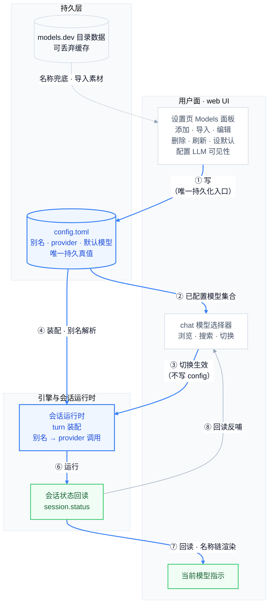
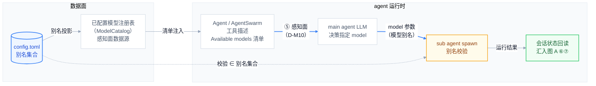

# Model 设置页需求文档（User Stories）

> 状态：v13（v12 基础上新增：D-M13 模型专属提示词与 US-17，SDR-2026-11-08） · 2026-11-08 ·
> 本文是 provider/model 配置功能形态的唯一事实源（内部规格文档，不进文档站构建，中文单语）。
> 契约基准为 TS v2 server（kap-server）的现有行为；运行目标为 rust 后端。
> 技术架构（组件、非功能需求映射、序列、Trade-offs）见 [model-settings-architecture.md](model-settings-architecture.md)（下称「架构文档」）。
> 现状盘点（根因、差异矩阵、代码事实）见 [model-settings-context.md](model-settings-context.md)（下称「context 文档」），本文不重复。
> 验收标准统一采用 Given-When-Then 格式；优先级 P0 > P1 > P2。
> 本文只定义页面层与数据面的呈现、交互、契约语义；OAuth 登录流程、MCP、agent profile 域（用户另行处理）不在本文范围。

## 0. 功能闭环总览

设置页不是 config.toml 的 CRUD 界面，而是「**配置 → 运行 → 感知 → 回读**」完整闭环上的用户操作面：用户在这里改变可用模型集合，集合驱动会话运行与 LLM 的 sub agent 模型决策，运行结果回读 UI 验证生效。闭环拆成两张图，各讲一件事：

- **图 A · 用户操作闭环**：配置 → 选择 → 切换 → 运行 → 回读，用户直接可见的路径；
- **图 B · LLM 模型决策感知面**：闭环点 ⑤ 的细化——模型集合如何被 main agent LLM 感知、`model` 参数如何被校验、sub agent 运行结果如何汇回状态回读（D-M10/US-14）。

两图共享两个锚点：**config.toml（唯一持久真值，图 A 的 ④ 即图 B 的数据源）**与**会话状态回读**。闭环上任何一条边断开，都表现为"配置了但不生效"或"看得到但选不了"——本轮评审前的 rust 后端即是实例（会话模型切换静默 no-op、选择器整体 unavailable、感知面只有裸别名清单）。**两图的每条边都是验收闭环点：一条边不通过对应的需求条目，闭环即未合拢。**

### 图 A · 用户操作闭环



### 图 B · LLM 模型决策感知面（闭环点 ⑤ 细化）



**闭环点对照表**（两图的每条边 → 需求条目，缺一即断线）：

| 图 | 闭环点 | 语义 | 需求条目 |
|---|---|---|---|
| A | ① | 设置页是别名的**唯一持久化入口**——手动添加与目录导入都经此落 config；刷新不写 | US-4/5/6/7/8/9/10（D-M2） |
| A | ② | config → 选择器：清单**恰好等于**已配置集合，名称按 D-M1 链解析 | US-1（D-M1/D-M9） |
| A | ③ | 选择器切换 → 会话**真实生效**（状态可回读验证，非乐观 UI；不写 config） | US-11 |
| A | ④ | config → 会话运行时装配（别名 → provider 调用；默认模型决定新会话起点）；也是图 B 感知面的数据源 | US-8（引擎既有路径，契约不变） |
| A | ⑧ | 状态回读反哺选择器（切换后重开时当前项与清单一致） | US-1/US-11 |
| B | ⑤ | config → 已配置模型注册表 → 工具描述 → LLM 感知 | US-14（D-M10） |
| B | 别名投影 | config → 注册表（同一 curated 投影，数据面完成） | US-14 |
| B | 清单注入 | 注册表 → 工具描述（curated 门控：仅写 `description` 的别名） | US-14 |
| B | model 参数 | LLM 决策值（模型别名）→ spawn 传递 | US-14 |
| B | 别名校验 | 校验 ∈ 已配置别名集合；错误内联 curated 清单 | US-14 |
| B | 结果汇回 | sub agent 运行汇入状态回读 | US-12（A⑥⑦） |
| A | ⑥⑦ | 运行 → 状态回读 → UI 名称渲染（pill / 选择器当前项）；图 B 的运行结果汇回此处 | US-12 |
| A | 目录边（虚线） | 目录数据只做**名称兜底与导入素材**，永不直接进入任何集合或感知面 | US-3/13（D-M1/D-M2/D-M4） |

## 1. 角色定义（Personas）

| 角色 | 场景 | 核心诉求 |
|---|---|---|
| **web UI 操作者** | 在浏览器里管理 provider/model 并选择聊天模型（loopback 本地场景） | 不改 config.toml 就能完成全部配置；模型名人类可读；改完即生效 |
| **远程管理员** | 在无外设服务器上跑轻量后端 | API 优先的语义不受页面能力影响（配置面是叠加不是替换） |

## 2. 术语与集合定义（全文唯一口径）

本文所有 User Story 只允许引用以下集合口径（三个集合 + 一个子视图），禁止使用"所有可用模型"这类无对照的表述：

| 术语 | 定义 | 出现在哪里 |
|---|---|---|
| **已配置模型**（别名集合） | config.toml `[models."provider/model"]` 中登记的别名，每条都可通过其 provider 的凭据实际调用。进入该集合的唯一途径是用户的显式动作：手动添加（US-4/US-9）或从目录导入（US-5）。 | chat 模型选择器（Composer 下拉、ModelPicker 全屏）、设置页 Models 面板的每个 provider 详情 |
| **curated（精选）** | 已配置模型的子集：写了非空 `description` 的别名。`description` 是 LLM 感知面的唯一可见性门控（D-M10.1）——未写的模型对人类界面可见、对 LLM 整体隐藏。操作入口 = 设置页「LLM 可见」开关（US-9）。 | Agent / AgentSwarm 工具描述的 "Available models" 清单、错误反馈内联清单 |
| **已配置 provider** | config.toml `[providers.<id>]` 中登记的供应商（mirri 官方 OAuth provider 亦在此）。 | 设置页 Models 面板的 provider 列表 |
| **目录数据** | 从 models.dev 拉取并缓存的公开模型目录（全部 provider 及其模型，含人类可读名、上下文长度、能力标注）。**目录数据不是可用模型**——一个目录模型只有被添加为别名（导入/手动添加）后才可用。 | 三个用途：(a) 已配置别名缺 `displayName` 时的名称兜底（D-M1）；(b) "Add provider" 对话框的浏览与导入来源（US-5）；(c) 刷新后保持以上两者最新（US-3） |

模型名称展示遵循 **D-M1 解析链**：别名显式 `displayName`（用户写的）→ 目录名（别名未写时，从目录数据查）→ 原始模型名。

### 2.1 标识符规范（四个名字，禁止自造同义词）

上文三个集合描述"哪里能看到什么"；本表定义"用什么名字指称它"。spec 中出现任何含 "id" 的模型相关表述，必须能唯一归位到下表四者之一，否则视为缺陷。四个术语的**跨域唯一定义**收录在 [glossary.md](glossary.md)（模型概念横跨 config / 引擎 / RPC / web / agent 工具多个域）；本表是它在本文的域内视图，两者冲突时以 glossary 为准：

| 规范名 | 形态与示例 | 它是什么 / 用在哪 | config.toml 对应位置 | 禁止的叫法（曾引发歧义） |
|---|---|---|---|---|
| **模型别名**（短称"别名"） | `[models.<键>]` 的键，**规范形态** `provider-id/model-id`（如 `github-copilot/claude-opus-4.8`）；亦容忍**短名形态**（如 `sonnet`，此时斜杠规则不适用） | 全系统指称"哪个模型"的唯一方式：Agent 工具 `model` 参数的唯一合法值、`default_model` 与会话当前模型的取值。**别名本身就是标识符，没有另外一个"id"**；本域所有写路径（手动添加、目录导入）生成的键一律用规范形态 | `[models."github-copilot/claude-opus-4.8"]` 的键（表名后面的部分） | ~~别名 id~~、~~modelId~~、~~模型 id~~ |
| **原始模型名** | 规范形态别名的斜杠右侧部分，如 `claude-opus-4.8`；短名形态别名没有斜杠，原始模型名只体现在表内 `model` 字段 | 调用 provider 时实际发送的模型名；`model.list` 行的 `model` 字段、表单中名为 "model id" 的输入框，取值都是它 | 同一张表内的 `model = "claude-opus-4.8"` 字段的值 | ~~原始 id~~、~~raw model id~~、~~原始 model id~~ |
| **provider id** | 规范形态别名斜杠左侧部分，如 `github-copilot` | `[providers.<id>]` 的键、provider 列表的条目标识；短名形态别名的 provider 由表内 `provider` 字段指明 | `[providers.github-copilot]` 的键 | —— |
| **显示名**（display name） | 任意人类可读文本，如 "Claude Opus 4.8" | D-M1 链的产物，仅供阅读。**不是标识符，不能作为 `model` 参数的值** | 同一张表内的 `display_name = "Claude Opus 4.8"` 字段的值 | —— |

四个标识符在 config.toml 中的位置（一段带注释的完整示例；`#` 注释指明对应规范名）：

```toml
# 模型别名（键）= "github-copilot/claude-opus-4.8"  ← 规范形态
# provider id = "github-copilot"                     ← 别名斜杠左侧 = 下方 [providers.<id>] 的键
[models."github-copilot/claude-opus-4.8"]
provider = "github-copilot"     # provider id（表内指明，短名形态别名的唯一 provider 来源）
model = "claude-opus-4.8"       # 原始模型名（发给 provider 的实际值）
display_name = "Claude Opus 4.8" # 显示名（D-M1 链最高优先；缺省时走目录名 → 原始模型名）

[providers.github-copilot]      # provider id = 表键 "github-copilot"
type = "openai"
api_key = "YOUR_API_KEY"

default_model = "github-copilot/claude-opus-4.8"  # 取值 = 模型别名（config 键）
```

**同名异义警示（三处）**：

1. wire 与代码中 "model" 一词有两种含义——`model.list` 行的 `model` 字段是**原始模型名**；Agent 工具与 `session.updateMeta` 的 `model` 参数是**模型别名**。两个 "model" 相邻出现（如"别名的 model 字段"）时，须按本表先归位再理解。
2. wire 行携带 config 键（`id` 字段，架构 ADR-003 推翻原 T3 裁决——组装 id 曾顺着写链路回传，短名别名下引擎解析不到，静默落到错误 provider），web 以该**模型别名**为应用层 id，一切回写（设默认模型、切换会话模型）以别名定位；无该字段的旧引擎行退回 `${provider}/${model}` 组装（仅展示，不回写）。
3. 英文 "catalog" 一词两义——引擎内 `ModelCatalog` = **已配置模型注册表**（config 别名装配，运行时解析与感知面的数据源，图 B 的 CATALOG 节点即它）；`providerDiscovery.listCatalog` / `importCatalog` 及 REST `/catalog/*` 中的 catalog = **models.dev 目录数据**。类名层与方法名层指向不同实体，唯一定义见 [glossary.md](glossary.md) 的 catalog 警示。

## 3. 范围与优先级

**In scope**：设置页 Models 面板全部能力、chat 模型选择器、Agent 工具的模型感知面契约（D-M10，数据面归本域、实现落点在 agent 工具域）、支撑上述能力的 RPC 契约语义。
**Out of scope**：OAuth 登录流（另立故事）、TS server 行为变更、provider 重命名迁移（D-M7）、agent profile 域（用户另行处理）、目录 UI 增强（搜索/分页）。

优先级：US-1/3/11/12 为 P0（用户当前被阻断的路径）；US-2/4/5/6/8/9/14 为 P1；US-7/10/13 为 P1~P2。

## 4. 契约级裁决（本次评审确定）

### D-M1 Display name 解析链（全 UI 统一）

任何展示模型名的界面（选择器行、搜索匹配、当前模型指示、设置页）按同一条链解析：**用户显式覆盖（config 别名 `displayName`）→ models.dev 目录名 → 原始模型名**。解析在数据面完成（`model.list` 的每一行都携带解析后的 `display_name`），展示层不做第二套逻辑。

评审注记：用户 config.toml 的别名大多已写 `display_name`，后端也已正确投递——当前失真是 web 适配器的 wire 字段命名 bug（见 context 文档 §1），属实现修复，不改变本链条定义。目录名兜底仅作用于未写 `displayName` 的别名。

### D-M2 刷新语义 = 目录拉取 + 读时合并，不改变已配置模型集合

刷新动作的语义：拉取 models.dev 目录 → 更新内存目录 + 磁盘缓存。**刷新不增删任何已配置模型（别名集合不变）**；目录数据只在读取时用于名称兜底（D-M1）与目录浏览（US-5）。目录不可达是降级事件（沿用缓存 + 诊断警告），不是调用错误。

### D-M3 展示不因刷新失败置灰

选择器打开时使用既有列表立即渲染，刷新在后台进行；刷新失败只产生提示，不把选择器置为不可用状态。

### D-M4 目录缓存懒加载 + 本地持久化开关

服务器启动**不因目录读取阻塞**；允许启动后台磁盘预热（零网络、零阻塞）。首次目录数据使用时（`model.list` 的名称兜底、目录浏览），若内存目录为空且磁盘缓存存在，则从本地缓存文件惰性恢复（本地磁盘读，快）；**任何网络拉取都只在显式刷新或后台触发时发生，永不阻塞请求路径**。

磁盘缓存的本地持久化可通过 config.toml 开关禁用（默认启用；禁用后刷新不写缓存、启动不读缓存，目录数据退化为"本次进程内刷新过才有"）。

### D-M5 目录浏览/导入本批交付

"从 models.dev 目录添加供应商"（浏览 + 一键导入）纳入本批范围（两个新后端方法，见 §6 契约面）。

### D-M6 供应商状态保持两态

`model.listProviders` 的 `status` 仅由 apiKey 有无推导（connected / unconfigured），不反映 OAuth 托管 provider 的登录态（对齐 TS 的 connected-含-OAuth 语义列为 followup）。

### D-M7 不做 provider 重命名

改 provider id 为低频操作，删除后重建可替代；`new_id` 迁移语义（别名键重写、默认模型指针改写）不做。

### D-M8 删除被活跃会话使用的别名 = 静默保持

删除别名不主动迁移正在使用它的会话；会话按已加载配置继续，后续请求遇到模型不存在时报可理解错误。

### D-M9 选择器与设置页的操作对象 = 已配置集合

chat 模型选择器与设置页 Models 面板展示、搜索、操作的对象**只限已配置模型与已配置 provider**。目录数据不出现在选择器中（一个未配置 provider 的目录模型选了也调不通：无凭据、无别名）；想使用新模型必须先通过 US-4/US-5/US-9 显式添加。曾考虑替代方案"选择器额外显示已配置 provider 的目录新模型、选中时隐式创建别名"（TS 刷新写回后的等效体验），因与 D-M2（不写回用户配置）冲突且引入隐式配置写入而否决。

### D-M10 Agent 模型感知面（LLM 决策契约）

main agent 通过 Agent / AgentSwarm 工具为 sub agent 指定模型时，LLM 依据的感知面契约：

1. **集合口径**：感知面清单 = 已配置模型中写了 `description` 的子集（curated，集合定义见 §2）；`description` 是唯一可见性门控，未写的模型不出现在任何 LLM 可见面。目录数据不出现在感知面。
2. **信息密度与标识口径**：每个条目必须携带——可指定的**模型别名**（`model` 参数的唯一合法值，即 config 键，规范形态见 §2.1）、描述（即门控字段，清单内条目必有）、能力标注（已配置时）。LLM 不需要额外调用任何接口就能据此决策。**感知面不携带显示名**：显示名是 UI 概念，D-M1 链只服务人类界面；LLM 面以模型别名为唯一标识——别名即 config 键，对 LLM 与人类同样可读，可读性诉求通过别名命名解决，不通过向感知面引入显示名解决（引入第二标识会破坏 `model` 参数取值的唯一性）。
3. **单一事实源**：感知面与设置页、chat 选择器不出现两套清单或两套标识（同一别名集合、同一模型别名）；显示名链（D-M1）只存在于人类 UI 面。
4. **错误反馈闭环**：指定未配置的别名时，错误信息必须**内联 curated 清单（含描述）**，LLM 无需额外调用即可自纠。
5. **安全边界**：凭据类信息（apiKey 等）永不出现在感知面。

实现落点在 agent 工具域（工具描述构建与参数校验）；本域负责数据面（别名集合与字段完整性）与契约定义。

### D-M11 思考开关的兑现承诺（可关闭性 + 表达方式 + 不谎报）

一个模型在界面上呈现"关闭思考"选项，**当且仅当**引擎能真正把这次关闭送达该端点。

1. **可关闭性判定**：模型能否关闭思考是**模型事实**，由两个来源决定——配置显式声明的"永远思考"标记（优先），以及端点是否采用一种已知的关闭表达法。两者都不成立、且模型本身声明了思考能力时，模型对界面呈现为"不可关闭"（只显示档位、不显示关闭项）；模型若根本不声明思考能力，界面维持"不支持思考"的既有呈现，不追加"永远思考"。
2. **表达方式分层**：不同端点用不同字段表达"关闭"。引擎按**模型级设置 → provider 级设置 → 内置端点表**的顺序确定该端点的表达法；三层都无结论时，模型进入"不可关闭"状态，而不是伪造一个关闭动作。
3. **档位与关闭分离**：档位（`support_efforts` / `default_effort`）与"能否关闭"是两件事，各自独立表达——一个模型可以有多档而无关闭档。档位能否发送取决于该端点是否声明了与关闭字段**并列**的档位字段；端点只声明关闭字段时，档位只限制界面可选范围，不额外发送。
4. **不谎报**：界面不得提供无法兑现的控制项（延续 R5 可用性诚实原则的推论）。无法关闭时，界面在思考控件旁明确说明"此模型始终思考"，而不是给出一个点击后无效的开关。
5. **可修正**：用户可对模型或 provider 显式指定表达法，覆盖内置推断——用于引擎未知的网关与厂商。非法取值不阻断启动，由配置体检报告。
6. **可见性分层**：思考关闭方式属于"我们怎么表达"的实现细节，不是模型事实。它只在**模型级设置面**提供，与同类字段（推理字段名覆盖）并列、默认折叠在思考区；用户可见的"能否关闭"事实由永远思考标记表达，不靠该字段。provider 级不设独立表单，由供应商编辑面承载（D-M12）。

技术形状（字段名、解析顺序、三种表达法的取值）见架构文档 C7。

### D-M12 供应商接入配置的可编辑范围（含类型切换）

已配置供应商的**接入配置**必须可编辑，而不是只能删了重建：类型、端点地址、自定义请求头、思考关闭方式。

1. **可编辑对象**：供应商类型、端点地址、自定义请求头、思考关闭方式。凭据（API key）的写入口归凭据域（见 US-6），不在此列。
2. **类型切换的真实含义**：切换类型改变的是"用哪种协议与端点对话"，已配置的模型别名与凭据不受影响（凭据按供应商身份存放，不按类型）。切换后新类型立即对后续请求生效，无需重启。
3. **类型切换的前置校验**：只提供本引擎真能建立连接的协议类型。引擎不支持的协议不得出现在可选项中（延续 R5：不提供点了会报错的入口）。端点地址的必填性取决于**该供应商是否一等供应商**——一等供应商（openai / anthropic / google-genai / kimi）可留空回落到官方默认地址，其余（自建、代理、目录导入的第三方）必须填写；留空且非一等时保存即报错并指出缺失项，而不是静默落一个"看着配好了、请求时才失败"的配置。
4. **自定义请求头**：以"名称—值"成对编辑，用于代理与自建网关的鉴权/路由头。保存后新值对后续请求生效。
5. **思考关闭方式**：由 D-M11 定义其语义；在供应商编辑面提供，是为了覆盖"同一个端点下多家厂商模型"与"自建网关"两类内置推断失效的场景。
6. **失败不破坏既有配置**：任何一项校验失败时整次保存不落盘，既有配置保持原样。

技术形状见架构文档 C8。

### D-M13 模型专属提示词：内置规则命中即物化、文件化、可微调

不同模型对"该想多久、该先说结论还是先推演"的默认倾向差异很大，而这种差异表现在**每一个回合**的可见行为上。让用户自己去发现并手写纠正提示词，是把产品该做的判断外包成用户的认知负担；但如果产品把纠正内容静默塞进提示词，用户又无从知道系统对自己的模型说了什么、也无从修改。本裁决要求两者兼得：**内置判断，但落成用户可读可改的实物**。

1. **命中即物化**：产品内置一张「原始模型名 → 提示词」规则表。当某个模型的原始模型名命中规则时——无论它来自导入供应商、新增供应商、新增模型、编辑模型改名，还是存量配置在升级后首次被装配——产品自动为该模型生成一份专属提示词文件（`~/.mirri-code/model_prompts/` 内，每个模型一份 Markdown）。用户无需理解、也无需配置规则。
2. **单向覆盖，永不改写**：物化只在"该模型还没有文件"时发生；**文件一旦存在就永不被覆盖**，无论用户是否编辑过。规则表日后扩充也只作用于此后新加入的模型——产品升级改进话术时，不得静默改写用户已有的调校。文件内容被清空视为"该模型明确不要额外提示词"，不得因此重新生成。
3. **按原始模型名共享**：同一原始模型名在不同供应商下共用同一份文件。模型特性属于模型本身，不属于接入方式。
4. **有则并入、无则不动**：组织系统提示词时，按当前模型的原始模型名读取该文件（见 §2.1）；有内容则并入系统提示词，**不替换基座、不替换角色文本**。文件不存在或为空时，系统提示词与未引入本能力时逐字节一致。
5. **会话创建时确定**：注入内容随会话创建时的模型固定；会话中途切换模型不重新计算，与既有"提示词在会话创建时装配"的语义保持一致。恢复旧会话按其恢复时装配，与新建同口径。此后新建的子 agent 按各自模型取各自的提示词。
6. **可整体关闭**：默认启用。顶层整体开关关闭全部模型专属提示词的**注入**（已存在的文件同样不注入），但**不停止物化、也不禁用编辑**——关闭的是"是否让产品替模型说话"，不是"用户能否自己写"。重新开启后，此后新建或恢复的会话按磁盘上的当前内容注入，无需重新生成。处于关闭状态时，编辑界面必须明确告知"眼下不会生效"。
7. **用户可微调**：模型设置页对每个**文件已存在**的模型（命中并已生成、或用户自建）提供查看与编辑入口；命中规则但文件尚未生成（例如生成时写盘失败）时，入口以空态呈现且可创建。用户也可为未命中规则的模型自行创建专属提示词，创建后与命中生成的文件同等注入、同等单向覆盖。编辑只影响该模型这一份文件。
8. **共享与时机双明示**：因同一原始模型名跨供应商共享、且注入在会话创建时确定，编辑界面必须同时告知两件事——"此改动影响所有使用该模型的供应商"、"当前会话不受影响，新建会话才生效"。
9. **写失败不造坏入口**：生成文件失败不得阻断配置动作，也不得留下一个点开即报错的入口（见第 7 条的空态语义）。
10. **可诊断而非静默**：文件名由模型名经统一安全化规则产生（跨平台一致，仅大小写不同的模型名互不覆盖）；文件身份以内容中记录的原始模型名为准，文件名不作为身份依据。单份文件超过体积上限时整篇不注入，并在用户可见的装配诊断中指明是哪个模型、哪份文件、超了多少——不做截断（半句提示比没有提示更糟），也不静默跳过。

技术形状见架构文档 C9。

## 5. User Stories

### US-1 查看已配置模型（P0）

作为用户，我打开 chat 模型选择器（或设置 → Models 页某个 provider 的详情）时，看到的模型清单**恰好等于已配置模型中属于该范围的那部分**：选择器显示全部已配置模型（按 provider 分组）；provider 详情显示该 provider 的已配置模型。目录里我未配置的模型不出现在这两个界面的任何位置。

- 名称展示遵循 D-M1 链。
- 验收：
  - Given 已配置 provider P，其别名共 3 条，When 打开选择器，Then P 分组下恰好出现这 3 个模型，不多不少；
  - Given 目录中存在未配置 provider Q 的 50 个模型，When 打开选择器，Then Q 的模型一条也不出现；
  - Given 某别名无显式 `displayName` 且目录数据含该模型，Then 显示目录名而非原始模型名；
  - Given 某别名有显式 `displayName`，Then 显式值优先于目录名；
  - Given 目录不可达且无缓存，Then 无 `displayName` 的别名显示原始模型名，不报错。

### US-2 查看已配置 provider 列表与状态（P1）

作为用户，我打开设置 → Models 页，看到的 provider 列表**恰好等于已配置 provider**。每个条目显示：id、类型、连接状态、是否有 API key、其名下已配置模型的数量、默认模型标记。目录里的其他 provider 不出现在列表中（想用它们走 US-5 添加）。

- 状态遵循 D-M6（两态）。
- 验收：
  - Given 配置了带 apiKey 的 provider P，When 打开面板，Then P 显示 connected、模型数 = P 的别名数；
  - Given 无 apiKey 的 provider，Then 状态为 unconfigured；
  - Given 目录中存在未配置的 provider Q，When 打开面板，Then 列表中没有 Q。

### US-3 刷新目录数据（P0）

作为用户，我可以 (a) 在设置页刷新目录数据（全部），(b) 针对单个已配置 provider 刷新，(c) 打开 chat 模型选择器时自动触发一次后台全量刷新。刷新的作用对象是**目录数据**，不是已配置模型集合（D-M2）：刷新后，(a) 缺 `displayName` 的别名名称兜底生效或更新，(b) "Add provider" 对话框中的目录列表更新，(c) 针对已配置 provider 的刷新会汇报该 provider 在目录中的模型增删（提示"有 N 个新模型可添加"）。刷新结果汇报 changed / unchanged / failed。

- 交互遵循 D-M3。
- 验收：
  - Given 已配置 provider P 在目录中有 3 个新模型，When 刷新，Then 返回结果中 P 为 changed（added=3）并可提示可添加；**P 的已配置模型数量与内容不变**；
  - Given 某别名无显式 `displayName` 且目录含该模型，When 刷新成功后重新读取模型清单，Then 该别名显示目录名；
  - Given 指定单个 provider 刷新，Then 只影响该 provider 相关的目录数据汇报；
  - Given 目录不可达，Then 调用不报错，UI 收到降级说明，名称兜底沿用既有缓存；
  - Given 服务器重启后磁盘缓存存在，When 首次目录数据使用发生，Then 目录已从缓存恢复（D-M4），期间无网络等待、无请求阻塞。

### US-4 手动添加供应商（P1）

作为用户，我可以在设置页手动添加 provider：填 id、类型、API key、可选 baseUrl，**初始模型可留空**（原始模型名、maxContextSize、可选 displayName 在添加模型时填写）。保存后该 provider 立即进入已配置集合——出现在 provider 列表中；若提交了初始模型，它们同时出现在 chat 选择器中。创建为空的 provider 可在同一页面继续添加模型（US-9），新模型随后出现在选择器中。

- 验收：
  - Given 提交合法表单（含初始模型），When 保存，Then provider 列表含新条目（connected），选择器出现其初始模型；
  - Given 提交合法表单（不含模型），When 保存，Then provider 以空模型集合创建并出现在 provider 列表，选择器不出现其模型，保存后自动引导进入添加模型流程；
  - Given id 与现有 provider 重复，Then 报已存在错误，表单不关闭；
  - Given API key 缺省，Then provider 以 unconfigured 状态创建（先建后配 key）。

### US-5 从目录导入供应商（P1）

作为用户，我可以在"Add provider"对话框浏览**目录数据**（全部目录 provider 及各自模型、env key 提示），选择一个并填 API key（+ 需要时的 baseUrl）后导入。导入前我可以在该 provider 的模型清单中**取消勾选不想导入的模型**（默认全部勾选，一键导入体验不变）；提交时 Provider 与勾选的模型在**一次写入**中完成，被取消勾选的模型留下永久排除标记（此后重新导入或刷新不会把它们加回来）。导入 = 把该 provider 写入已配置 provider 集合，并把**勾选的**目录模型写入已配置模型集合——模型自动携带目录标注的能力（如视觉输入、工具调用、推理）与输出上限、推理档位等目录事实，**无需我逐模型手动补能力**（显示名按 D-M1 链解析，不强制持久化 displayName）。对已配置的 provider 重复导入不报错：既有模型配置保持不变（我做过的人工修改不被覆盖），目录新增的模型被追加，我曾删除或排除的模型不会被复活；全新环境导入后第一个模型自动成为默认。

- 交付遵循 D-M5；浏览的合法性见 §2（目录数据只在对话框中出现）；能力推导与 merge 语义见 SDR-2026-09-18；导入时模型选择与排除标记语义见 SDR-2026-10-28。
- 验收：
  - Given 目录可达，When 打开对话框，Then 列出目录 provider（含名称 / 是否需要 baseUrl / 环境变量名提示）；
  - Given 选择目录 provider 并填 key，When 导入，Then 已配置集合出现该 provider 及其全部目录模型（带目录名展示），选择器可见，结果提示导入数量；
  - Given 选中某 provider 后其模型清单展示，Then 每个模型默认勾选、可单独取消勾选，且清单支持按名称搜索（搜索只影响显示，不改变勾选状态），底部实时显示"将导入 N / 共 M 个"，被取消勾选的行视觉弱化；
  - Given 取消勾选 3 个模型后导入，Then 一次提交完成（Provider 与所勾选模型单次写入），已配置集合只出现勾选的模型，且被排除的 3 个留下永久排除标记；
  - Given 曾导入时排除（或删除）过模型 M，When 重新导入同一 provider，Then M 不被复活、不重新出现；
  - Given 导入的目录模型声明了视觉输入与工具调用能力，When 导入后打开该模型的编辑表单，Then 能力标注已自动勾选，无需手动补填；
  - Given 对已配置的 provider 再次导入，When 目录新增了 2 个模型，Then 导入成功、新增 2 条模型、既有模型配置逐项不变、此前删除或排除过的模型不复活；
  - Given 目录不可达，Then 对话框退化为手动添加路径（US-4）并提示原因，不阻塞手动添加。

### US-6 编辑供应商凭据 / 端点（P1；2026-10-28 修订——对齐 provider-credential 域 D-M6/G 组）

作为用户，我可以修改**已配置 provider** 的 API key 与 baseUrl，保存后新值即时生效（无需重启）。**API key 的写入入口为凭据库**（provider-credential 域 `credential.set`，D-M6 目标态）；baseUrl 仍写配置面。编辑表单对已存密钥**留空不回显**（明文只在命令行回读，provider-credential G.5/V15）。

- 验收：
  - Given 提交新 key，When 保存，Then 后续请求使用新 key（经凭据库指纹失效机制，provider-credential ADR-005）；
  - Given 编辑对话框中呈现该 provider 的凭据状态（类型 / 外部来源在场态 / 健康徽标——provider-credential G.1/G.5）；换密钥或收到 `credential.updated` 通知后徽标即时刷新（G.8）；
  - Given OAuth 托管 provider，Then 拒绝手动改 key（明确的域错误码）。
- 历史措辞注记：~~「编辑表单能回显已存 key」~~（G.5/V15 只写不读，废除）与 ~~「key 提交空串 → 清除凭据」~~（空串在 `credential.set` 被拒绝；清除走 `credential.remove`，见彼域 B 组）——两句均因凭据域裁决废除。（修订记录：本域按 provider-credential SDR-005 批的七点 diff 对齐，操作语义归属彼域。）

### US-7 删除供应商（P1）

作为用户，我可以删除一个已配置 provider：其名下别名一并从已配置模型集合移除；默认模型指针若指向被删范围则同步清理。删除后该 provider 及其模型从设置页与选择器消失。

- 与 TS 基线的差异注记：TS 的删除端点级联删别名但**故意不动全局默认模型指针**（视为用户设置不代为回收）；本域目标态选择"指针同步清理"，由 rust `config.removeProvider` 的现有语义承载（见 context 文档 §3、架构 C6），无需实现差异。
- 验收：
  - Given provider P 有 3 条别名，When 删除 P，Then 3 条别名全部消失，provider 列表与选择器不再含 P 及其模型；
  - Given 默认模型属于 P，When 删除 P，Then 默认模型指针不悬空；
  - Given OAuth 托管 provider，When 删除，Then 明确域错误拒绝（与 US-6 的 OAuth 拒改 key 同口径，对齐 TS 契约）。

### US-8 设置默认模型（P1）

作为用户，我可以把某个**已配置模型**设为默认，新会话默认使用它。

- 验收：
  - Given 设置别名 X 为默认，When 新建会话，Then 会话模型为 X；
  - Given X 不在已配置模型集合中，Then 报 model_not_found，默认不变。

### US-9 添加 / 编辑模型别名（P1）

作为用户，我可以为已配置 provider 手动添加模型别名（原始模型名、displayName、maxContextSize、capabilities、supportEfforts/defaultEffort、思考关闭方式（D-M11.5）、description（用途说明，高级选项区）），并编辑已有别名的这些字段（表单自动保存）。任何添加/修改立即反映到已配置模型集合（选择器可见）。`description` 同时是 LLM 感知面的可见性开关（D-M10.1）：表单提供「LLM 可见」开关控制它。

- 验收：
  - 假如 我把某别名的 `displayName` 改为 "Foo Pro"，当 保存后打开选择器，那么 该模型显示 "Foo Pro"（D-M1 链中显式值最高优先）；
  - 假如 我为 provider P 添加别名 M，当 保存，那么 选择器 P 分组出现 M；
  - 假如 maxContextSize 非法（非正整数），那么 表单校验拒绝；
  - 假如 我打开某别名的「LLM 可见」开关并填写用途说明，当 保存，那么 该模型出现在 Agent 工具的 "Available models" 清单（进入 curated 集合）；
  - 假如 我关闭某别名的「LLM 可见」开关，当 保存，那么 其 description 清空、该模型从 LLM 清单消失（人类界面——选择器 / 设置页——不受影响）；
  - 假如 我为某别名把"思考关闭方式"从"自动"改为某个具体取值，当 保存，那么 该模型的关闭请求按新取值发出（覆盖内置推断，D-M11.5）；
  - 假如 某别名的"思考关闭方式"保持"自动"，当 我打开该别名，那么 该字段显示内置推断出的取值及其来源，我不需要理解它也能确认生效；
  - 假如 我从不展开模型的思考区，那么 思考关闭方式不占据表单的默认可见空间（它属于实现细节，默认折叠）。

### US-10 删除模型别名（P1）

作为用户，我可以删除一个已配置模型别名；若它是默认模型，指针同步清理；被活跃会话使用时遵循 D-M8。删除后该模型从选择器消失，且留下永久排除标记——将来重新导入同一 provider 或刷新目录时不会被复活（SDR-2026-10-28）。我也可以一次勾选**多个**别名批量删除：勾选与删除一次性提交（单次配置写入），批量操作作用于当前过滤可见的范围。

- 验收：
  - Given 删除默认模型别名 X，Then 默认模型指针清空、`model.list` 不再含 X、选择器不再显示 X；
  - Given 在 provider 详情勾选 3 个模型后点删除并确认，Then 三条别名在**单次配置写入**中全部移除，选择器不再显示它们；
  - Given 已在模型清单输入过滤词，When 勾选并批量删除，Then 操作对象为当前过滤可见的模型；
  - Given 批量删除后当前过滤条件与选中 provider 保持不重置，Then 我可以继续在过滤后的清单中查看/操作剩余模型；
  - Given 批量删除包含默认模型，Then 默认模型指针同步清空，不悬空；
  - Given 删除（单个或批量）后重新导入同一 provider，Then 被删除的模型不被复活（永久排除标记生效）。

### US-11 Chat 模型选择器（P0）

作为用户，我在 chat 界面打开模型选择器（Composer 下拉或全屏 ModelPicker），看到的是**全部已配置模型**（US-1 口径，按 provider 分组），支持搜索（按 D-M1 解析后的名称匹配，大小写不敏感）。选择一个模型后，**当前会话的模型真实切换**（后端状态可查证，不只是乐观 UI），后续消息使用新模型；选择器打开时后台刷新目录数据（D-M3：不阻塞、失败不置灰）。

- 验收：
  - Given 已配置模型若干，When 打开选择器，Then 列表立即可见（来自已配置模型集合），后台刷新进行中；
  - Given 在会话 S 中选择模型 Y，When 切换完成，Then 从会话状态接口回读的当前模型为 Y（不是切换前的旧值），S 的后续消息实际使用 Y；
  - Given 切换失败（后端错误），Then UI 回滚到切换前的模型并提示；
  - Given 搜索 "pro"，Then 匹配名称解析结果含 "pro" 的已配置模型，不匹配未配置的目录模型。

### US-12 当前模型指示（P0）

作为用户，chat 输入框的当前模型指示显示 D-M1 链解析后的名称，悬停可见完整模型别名（`provider-id/model-id`，其斜杠右侧即原始模型名）。

- 验收：
  - Given 当前模型无显式 `displayName`，When 指示渲染，Then 显示目录名（有目录数据时）或原始模型名，不显示内部拼接串。

### US-13 目录数据生命周期（P2）

服务器重启后目录数据（用于名称兜底与目录浏览）无需手动刷新即可用；缓存的本地持久化可被 config 开关禁用。

- 遵循 D-M4；更新路径 = 手动刷新 + 选择器打开触发的后台刷新（D-M3），无启动网络刷新、无定时器（允许启动后台磁盘预热：零网络、零阻塞）。
- 验收：
  - Given 上次刷新曾成功（缓存文件存在），When 重启后首次目录数据使用，Then 目录已从缓存恢复（经后台预热或惰性读取），期间无网络等待、无请求阻塞；
  - Given config 禁用本地持久化，When 刷新成功，Then 不写缓存文件，重启后目录数据为空（名称兜底退化为原始模型名）；
  - Given config 禁用本地持久化，Then 磁盘上已有的缓存文件不被读取。

### US-14 LLM 模型决策感知面（P1）

作为 main agent（LLM），我在决定为 sub agent 指定哪个模型时，能在 Agent 工具描述中看到每个对 LLM 可见模型的别名、描述与能力标注（感知面以别名为唯一标识，不出现显示名），据此做出有依据的选择；指定错误时能从错误反馈中直接自纠。

- 契约遵循 D-M10；实现落点在 agent 工具域（工具描述构建与参数校验），本域交付数据面与契约。
- 验收：
  - Given 已配置 3 个别名（其中 2 个写了 `description`），When 构建 Agent / AgentSwarm 工具描述，Then "Available models" 清单恰好含 2 条（curated 门控，D-M10.1）：每条以模型别名（规范形态，见 §2.1）为唯一标识并携带其描述，任何条目不携带显示名；
  - Given 未写 `description` 的别名，Then 它不出现在感知面清单（对人类界面无影响）；
  - Given 别名 A 的 `description` 为"适合快速检索"，When LLM 读取清单，Then A 的条目携带该描述（无需任何额外调用即可据此决策）；
  - Given LLM 指定了未配置的别名 Z，When 工具返回错误，Then 错误信息内联 curated 别名清单（含描述），LLM 可直接自纠；
  - Given 目录中存在未配置 provider 的模型，Then 感知面清单不含它们（与 chat 选择器同口径）；
  - Given 无任何已配置模型或全部未写 `description`，Then 省略整个清单节，`model` 参数说明保持可读。

### US-15 关闭思考真的生效（P0）

作为用户，我在 chat 输入框把某个推理模型的思考档位切到"关闭"后，该模型在后续消息里**确实不再进行扩展推理**；如果这个模型根本关不掉，界面就不给我"关闭"这个选项，而是明确告诉我它始终思考。

- 契约遵循 D-M11；表达法的配置入口与推断规则见架构文档 C7。
- 验收：
  - 假如 某模型所在端点采用"思考对象开关"式表达法且未声明"永远思考"，当 我把档位切到关闭，那么 发往该端点的请求携带关闭该端点的思考字段（不是省略字段），且界面在我切换后保持"关闭"选中态；
  - 假如 模型声明了"永远思考"，当 我查看该模型的思考控件，那么 控件不出现"关闭"选项，并说明该模型始终思考；
  - 假如 某端点采用"推理档位"式表达法且支持"无"档，当 我切到关闭，那么 请求携带该端点文档规定的"无"档取值；
  - 假如 某端点采用"布尔开关"式表达法（默认不思考），当 我选择某个档位，那么 请求同时携带开启标记与该档位，使我选择的档位真实生效；
  - 假如 端点无任何已知表达法且用户未配置，当 我查看思考控件，那么 不出现"关闭"选项，界面提示该端点未声明关闭方式、可在模型设置中指定；
  - 假如 我在模型设置里显式指定了表达法，当 我切到关闭，那么 请求按我指定的表达法发出该字段（覆盖内置推断）；
  - 假如 我为一个已配置"永远思考"的模型又显式指定了表达法，那么 "永远思考"优先，仍不下发关闭请求（配置矛盾不产生半个控制项）；
  - 假如 新建一个会话且该模型声明了默认档位，当 我发出第一条消息，那么 该默认档位已生效，无需先切换一次模型；
  - 假如 config.toml 仍保留已废弃的全局思考配置节，当 我运行配置体检，那么 得到一条明确的"该节已废弃、请改用模型级默认档位与思考控件"提示，且我的配置文件不被自动改写；

### US-16 编辑供应商接入配置（P1）

作为用户，我可以编辑**已配置供应商**的接入配置——协议类型、端点地址、自定义请求头、思考关闭方式——而不必删掉重建。这对自建 API 服务、走代理、或多模型聚合网关的场景尤其重要：这类配置经常需要在试错中修正，而"改错一次就得删库重建"会连模型清单一起丢掉。

- 契约遵循 D-M12；凭据编辑见 US-6（写入口归凭据域）。
- 验收：
  - 假如 我打开某供应商的编辑面，当 表单呈现，那么 显示它的协议类型、端点地址、已有的自定义请求头（成对呈现）、思考关闭方式；
  - 假如 我把协议类型从一种改为另一种，当 保存成功，那么 后续请求按新协议发出，且该供应商已配置的模型清单与凭据都还在（不因换类型而丢失）；
  - 假如 我选择的协议类型本引擎不支持建立连接，那么 该选项不出现在可选项里（不是选了之后报错）；
  - 假如 我把端点地址清空，而新协议没有官方默认地址，当 保存，那么 保存被拒绝并明确指出"该协议需要端点地址"，既有配置不变；
  - 假如 我为走代理的供应商添加一对自定义请求头，当 保存，那么 后续请求携带该请求头；
  - 假如 我修改思考关闭方式，当 保存，那么 该供应商下未单独覆盖的模型按新值发送关闭请求（模型级覆盖优先，D-M11.2）；
  - 假如 表单中任一字段校验失败，那么 整次保存不落盘，已配置内容原样保留。

### US-17 模型的专属提示词：自动生成、可读可改、只影响该模型（P1）

作为用户，我导入一个已知有些毛病的模型（例如总在思考阶段铺陈过长、迟迟不动手），**不需要自己知道该对它说什么**：产品已经按模型名准备好了纠正内容，并且这份内容是磁盘上一份可打开、可修改的 Markdown 文件，而不是藏在某处的黑盒。我改它只影响这个模型，别处都不受影响。

- 契约遵循 D-M13；规则表与文件名规则见架构文档 C9。
- 验收：
  - 假如 我导入一个供应商，其中某个模型的原始模型名命中内置规则，当 导入完成，那么 `~/.mirri-code/model_prompts/` 下出现该模型的一份提示词文件，内容即规则定义的内容；
  - 假如 我导入的模型命中规则，当 我打开该模型的设置页编辑面，那么 出现该模型提示词的查看与编辑入口，打开后内容即生成的内容；
  - 假如 我升级产品前就已经手动添加了某模型、且它的原始模型名命中后来才有的规则，当 我用该模型新建会话，那么 该模型同样得到提示词（不会因为"我没有再做一次导入"而落空）；
  - 假如 我把一个已配置模型的原始模型名改成命中规则的名称，当 保存生效，那么 该模型得到一份提示词文件；
  - 假如 某模型的提示词文件此前已经存在，当 我再次导入同一供应商或同一模型，那么 该文件一个字节都不变（不因重新导入而被规则内容覆盖）；
  - 假如 我已把某模型的文件改成自己的话术，当 产品升级新增/改进了内置规则，那么 我的文件保持不变，规则新内容不会出现在我这一份里；
  - 假如 我把某模型的文件内容整体清空，当 我再次导入该模型，那么 该文件仍为空，不被规则内容重新填充（清空是我的明确意图，不被"修好"）；
  - 假如 供应商 A 与供应商 B 各有一个同名的原始模型，当 我修改这个模型的提示词文件，那么 两个供应商下的该模型都按新内容注入（共享一份）；
  - 假如 某模型的提示词文件有内容，当 我新建会话并发出第一条消息，那么 系统提示词包含该文件的内容，且原有的基座内容、角色文本、项目说明与目录树一处不少；
  - 假如 某模型没有提示词文件（未命中规则且从未创建），当 我新建会话，那么 系统提示词与未引入本能力时完全一致（不多一个字）；
  - 假如 我在会话进行中把模型切换到另一个有提示词的模型，当 我发出下一条消息，那么 当前会话的提示词不重新装配（沿用创建时的内容），此后新建的子 agent 使用新模型的提示词；
  - 假如 我修改了某模型的提示词文件，当 我恢复一个此前用该模型创建的会话，那么 待恢复的会话按修改后的内容装配（与新建同口径）；
  - 假如 我正在使用一个通过长上下文压缩继续的会话，当 压缩后提示词被刷新重建，那么 模型专属提示词仍在（不因刷新而丢失）；
  - 假如 我为某模型编辑提示词，当 我打开编辑界面并保存，那么 界面同时告知我"此改动影响所有使用该模型的供应商"与"当前会话不受影响，新建会话才生效"；
  - 假如 我想为一个未命中规则的模型写提示词，当 我从该模型的设置页创建并保存，那么 后续新建会话确实注入这份内容（自建与命中生成同等对待）；
  - 假如 生成提示词文件时写盘失败，当 我打开该模型的设置页，那么 入口呈现为空态且我可以在其中创建内容（不是一个点开即报错的入口），且那次配置动作本身没有被阻断；
  - 假如 某模型的文件内容超出体积上限，当 我新建会话，那么 该内容整篇不注入（不是截断半句），并且我在会话界面能看到一条指明该模型与超限事实的诊断，无需翻日志；
  - 假如 我打开了整体关闭开关，当 我新建会话，那么 任何模型的提示词文件都不注入，即使文件存在且有内容；且我新增模型时文件仍会被生成、编辑入口仍可用，界面明示"当前不会生效"；
  - 假如 我在关闭状态下编辑了某个模型的提示词，当 我重新开启开关并新建会话，那么 注入的是我编辑后的内容（无需重新生成）；
  - 假如 我用的是 macOS 或 Windows 这类默认大小写不敏感的系统，当 我导入两个仅大小写不同的模型名，那么 它们各自得到互不覆盖的提示词文件（不因文件系统差异互相踩踏）。

## 6. 契约面要求（数据面必须提供的方法语义）

| 能力 | RPC 方法（命名对齐现有注册表） | 语义 |
|---|---|---|
| 模型目录 | `model.list` | **恰好返回已配置模型集合**（别名全集），每行带 D-M1 解析后的 `display_name` 与 `id`（= `[models.<id>]` 配置键，模型别名，ADR-003）；行内 `provider`/`model` 字段对应 config 模型条目的同名字段；wire 形状遵循 klient snake_case 契约（`id` 为加法字段，klient strip 兼容）；**不**返回未配置 provider 的目录模型 |
| 供应商列表 | `model.listProviders` | 恰好返回已配置 provider 集合（`ProviderCatalogItem` snake_case），状态遵循 D-M6 |
| 刷新 | `providerDiscovery.refreshProviderModels` | D-M2 语义（只更新目录数据），支持 `{scope:'all'}` 与 `{providerId}`；磁盘缓存持久化受 D-M4 开关控制 |
| 供应商 CRUD | `provider.set` / `provider.delete` / `provider.get` / `provider.list` / `config.removeProvider` | US-4/6/7；**删除走 `config.removeProvider`**（级联别名与默认指针——`provider.delete` 刻意不级联，见架构 C6）；OAuth 托管 provider 拒删（US-7） |
| 模型 CRUD | `model.set` / `model.delete` / `model.setDefaultModel` | US-8/9/10；删除遵循 D-M8；`model.delete` 删除即留永久排除标记（SDR-2026-10-28），接受别名数组实现**单次写事务的批量删除**，默认模型在被删范围时同步清理 |
| 目录浏览 | **新增**（如 `providerDiscovery.listCatalog`；方法名中的 catalog 指 models.dev 目录数据，见 §2.1 警示 3） | US-5：返回目录数据（provider 条目：name / needs_base_url / env_key / models），与已配置集合无关 |
| 目录导入 | **新增**（如 `providerDiscovery.importCatalog`；catalog 同上） | US-5 组合写 provider + 所勾选别名（遵循 D-M1/D-M2：别名字段最小化，名称靠解析链），接受导入时的模型排除清单（未勾选模型同样落永久排除标记，SDR-2026-10-28），返回导入数量 |
| 会话模型切换 | `session.updateMeta`（或等效方法） | US-11：`model`（及 `thinking`）字段必须真实生效（校验模型在已配置集合内），不再是静默 no-op |
| 配置开关 | config.toml `[model_catalog]` 域 | D-M4 的本地持久化开关（默认启用） |
| 思考关闭方式 | `[models.<id>].thinking_off` / `[providers.<id>].thinking_off` | D-M11：模型级 → provider 级 → 内置端点表三级解析；取值见架构 C7，非法取值由配置体检报告且不阻断启动 |
| 供应商接入配置 | `provider.set` / `config.set`（providers 节） | D-M12：类型、端点地址、自定义请求头、思考关闭方式可编辑；类型切换不触碰模型别名与凭据；仅提供引擎支持建立的协议类型 |
| 永远思考标记 | `[models.<id>].capabilities` 含 `always_thinking` | D-M11.1/D-M11.3：模型事实，优先于表达法；`model.list` 行把它作为**有效能力**投递（界面据此隐藏关闭项） |
| 模型专属提示词 | `model.getPrompt` / `model.setPrompt` | D-M13.7：**只接受原始模型名，不接受路径**——文件名由服务端按安全化规则派生，客户端无法指定落点；读返回原文、是否存在、是否命中内置规则；同名跨供应商共享同一份 |
| 提示词注入总开关 | config.toml 顶层布尔 `disable_model_prompts` | D-M13.6：默认 `false`（启用）。只关注入，不关物化与编辑；读时生效，不参与热重载 |

## 7. 评审记录

### 2026-09-08 首轮（Q1~Q7）

| 问题 | 裁决 |
|---|---|
| Q1 display name 生效方式 | 修 web 适配器 wire 字段名 bug（P0）+ 目录名读时合并兜底（D-M1/D-M2）；用户 config 已写 display_name，修复即恢复 |
| Q2 目录浏览/导入 | 本批交付（D-M5，US-5 P1） |
| Q3 agent profile | 移出本域，用户另行处理 |
| Q4 供应商状态 | 保持两态（D-M6），OAuth 态 followup |
| Q5 provider 重命名 | 不做（D-M7） |
| Q6 删除被活跃会话使用的别名 | 静默保持（D-M8） |
| Q7 目录自动刷新 | 懒加载 + 本地缓存持久化 + config 开关（D-M4/US-13）；无启动网络刷新、无定时器 |

### 2026-09-08 表述澄清轮

| 澄清点 | 结论 |
|---|---|
| "所有可用模型"歧义 | 定义三个集合（§2）：已配置模型 / 已配置 provider / 目录数据；全部 User Story 只引用集合口径（D-M9） |
| 选择器是否含未配置 provider 的目录模型 | 否（D-M9）：目录数据不是可用模型，只用于名称兜底与添加/导入来源 |
| 刷新的可见效果 | 只作用于目录数据（D-M2），不增删已配置模型；新模型的进入途径 = 显式添加/导入 |
| 会话模型切换 | 补充根因（`session.updateMeta` 忽略 `model` 字段，切换为静默 no-op），US-11 验收要求后端状态可查证的真实切换 |
| LLM 模型感知面 | 新增 D-M10/US-14：感知面清单 = 已配置集合 + 模型别名/显示名/描述/能力，错误反馈内联合法清单；rust 现状为裸别名清单（见 context 文档 §1.2），属实现缺口非目标差异 |
| 功能闭环总览 | 新增 §0：闭环示意图 + 闭环点对照表（图上每条边对应需求条目），明确设置页与 agent 运行时的因果闭环，防"配置不生效"类断线 |

### 2026-09-08 标识符规范轮

| 澄清点 | 结论 |
|---|---|
| "别名 id"表述歧义 | 存在两类风险：(a) 读者把"别名 id"误解为别名之外还有一个 id（实际别名本身就是标识符）；(b) 与"原始 model id"（原始模型名）混淆，二者形态不同（`provider-id/model-id` vs `model-id`）、取值域不同（`model` 参数 vs 发给 provider 的值）。裁决：新增 §2.1 标识符规范表，全文统一为四个规范名（模型别名 / 原始模型名 / provider id / 显示名），禁用"别名 id""原始 id""modelId"等自造同义词；wire 上 `model` 字段的双重含义（`model.list` 行字段 = 原始模型名，Agent 工具 `model` 参数 = 模型别名）列入同名异义警示 |
| 防复发机制 | `docs/specs/AGENTS.md` 修改设计文档检查清单新增第 5 问（标识符唯一可归位、同形异义显式标注）；需求文档中任何含 "id" 的模型表述必须能归位到 §2.1 四者之一，否则视为缺陷 |
| 标识符与 config.toml 的对应 | §2.1 增加 "config.toml 对应位置" 列与带注释的完整 toml 示例；核实依据：`[models.<键>]` 键 = 模型别名（`default_model` 取值即键），表内 `model` 字段 = 原始模型名，`display_name` 字段 = 显示名，`[providers.<id>]` 键 = provider id |
| 别名的两种键形态 | 键的**规范形态**为 `provider-id/model-id`（本域所有写路径按此生成）；**短名形态**（如 `[models.sonnet]`，provider 由表内字段指明）为合法的历史容忍形态。新增警示：wire 行不含键，web 组装 id 仅在规范形态下等于键，回写 config 的操作必须以键定位（架构文档 C6 约束） |
| 跨域术语文档 | 新建 [glossary.md](glossary.md)：横跨多个域的术语（模型四术语为其首批条目）唯一定义于该文件，域内 spec 引用而不重复定义（治理见 `docs/specs/AGENTS.md` 术语文档类型） |

### 2026-09-08 感知面修订轮

| 裁决点 | 结论 |
|---|---|
| 感知面条目是否携带显示名 | 否（D-M10.2/3、US-14 修订，架构 §5 同步）：感知面以模型别名为唯一标识——别名即 config 键，对 LLM 与人类同样可读；可读性诉求通过别名命名解决，不通过向感知面引入显示名解决（引入第二标识会破坏 `model` 参数取值唯一性） |
| 感知面清单口径 | curated 门控（D-M10.1、§2 补 curated 视图、US-14 验收修订）：清单 = 已配置模型中写了 `description` 的子集；`description` 是唯一可见性门控，未写的模型对 LLM 整体隐藏（避免全量清单压迫上下文窗口）；错误反馈内联 curated 清单 |
| description 的编辑入口 | US-9 补 description 字段与「LLM 可见」开关验收（现状 web 已有：ModelEditForm / ProviderDetail，见 context §1.2）——开关即 curated 门控的用户操作面 |
| 「catalog」一词两义 | §2.1 新增警示 3 + glossary 补 catalog 警示 + 全文统一（图 B 节点、架构 §5/C4、context §1.2）：`ModelCatalog` = 已配置模型注册表；方法名中的 catalog = models.dev 目录数据 |
| provider 删除的级联语义 | 已核事实落文档（US-7/架构 C6/context §3）：`provider.delete` 刻意不级联，级联在 `config.removeProvider`（含默认模型指针清理）；web 接线后者；补 OAuth 拒删验收；与 TS 基线的指针差异为目标态选择（US-7 注记） |
| addProvider 组合方式 | 定型（架构 C6）：两次 `config.set` 分节写、别名键规范形态、全新环境种子默认（对齐 TS `createProvider`），替换原"取实现简单者" |
| 目录预载措辞 | D-M4/US-13 改为「启动不因目录读取阻塞；允许启动后台磁盘预热」，消除与架构 C1 的字面冲突 |
| 闭环点对照表 | 补 6 行（图 A ⑧ 边 + 图 B 五条边），图 A 补 ⑧ 边标签，兑现"每条边都对应需求条目"的声明 |
| 供应商状态 | 复核后确认无需改裁决：TS 实现同样只产生两态（`'error'` 枚举值从不赋值），说明补入架构 C6 |

### 2026-09-12 模型传递链路修订（SDR）

| 裁决点 | 结论 |
|---|---|
| 选择链路的标识 | **模型别名（config 键）是模型信息传递链路的唯一标识**（用户裁决）：web 的一切回写（切换会话模型、设默认模型、删除）以别名定位；引擎解析失败必须明确报"未配置"，不得静默落到内部默认通道 |
| `model.list` 行携带 `id` | SDR 落定（架构 ADR-003 推翻 T3）：行新增 `id` = `[models.<id>]` 键。原 T3 的"web 组装零成本"判断被实测推翻——组装 id 顺着写链路回传，短名别名（如 `[models.fast]` 命名 rakuten DeepSeek）下引擎解析不到，静默落到错误 provider 的环境变量死胡同，用户明确选择的模型被擅自替换；同一根因还造成默认模型徽标显示裸别名（display_name 丢失）与 Composer 面板空白（当前模型解析失败） |
| 收藏迁移 | web 在 `loadModels` 时把按旧组装 key 收藏的条目一次性迁移到别名 key（同一 `provider/model` 组合匹配），未匹配项保留原样 |
| 引擎防御 | 引擎保留 `provider/model` 组合 id 的防御性解析（`resolve_model_alias_in`）与未配置明确报错，兼容存量客户端与存量会话回读 |

### 2026-09-18 目录导入能力字段与 merge 语义（SDR）

| 裁决点 | 结论 |
|---|---|
| 导入模型的能力标注从何而来 | **随导入自动写入**（目录事实推导：能力标注、输出上限、推理档位、推理字段名）：用户从目录导入 provider 后，模型无需手动编辑即具备正确能力。背景（现状证据见 context 文档 §6）：rust 实测导入的模型能力全空，运行时只剩名字猜测，用户被迫逐模型手勾能力标签；TS 基线（契约基准）的导入即如此写入。此为用户显式动作写 config，与 D-M2（刷新永不写别名）不冲突 |
| 能力呈现的诚实性 | 浏览目录时，目录模型行如实携带其能力标注与推理标注（只读目录事实，非已配置集合承诺）——目录说支持什么就展示什么，导入后即按此写入 |
| 重复导入已配置 provider | **merge**：既有模型配置逐项保持不变（用户的人工修改不被目录覆盖），目录新模型追加，被用户删除过的模型不复活。"已存在即报错"保留给手动添加场景（US-4）——原架构引用的 TS 错误面属于手动建 provider，导入面实际为 merge（见架构 ADR-004 勘误） |
| 导入后默认模型 | 全新环境（尚未设置默认模型）导入时，以第一个未被用户删除的模型作为默认；已有默认不移动 |
| 暂不引入的字段 | 目录的输入上限、推理关闭档位、不可关闭的推理标注暂不随导入写入（rust 配置模型暂无对应落点，rust 引擎亦不消费——记为开放项，出现真实消费方再引入） |

### 2026-10-13 手动创建允许空模型集合（SDR）

| 裁决点 | 结论 |
|---|---|
| 手动创建是否要求初始模型 | **不再要求**：手动创建 provider 时模型列表可为空，provider 以空模型集合创建。原先"至少一个初始模型"的约束取消——创建表单不再内联模型编辑器，模型在创建后通过添加模型流程（US-9）补录。背景：零模型 provider 是合法目标态（用户先登记凭据、再逐个补模型），强制至少一个模型反而阻断该路径 |
| 空 provider 的引导 | 创建为空的 provider 后，保存动作自动引导进入添加模型流程（打开添加模型弹窗），用户在同一页面完成首个模型补录，无需自行寻找入口 |
| 零模型创建的种子语义 | 全新环境默认模型种子仅在 provider 带至少一个模型时发生（以该 provider 默认模型或首个模型为种子）；空模型创建不产生任何种子——没有模型可指，全局默认指针保持未设置，等后续添加模型后再由用户或既有种子规则落定 |
| 空模型列表的契约 | 服务端接受空 `models` 列表（创建与整体替换皆然）；替换语义不变——提交空列表即清空该 provider 名下全部别名，空创建与空替换都是合法终态 |

### 2026-10-28 批量删除、导入时模型选择与删除的永久排除语义（SDR）

| 裁决点 | 结论 |
|---|---|
| 删除/排除的持久语义 | **永久记住排除**（用户裁决）：删除别名或导入时排除模型即留下永久排除标记，此后重新导入同一 provider 或刷新目录都不会把它们加回来。背景：原 `model.delete` 不写排除标记，"删除过的模型不复活"的既有承诺只对旧接口成立，现行删除路径删除后重导入即复活，用户精心清理过的清单会被打回原形（现状证据见 context 文档 §7） |
| 批量删除的写事务 | 一次勾选多个别名、一次提交、**单次配置写事务**（用户明确要求配置写入只发生一次）；批量操作作用于当前过滤可见的范围；默认模型在被删范围时指针同步清理（与单删同口径） |
| 单删后的过滤条件保持 | 删除操作后，provider 详情的过滤词与当前选中 provider 不重置——用户可继续在过滤后的清单中操作（纯页面状态问题，不涉契约） |
| 导入时的模型选择 | "Add provider" 对话框选中目录 provider 后，模型预览改为可勾选清单：默认全部勾选（一键导入体验不变）、可逐个取消、支持清单内搜索（搜索只影响显示不影响勾选）、实时显示"将导入 N / 共 M 个"；提交时 Provider + 所勾选模型 + 排除标记一次写入 |
| 被拒绝的备选 | ・纯前端批量（循环调单删）：配置写 N 次，违背"只写一次"要求，且无排除标记・"仅本次生效"的排除语义：刷新即复活，排除功能形同虚设・通用配置批量写协议：改动面远超本需求，不值得 |
| 影响范围 | US-5（导入时勾选与排除标记）、US-10（批量删除 + 永久排除标记 + 过滤保持）、§6 契约面（`model.delete` 批量化、`importCatalog` 排除清单入参）；对应架构 ADR-005 |

### 2026-10-28 US-6 对齐凭据库写路径（SDR，第二批）

| 项 | 内容 |
|---|---|
| 背景与动机 | provider-credential 域 SDR-005 批落地凭据库后，US-6 的七点措辞与彼域 D-M6/G 组目标态冲突：API key 写 config.toml 字段已被 D-M3 退休（运行期不解析，重启后经 E.6 兜底迁移）；「回显已存 key」违背彼域 G.5/V15 只写不读；「空串清除凭据」与 `credential.set` 拒空冲突 |
| 决策 | API key 编辑入口改为 `credential.set`（写凭据库）；baseUrl 仍走配置面；表单对已存密钥留空不回显；凭据状态徽标（类型/外部在场态/健康）与 `credential.updated` 通知刷新（G.8）进编辑对话框验收；空串清除语义废除（清除走 `credential.remove`） |
| 被拒绝的备选 | ・保留 config.apiKey 写入口（否——D-M3 已退休该字段解析，写入实际不生效）・空串映射 remove（否——与命令行行为不一致，且「输入框为空=删除凭据」易误触） |
| 影响范围 | US-6（验收重写 + 历史措辞注记）；`docs/specs/provider-credential-requirements.md` SDR-005 批（跨域引用，操作语义归属彼域） |

### 2026-11-07 思考开关的兑现承诺（SDR）

| 项 | 内容 |
|---|---|
| 背景与动机 | 用户反馈：把推理模型的思考切到"关闭"后，模型仍在明显思考，且无任何提示。抽象问题：当端点用不同字段表达"停止推理"，而引擎只有一种表达法且该表达法在多数端点上等价于"交给厂商默认"时，「关闭」这个用户动作会变成静默的空操作——界面显示了控制项、系统接受了操作、真实行为没有变化。这类失真比缺少功能更糟：用户无法从任何信号察觉它没生效。相关现状证据见 context 文档 §8。 |
| 决策 | ①**关闭必须真实送达**：用户在界面选择"关闭思考"后，发往端点的请求必须携带该端点文档规定的关闭表达，而不是省略字段（省略在多数端点意为"厂商默认"，即仍在思考）。②**分端点表达**：关闭的表达法按"模型级设置 → provider 级设置 → 内置端点表"解析，用户可覆盖内置推断以支持未知网关。③**不可关闭就不展示**：模型若声明"永远思考"（或端点无已知表达法且用户未配置），界面不提供"关闭"选项，改为明确说明该模型始终思考；不给一个点击无效的开关。④**档位与可关闭性分离**：`support_efforts`/`default_effort` 表达档位，"能否关闭"是独立事实，两者不互相推导。⑤**导入即带事实**：从目录导入模型时，目录数据中已隐含的"能否关闭"事实随别名写入（目录把"有开关"或"有『无』档"记为可关闭，其余的记为永远思考）；此项撤销 G-18 中对 `always_thinking` 的"暂不引入"挂账。⑥**全局默认档位在会话创建时生效**：新建会话应按模型声明的默认档位初始化思考强度，而不是要求用户先切换一次模型。⑦**全局思考配置节移除**：该节的三个字段各自有更准确的归属——强度由模型级默认档位表达（`effort`）、可关闭性由模型事实表达（`enabled`）、`keep` 是无实现的残留——因此整节废弃，而不是接上或仅告警；存量配置按未知节保留不改写，配置体检提示已废弃。**不做统一刻度映射**：`support_efforts` 保持目录导入的原值透传，不引入"产品统一档位 → 厂商值"的映射层——映射需随每家厂商持续维护，而导入已自动填好这些值，原值对目标用户可读。 |
| 被拒绝的备选 | ・**用单一复合对象同时表达开关与档位**：经九家厂商文档核实，档位一律是顶层兄弟字段、从不嵌在思考对象内部，且 Kimi K3 等模型拒收思考对象——统一对象在任何一家都会产生非法字段。拒绝。・**把 provider 类型改成既有的"思考对象"适配器**：该适配器会额外发送对象内的档位字段，而文档化该对象的厂商只声明了一个开关字段；结果是修好关闭、弄坏档位，且同厂商不同代际语法分裂（K2 认对象、K3 只认档位）会立刻坏掉。拒绝。・**每接一家厂商就新增一个 provider 类型**：类型字段目前承担"用哪个传输适配器"，再叠加"用哪种思考语法"会让两者互相绑架——现实中同一厂商跨代际即分裂。拒绝。・**任意 JSON 载荷直塞请求体**：表达力最强但引擎无法校验，且给用户一个请求体注入面，收益不抵风险。拒绝。・**保留关闭选项但加警告**：假开关的问题不是缺提示，而是用户根本不知道该怀疑它；无法兑现的能力就不展示（R5 推论）。拒绝。・**运行时按目录数据推导可关闭性**（不写配置）：能力真值会分裂在配置与目录两处，且用户无法覆盖；延续既有"导入即写入、运行时不回查目录"的口径。拒绝。 |
| 影响范围 | D-M11（新增）；D-M12（新增）；US-15（新增，P0）；US-16（新增，P1）；US-9（模型编辑表单增加"思考关闭方式"字段，思考区内默认折叠）；US-6（凭据编辑，接口面不变）；§6 契约面（`model.list` 行增发"是否永远思考"的有效能力、`providerDiscovery.importCatalog` 派生 `always_thinking` / 关闭表达法、provider 接入配置可编辑）；架构文档 C7/C8 与 ADR-006/ADR-007；context 文档 §8；glossary 新增三条跨域术语（思考方言 / 永远思考 / 供应商接入配置）与一条 custom 同名异义警示；ROADMAP G-18 状态改判与 G-29~G-35 |

### 2026-11-08 模型专属提示词：内置判断、落成实物、单向覆盖（SDR）

| 项 | 内容 |
|---|---|
| 背景与动机 | 不同模型对"该想多久、该先说结论还是先铺推演"的默认倾向差异很大，而这种差异体现在每一个回合的可见行为上。抽象问题：**模型级的行为校正要么由用户自己发现并手写（把产品的判断外包成用户的认知负担），要么由产品静默注入（用户不知道系统对自己的模型说了什么、也无从修改）**——两种做法都不可接受，前者的门槛使绝大多数用户永远得不到校正，后者让用户失去对提示词的最终解释权。 |
| 决策 | ①**内置判断**：产品维护一张「原始模型名 → 提示词」规则表，用户无需理解或配置。②**命中即物化**：导入供应商或新增模型时命中规则，自动生成该模型的提示词文件（应用数据目录 `model_prompts/` 下的 Markdown），用户可打开、可审查、可修改。③**单向覆盖**：文件一旦存在永不被覆盖；规则表升级只作用于此后新加入的模型；文件被清空视为"该模型明确不要"，不得重新填充。④**按原始模型名共享**：同一原始模型名跨供应商共用一份——模型特性属于模型本身，不属于接入方式。⑤**有则追加、无则不动**：命中则追加到系统提示词末尾，不替换基座与角色文本；不命中则提示词与未引入本能力时逐字节一致。⑥**会话创建时确定**：注入随会话创建时的模型固定，中途切换模型不重算，此后新建的子 agent 按各自模型取值。⑦**可整体关闭**：顶层开关一次性退出，已存在文件同样不注入。⑧**文件名安全统一**：模型名经统一安全化规则生成文件名（跨平台一致、大小写不敏感系统下不互相踩踏），文件身份以内容中记录的原始模型名而非文件名为准。⑨**可诊断**：单份文件超体积上限整篇不注入并给出可定位诊断，不截断。 |
| 被拒绝的备选 | ・**只做配置项、全部交给用户写**：认知负担外包，绝大多数用户不会去写；且用户不读源码就不知道产品对模型有什么预期。拒绝（用户明确裁决："产品内置这些"，把使用认知负担推给用户不友好）。・**纯静默注入、不落文件**：用户无法审查系统对自己的模型说了什么，也无法调整；一旦内容不合意，用户没有任何修正手段。拒绝。・**按别名配置而不是按模型名**：同一模型换个别名就要重写一遍；且别名是用户自定义的显示层概念，不适合承载模型事实。拒绝。・**每次导入/每次启动都按内置规则刷新文件**：产品每次改进话术都会静默覆盖用户的调校。拒绝（这正是单向覆盖要防的）。・**按文件名反推模型名**：文件名经过安全化后与原名不可逆，重名或大小写差异会导致静默串味。拒绝——身份必须由内容自陈。・**命中规则时直接改写已有文件为最新版**：等价于第 4 条的另一种写法。拒绝。・**把提示词写进 config.toml 的模型别名**：提示词是长文本，塞进配置会把用户配置文件变成难以审阅的混合体，也失去"可当作普通文件编辑/版本管理/分享"的形态。拒绝。 |
| 影响范围 | D-M13（新增）；US-17（新增，P1）；§6 契约面（`model.getPrompt` / `model.setPrompt`、顶层开关 `disable_model_prompts`）；架构文档 C9 与 ADR-008；context 文档 §9；glossary 新增 MP1；ROADMAP 新增 B13 与 G-36~G-38；`docs/specs/rust-core-design/10-agent-context-assembly.md` §2 与验收（新增第四段——组装顺序的事实源在该文档，画像域只定义覆盖入口）。**边界**：本域只定义"哪个模型有什么额外提示词"及其实物管理；装配顺序与提示词生命周期归 rust-core-design/10 与画像域的共享系统提示词规格，本域只声明"并入而不替换任何既有段"。 |
