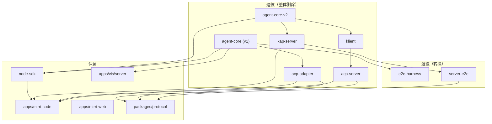

# Rust Core 架构迁移 — Phase 4: TypeScript Engine 退役设计

> **文档类型：计划类**（按 `docs/specs/AGENTS.md` 治理约定）——可随执行推进更新状态；设计主体见 [../00-overview.md](../00-overview.md) 与 [../01-protocol-unification.md](../01-protocol-unification.md)，跨阶段状态汇总见 [../ROADMAP.md](../ROADMAP.md)。
> **范围修订（ADR-001，2026-10-12）**：退役范围已从「TS 引擎」扩大为「整个 TS CLI 面」——除下文清单中的引擎/ACP 包外，TS CLI 应用（含终端 TUI）、TS SDK 包装（node-sdk）、NAPI 绑定桥（mirri-node）一并退役，不做「TS 前端保留在 NAPI 上」的过渡形态，详见 [../00-overview.md](../00-overview.md) §7 ADR-001。下文 §1 表格与 §3–§5 中「保留 apps/mirri-code / node-sdk」及一切为 TS 前端服务的转换项（e2e-harness fixture 换 rust、node-sdk 测试重写、vis 迁移、引擎路由/NAPI 加载）按删除项理解；klient 契约真源先行迁移的前置不变。**新增硬前置：Rust 二进制先完成分发接管（ROADMAP 2.5），desktop 后端先切 Rust 二进制（1.11 ②），再执行删除。** 计划正文将随执行批次按新范围重写。
> **路线裁决（持久）**：klient 的 `src/contract/` 是 TS 契约 schema 唯一源（`KLIENT_RESPONSE_SCHEMAS` 被 contract-e2e fixture 依赖）——退役顺序必须"先迁契约真源（ts-rs/schemars 生成或独立成包）→ fixture 改造 → 才可删 klient 其余部分"；方法目录以 mirri-proto 注册表为准，MCP 域以 [docs/specs/mcp-architecture.md](../../mcp-architecture.md) 为准。

> 状态: Draft
> 日期: 2026-08-29
> 作者: Architecture Team
> 关联文档: [00-overview.md](../00-overview.md)（总体设计）

## 1. 退役目标

Phase 2（Web on Rust）与 Phase 3（TUI + ACP on Rust）完成后，TypeScript 引擎代码路径不再是任何生产流量的运行时依赖。本阶段的目标是**将 TS 引擎代码从仓库中整体移除，使仓库的 TypeScript 面收敛为「前端 + SDK + 工具包」**：

| 类别 | 保留的 TS 包 | 退役的 TS 包 |
|------|-------------|-------------|
| 前端 | `apps/mirri-code`（TUI，NAPI binding → Rust）、`apps/mirri-web`（Web UI，WS → Rust server） | — |
| SDK | `packages/node-sdk`（包装 NAPI binding） | — |
| 引擎 | — | `packages/agent-core`（v1）、`packages/agent-core-v2`（v2）、`packages/kap-server`（v2 server）、`packages/klient`（in-memory facade） |
| ACP | — | `packages/acp-adapter`（v1 ACP host）、`packages/acp-server`（v2 ACP host） |
| 测试基础设施 | `packages/e2e-harness`（转换后）、`packages/server-e2e`（转换后） | `packages/server`（v1 server，已在更早阶段移除） |
| 工具/抽象 | `packages/kosong`、`packages/kaos`、`packages/telemetry`、`packages/api-shared`、`packages/protocol` 等（`packages/oauth`、`packages/kimi-code-oauth` 原列于此，已于 2026-10-13 删除，见修订注记） | — |

> **修订注记（2026-09-04）**：退役清单核对——`packages/server` 已删除（✅）；`agent-core`、`agent-core-v2`、`kap-server`、`klient`、`acp-adapter`、`acp-server` 仍在仓（保留原分析）。
>
> **修订注记（2026-10-13）**：`packages/oauth`（`@mirri-ai/mirri-code-oauth`）与 `packages/kimi-code-oauth`（`@mirri-ai/v2-oauth`）已随 managed login 退役先行删除（早于本阶段 §3.10 的原定 Phase 4.5 复查）；下文 §3.2/§3.8 依赖描述中的对应条目已同步移除。

退役后，**「agent 引擎」这个概念的实现只存在于 `rust/crates/` 一个地方**：

- TUI：`apps/mirri-code` → `packages/node-sdk` 的 Rust harness（NAPI binding）→ `rust/crates/mirri-core`
- Web：`apps/mirri-web` → WS/REST → `rust/crates/mirri-server`
- ACP：`mirri acp` → Rust binary 直接实现 ACP host
- 测试：Rust 侧 `rust/crates/mirri-test-harness` 为主

**不在本阶段范围**（见 §3.10「保留但需复查」）：`packages/agent-profile`、`packages/minidb`、`packages/transcript`、`packages/tree-sitter-bash`、`packages/oauth`。这些包的主要消费者是 TS 引擎；引擎删除后若仓库内无消费者，应在后续小阶段（Phase 4.5）逐一退役，避免与本次大删除混在一个 commit 里。

## 2. 退役前置条件

以下条件**全部满足**后才允许执行 §3 的删除。每项给出验证方式。

### 2.1 Checklist

| # | 前置条件 | 验证方式 |
|---|---------|---------|
| 1 | **Phase 2 完成**：Web 100% 运行在 Rust server（`rust/crates/mirri-server`）上，`mirri web` 不再 boot `kap-server` | `git grep -n "kap-server" apps/mirri-web apps/mirri-code/src/cli/sub/web` 无结果（除注释）；Web e2e 全绿且跑的是 Rust server 进程 |
| 2 | **Phase 3 完成**：TUI 走 NAPI binding（`createMirriHarnessRust()` + `SDKRpcClientRust`），ACP 走 Rust binary（`mirri acp`） | TUI functional tests 全绿；ACP conformance tests 全绿，测试日志确认进程为 Rust binary；`rust/crates/mirri-*` 中 NAPI binding 产物可在 `apps/mirri-code` 与 `packages/node-sdk` 中正常加载 |
| 3 | **全部 e2e 通过 Rust engine**：TUI functional、Web e2e、ACP conformance、wire golden 均不依赖 TS engine | `pnpm test`、`pnpm test:e2e`（过滤掉即将删除的包）、`cargo test --workspace` 全绿；`packages/e2e-harness` 的 golden 用例在 Rust server 上原样通过（wire 兼容性证明） |
| 4 | **无生产使用 TS engine**：无外部流量打到 kap-server；无部署配置设置 `MIRRICODE_LEGACY_FLAG`；node-sdk 的消费者只有仓库内前端 | 检查 telemetry 面板（kap-server 进程数为 0）；`git grep -rn "MIRRICODE_LEGACY_FLAG" -- ':!*.md'` 仅剩仓库内代码引用；与发布负责人确认灰度/生产配置 |
| 5 | **应急回滚开关 `MIRRICODE_RUST_ENGINE` 已可用**（见 §2.2） | 启动 commit（bootstrap）已合入，`MIRRICODE_RUST_ENGINE=ts` / `=rust` 两条路径在 CI 中均验证过 |
| 6 | **TS engine 进入冻结态**：自本阶段起不再向 `agent-core*`/`kap-server` 合入新功能，只接受阻塞性 bug 修复（且修复需同时落到 Rust 侧） | 代码评审约定 + AGENTS.md 记录 |

### 2.2 `MIRRICODE_RUST_ENGINE` 开关的引入顺序（关键）

仓库现状已有引擎开关 `MIRRICODE_RUST_ENGINE`（`apps/mirri-code/src/cli/experimental-v2.ts`，优先级 `MIRRICODE_RUST_ENGINE` > v2 默认 > v1；2026-09-04 已落地）。原规划要求开关**分两步引入**（bootstrap 侧已实际完成；退役 commit 的剩余动作为默认值翻转与快速失败），两步计划保留如下：

1. **启动 commit（bootstrap，先于删除合入）**：在 `apps/mirri-code` 的引擎路由处新增 `MIRRICODE_RUST_ENGINE` 环境变量，取值 `ts | rust`：
   - `MIRRICODE_RUST_ENGINE=ts`（**bootstrap 阶段默认值**）：等价于现状，走 `createMirriHarnessV2()`（in-memory RPC → `agent-core-v2`）；
   - `MIRRICODE_RUST_ENGINE=rust`：走 `createMirriHarnessRust()`（NAPI binding）。
   - `MIRRICODE_LEGACY_FLAG` 语义并入 `MIRRICODE_RUST_ENGINE`（`LEGACY_FLAG=1` 等价于 `ENGINE=ts`，bootstrap 阶段短暂双写兼容，退役 commit 中删除）。
2. **退役 commit**：默认值翻转为 `MIRRICODE_RUST_ENGINE=rust`；`=ts` 分支保留但改为**快速失败**——打印明确的错误信息（指向回滚流程）而不是静默降级，防止「以为在用 Rust 实际跑的是 TS」的假绿。

> 为什么 `=ts` 在退役后不能继续工作：引擎包已物理删除，TS 路径无法运行。保留该分支的意义是**语义清晰 + 回滚后立刻可用**（`git revert` 恢复全部代码与包后，`MIRRICODE_RUST_ENGINE=ts` 即回到 bootstrap 状态，无需额外改动）。回滚窗口结束后（§10），`MIRRICODE_RUST_ENGINE` 整体移除。

### 2.3 提交切分（重要）

退役工作拆成两个可独立 revert 的 commit，回滚精度更高：

- **Commit A — bootstrap**：`MIRRICODE_RUST_ENGINE` 开关 + Rust 路径补齐 + 双路径 CI。
- **Commit B — retirement**：包删除 + 代码清理 + workspace/flake/CI/文档更新 + 默认值翻转。

回滚时 `git revert B` 即回到「双引擎并存、默认 ts」；若需彻底放弃则 `git revert B A`。两个 commit 的 SHA 记入发布说明。

## 3. 删除清单

除特别说明外，删除动作 = `git rm -r packages/<name>` + 清依赖方引用（每节列出）。**发布状态提醒**：删除前检查各包 `package.json` 的 `publishConfig`；若已发布到 npm，需先发布一个最终的 deprecated 版本（npm `deprecate`），再执行仓库内删除。

### 3.1 `packages/agent-core`（v1 引擎）— 整体删除

- 职责：v1 agent 引擎（`MIRRICODE_LEGACY_FLAG=1` 时被 TUI 加载），依赖 `agent-profile`、`kaos`、`kosong`、`protocol`、MCP SDK、`node-pty` 等。
- 依赖它的包（需同步更新）：
  - `packages/acp-adapter`（runtime dep）→ 随本清单删除（§3.5）
  - `packages/e2e-harness`（runtime dep，`@mirri-ai/agent-core` 用于 engine fixture）→ 按 §3.8 转换
  - `packages/node-sdk`（devDep，测试用）→ 删除 devDep，测试改用 Rust harness（§5.2）
  - `apps/vis/server`（runtime dep `@mirri-ai/agent-core`，`apps/vis/package.json` 的 `build:deps` 也引用）→ 见 §4.5，**这是当前被遗漏的消费者，必须处理**

### 3.2 `packages/agent-core-v2`（v2 引擎）— 整体删除

- 职责：v2 DI × Scope 引擎，当前默认引擎；依赖 `agent-profile`、`minidb`、`protocol`、`tree-sitter-bash`、MCP SDK 等。
- 依赖它的包：
  - `packages/kap-server`（runtime）→ 随本清单删除（§3.3）
  - `packages/klient`（runtime）→ 随本清单删除（§3.4）
  - `packages/acp-server`（runtime）→ 随本清单删除（§3.6）
  - `packages/node-sdk`（devDep，测试用）→ 删除 devDep（§5.2）

### 3.3 `packages/kap-server`（v2 server，REST + WS）— 整体删除

- 职责：Web 的 REST + WebSocket 服务端（Fastify），`mirri web` 在 Phase 2 之前 boot 它。Phase 2 后该角色由 `rust/crates/mirri-server` 承担。
- 依赖它的包：
  - `apps/mirri-code`（devDep `@mirri-ai/kap-server`）→ 删除 devDep；`mirri web` 改 spawn Rust server（§5.4）
  - `packages/server-e2e`（其 `docker:e2e` 脚本 boot kap-server 容器）→ §3.7 转换后指向 Rust server
  - 根 `package.json` 的 `test:e2e` 脚本（显式列出 `packages/kap-server`）→ 移除
  - `apps/mirri-code` 的 `scripts/dev-server-restart.mjs`、`dev:kap-server:multi` / `MIRRICODE_EXPERIMENTAL_MULTI_SERVER` / `MIRRICODE_DEV_SERVER` 等 kap-server 时代脚本与环境变量 → 审计清理（§5.5）
  - `apps/vis`（如依赖 kap-server 做数据源）→ 见 §4.5

### 3.4 `packages/klient`（TS 契约 schema 唯一源）— 处置改写

- **修订（2026-09-04）**：原规划「in-memory RPC facade、唯一消费者 `acp-server`、整体删除」已过时——`packages/klient` 的 `src/contract/` 现为 **TS 契约 schema 唯一源**（`KLIENT_RESPONSE_SCHEMAS` 被 contract-e2e fixture 依赖），不能作为整体删除处理。
- **退役顺序必须改为**：第一步先把契约真源迁出（方案 A：mirri-proto 注册表经 ts-rs/schemars 生成 TS 契约；方案 B：契约独立成包）；确认 contract-e2e fixture 改造完成（不再依赖 klient 的 schema）后，才可删除 klient 其余部分。
- 其余历史分析（原 in-memory facade 角色）：在 agent-core-v2 之上的 in-memory RPC facade，唯一消费者是 `packages/acp-server`（runtime）。
- 依赖它的包：`packages/acp-server`（随删除）、`packages/node-sdk`（devDep，测试用）。

### 3.5 `packages/acp-adapter`（v1 ACP host）— 整体删除

- 职责：v1 ACP host，基于 `@agentclientprotocol/sdk@^0.23` + `agent-core`（v1）。
- 依赖它的包：
  - `apps/mirri-code`（devDep `@mirri-ai/acp-adapter`）→ 删除 devDep；`mirri acp` 的 legacy 分支（`src/cli/sub/acp-legacy.ts`）随 §5.3 删除
  - 根 `package.json` `test:e2e` 显式列出 `packages/acp-adapter` → 移除
  - ACP conformance 测试资产若挂在 adpater 下 → 迁移到 Rust ACP host 测试（§5.3）

### 3.6 `packages/acp-server`（v2 ACP host）— 整体删除

- 职责：v2 ACP host，`@agentclientprotocol/sdk@^1.3` + `agent-core-v2` + `klient`。Phase 3 后由 Rust binary 的 `mirri acp` 命令替代。
- 依赖它的包：
  - `apps/mirri-code`（devDep `@mirri-ai/acp-server`）→ 删除 devDep；`src/cli/sub/acp.ts` 改 spawn Rust binary（§5.3）
  - 根 `package.json` `test:e2e` → 移除
  - 其 conformance 测试 → 迁移到 Rust 侧（§9）

### 3.7 `packages/server-e2e`（wire-level e2e client）— **转换而非删除**

- 职责：HTTP + WS wire-level e2e 客户端（依赖仅 `@mirri-ai/protocol` + `ws` + `ulid`，**不依赖任何引擎包**），驱动 scenario 脚本对真实 server 进程做黑盒测试。
- 转换动作：
  - 保持包名与 wire client 代码不变——这正是它的价值：REST/WS 协议由 Rust server 保持兼容（Phase 2 验收），客户端无需改动；
  - `scripts/run-scenarios.ts` / `scripts/run-docker-e2e.sh` 的 boot 目标从 kap-server 换成 `rust/crates/mirri-server` 的构建产物（或镜像）；
  - 依赖清理：`@mirri-ai/protocol` 保留（继续共享 wire schema）。
- 依赖它的包：无（仅 CI 与 scenario 脚本使用）。

### 3.8 `packages/e2e-harness`（共享 e2e 基础设施）— **转换而非整体删除**

- 职责：fake LLM server、engine fixture、wire record golden 快照（依赖 `@mirri-ai/agent-core`（v1）、`kosong`、`mirri-code-sdk`）。
- 转换动作：
  - **保留**：fake LLM server、golden 文件与 golden-consistency 测试（wire 兼容性的核心证明，§9）；
  - **替换**：以 `@mirri-ai/agent-core` 为底的 engine fixture 替换为 Rust harness fixture（`createMirriHarnessRust()` / `rust/crates/mirri-test-harness` 的 TS 侧包装）；
  - 依赖更新：删除 `@mirri-ai/agent-core`，若 `kosong`/`mirri-code-oauth` 不再被使用则一并删除；
  - golden 文件本身是**历史 wire 数据**，内容中出现旧服务名字符串（如 `kap-server`）属正常，不在 §11 的 grep 验收范围内。
- 依赖它的包：`acp-adapter`（devDep，随删除）、`kap-server`（devDep，随删除）、`node-sdk`（devDep，保留）。

### 3.9 `packages/server`（v1 server）— 已删除 ✅（2026-09-04 确认），无需动作

早前阶段已退役。相关遗留：`apps/mirri-code/src/cli/sub/server/index.ts` 中的 `mirri server` deprecation shim 与 `web/legacy-kill.ts`（清理 pre-0.28.0 daemon 的 `server kill`）在本阶段一并删除（§5.4）。

### 3.10 保留但需复查（Phase 4.5 候选）

| 包 | 现状消费者 | 复查动作 |
|----|-----------|---------|
| `packages/agent-profile` | 仅 `agent-core`、`agent-core-v2`、`kap-server`（其描述自述 shared by both engines） | 删除后 grep 全仓；若 Rust 侧已自实现 agent profile 解析，则 Phase 4.5 删除 |
| `packages/minidb` | `agent-core-v2`、`kap-server` | 同上 |
| `packages/transcript` | `kap-server` | 同上 |
| `packages/tree-sitter-bash` | `agent-core-v2` | 同上 |
| ~~`packages/oauth`（`@mirri-ai/v2-oauth`）~~ | —（已无消费者） | ✅ **已删除（2026-10-13，managed login 退役）**——原定「若 OAuth 未在 Rust 重实现则保留（如 `mirri-auth` crate 已覆盖则删除）」的条件裁决已落地为删除 |
| `packages/kosong` | `agent-core`、`e2e-harness`、`node-sdk`(dev) | 用户明确「may still be needed for TS-side provider adapters」→ 保留；若 e2e-harness 转换后无 TS 消费者则 Phase 4.5 评估 |
| `packages/kaos` | `agent-core`、`acp-adapter`、`node-sdk`(dev) | 同上 |
| `packages/protocol` | `kap-server`、`acp-server`、`server-e2e`、`node-sdk`(dev) 等 | 保留（`server-e2e` 仍依赖）；若 Rust 侧 schema 完全接管后可评估 |

## 4. 依赖链分析

### 4.1 依赖关系图（现状）



### 4.2 逐条处理

| 依赖 | 处理 |
|------|------|
| `node-sdk` ← `agent-core-v2`（devDep） | 删除 devDep；引擎能力改为 NAPI binding（`SDKRpcClientRust`，见 §5.2）。注意：node-sdk 对 TS 引擎的依赖在 **devDependencies**（测试用），运行时依赖面本就只含通用工具——退役后运行时 = NAPI binding |
| `node-sdk` ← `agent-core` / `klient` / `e2e-harness`（devDeps） | 全部删除 / 按 §3.8 转换后保留 |
| `apps/mirri-code` ← `node-sdk` | **无直接变更**——TUI 通过 SDK 抽象（`MirriHarness` 类型面）访问引擎，SDK 内部换成 Rust harness 后 TUI 调用点不变（§5.1 的哲学） |
| `apps/mirri-code` ← `kap-server` / `acp-adapter` / `acp-server`（devDeps） | 删除三个 devDep；`mirri web` 改 spawn Rust server，`mirri acp` 改跑 Rust binary |
| `apps/mirri-web` ← 引擎 | **无变更**——mirri-web 自行 re-implement wire types（`src/api/types.ts`、`src/api/daemon/wire.ts`），只通过 REST/WS 与 server 通信，仓库内 grep 到的 `kap-server` 字样仅为类型/注释残留，逐一确认后清理即可 |
| `acp-server` ← `agent-core-v2` + `klient` | 随包整体删除（§3.6） |
| `e2e-harness` ← `agent-core`（v1） | engine fixture 替换为 Rust harness fixture（§3.8） |
| `apps/vis/server` ← `agent-core` | **必须处理（易被遗漏）**：vis 是开发者可视化工具，`apps/vis/server/package.json` 直接 runtime 依赖 `@mirri-ai/agent-core`。两条路线：① 迁移到 `@mirri-ai/mirri-code-sdk` 的 `createMirriHarnessRust()`（改动最小）；② 若 vis 仅消费 wire 数据，改用 `server-e2e` 式 wire client 连 Rust server。推荐 ①，由 vis owner 在 Commit A 内完成 |
| `apps/vis` ← `@mirri-ai/agent-core...`（`build:deps`） | 同步更新构建脚本 |
| `server-e2e` ← `kap-server`（docker 脚本） | boot 目标换 Rust server（§3.7） |
| 根 `package.json` ← 引擎包 | `test:e2e` 移除 `packages/acp-adapter`、`packages/kap-server`；`sherif -i @agentclientprotocol/sdk` 在 SDK 离开依赖树后去掉 `-i`；`postinstall`（`fix-node-pty-perms.mjs`）在 `node-pty` 无消费者后移除（需先确认 `apps/mirri-code` 自身不再用 node-pty） |

### 4.3 workspace 层面的依赖

- `pnpm-workspace.yaml` 用的是 `packages/*` glob（**没有显式包列表**），因此「删除」是物理删除目录，workspace 文件本身无需编辑；但 `pnpm-lock.yaml` 必须随 `pnpm install` 重新生成。
- `flake.nix` 是**显式双列表**（`workspacePaths` + `workspaceNames`，文件内有 HARD REQUIREMENT 注释）：必须同步删掉 8 个 path 与 7 个 name（`server-e2e` 本就不在 name 列表，属既有不一致，顺带修正），并更新 `pnpmDeps` 的 `fetchPnpmDeps` hash（见 §6）。
- `apps/vis` 的 `build:deps` 使用 `pnpm --filter @mirri-ai/agent-core...` 语法 → 替换为对新依赖的 filter。

## 5. 代码清理

原则：**删除前先保证 `MirriHarness` 类型面不动**——TUI 与 node-sdk 对外 API 的调用点只换实现、不换签名，把本次变更的爆炸半径压在 SDK 内部与 CLI 引擎路由处。

### 5.1 移除引擎开关逻辑（`apps/mirri-code/src/cli/`）

- **删除 `experimental-v2.ts`**：`MIRRICODE_LEGACY_ENV` / `isLegacyEnabled()` / `isV2Enabled()` / `createHarnessForEngine()` 全部移除。由新的最小路由文件（如 `engine.ts`）取代，仅保留 §2.2 的 `MIRRICODE_RUST_ENGINE` 判定 + 快速失败分支。
- 全仓 grep `createHarnessForEngine|isLegacyEnabled|isV2Enabled|MIRRICODE_LEGACY_FLAG`（命中文件：`src/cli/sub/acp.ts`、`acp-legacy.ts`、`experimental-v2.ts` 及一组 `test/cli/*.test.ts`）→ 逐一改为直接调用 `createMirriHarnessRust()` 或删除对应分支。

### 5.2 node-sdk：v1/v2 客户端退役，落地 Rust harness（`packages/node-sdk/src/`）

| 文件 / 目录 | 动作 |
|------------|------|
| `src/mirri-harness.ts`（`createMirriHarness`，v1） | 删除 |
| `src/sdk-rpc-client.ts`（`SDKRpcClient`，v1） | 删除 |
| `src/sdk-rpc-client-v2.ts`（`SDKRpcClientV2`，77KB，v2 in-memory RPC client） | 删除 |
| `src/v2/`（`session-wiring.ts`、`event-mapper.ts`、`config-mapper.ts`、`session-mapper.ts`、`resume-replay.ts`） | 整目录删除（v1/v2 事件与状态映射逻辑，Rust 侧不再需要） |
| `src/rpc.ts`（`createRPC()`，v1/v2 共享的 in-memory RPC 核心） | 若仅被上述客户端使用 → 删除；被 Rust harness 复用（如协议信封类型）→ 保留必要部分 |
| `src/rust-harness.ts`（已交付 2026-09-04） | `createMirriHarnessRust()`：NAPI binding 之上的 harness 工厂，实现同一 `MirriHarness` 类型面。**修订：`createMirriHarnessRust` / `SDKRpcClientRust` 已存在（`packages/node-sdk`），不再属 Commit A 交付物**（Commit A 剩余为开关引入收尾与默认值翻转） |
| `src/sdk-rpc-client-rust.ts`（已交付 2026-09-04） | `SDKRpcClientRust`：NAPI binding 客户端（已存在，不再属 Commit A 交付物）。binding 加载机制复用 `apps/mirri-code/src/native/` 已落地的通路（`native-require.ts` / `native-assets.ts` / `module-hook.ts`），node-sdk 与 TUI 共用同一 native 资产 |
| `src/index.ts` | 导出面：移除 v1/v2 工厂与客户端，导出 `MirriHarness`/`MirriHarnessOptions`（类型别名保持，兼容 TUI 调用点）+ Rust 工厂 |
| `test/` | `test/v2/*`（config-wiring、session-mutations、event-mapper、command-rpc 等）删除或改写为 Rust harness 语义下的等价用例；其余基于 `MirriHarness` 的测试改注入 `createMirriHarnessRust()` |
| `package.json` | devDependencies 移除 `agent-core`、`agent-core-v2`、`klient`；按需新增 NAPI binding 依赖（与 `apps/mirri-code` 的 native 资产通路一致，见 Phase 3 交付） |
| `examples/` | `mirri-harness-*.ts` 示例改为 Rust harness 版本；删除仅演示 v1/v2 行为的示例 |

### 5.3 ACP 命令：TS host 移除（`apps/mirri-code/src/cli/sub/`）

- 删除 `acp-legacy.ts`（v1 路径）与 `acp.ts` 中的 TS host 分支；`mirri acp` 改为 spawn Rust binary（Phase 3 交付的 `mirri acp` 原生命令）。
- `test/cli/acp.test.ts`：进程断言目标从 `packages/acp-server`（或 adapter）换成 Rust binary；conformance 用例迁至 Rust 侧测试目录。
- 删除 `@mirri-ai/acp-adapter`、`@mirri-ai/acp-server` 两个 devDep。

### 5.4 `mirri server` / `mirri web` deprecation shim（`apps/mirri-code/src/cli/sub/server/`）

- **删除 `server/index.ts` 中的 `registerDeprecatedServerCommand` 整棵 v1 shim**（`mirri server` 报错退出 + `server kill` 旧 daemon 清理 `web/legacy-kill.ts`）：到 Phase 4 时 pre-0.28.0 daemon 已无存在可能。
- `registerWebCommand` 从 `sub/server/` 挪到其真正的归属 `cli/sub/web.ts`（`cli/commands.ts` 的注册调用同步更新）；`web/` 目录下 `deprecated-server.*` 删除。
- `mirri web` 的内容改为启动 Rust server（`rust/crates/mirri-server`，进程生命周期管理复用 Phase 2 的 spawn 逻辑）。

### 5.5 kap-server 时代脚本与环境变量

- `apps/mirri-code/package.json`：删除 `dev:kap-server:multi`（`MIRRICODE_EXPERIMENTAL_FLAG`、`MIRRICODE_EXPERIMENTAL_MULTI_SERVER`）、`MIRRICODE_DEV_SERVER` 相关脚本；`dev:server` 指向 Rust server。
- `scripts/dev-server-restart.mjs`、`scripts/dev.mjs`、`scripts/smoke.mjs`、`scripts/copy-web-assets.mjs`：审计其中 kap-server 引用并更新。
- 根 `package.json`：`test:e2e` 移除已删包；`postinstall` 与 `sherif -i` 按 §4.2 处理。

## 6. pnpm-workspace 与 flake.nix 更新

### 6.1 `pnpm-workspace.yaml`

- 无显式包条目（glob `packages/*`），**无需编辑文件本身**。
- 审视 `overrides`（`ssh2@1.17.0>cpu-features`、`ssh2@1.17.0>nan`）：若 `ssh2` 仅随引擎依赖树进入，删除后应移除对应 override 并跑 `pnpm install` 验证。
- **必须执行**：`pnpm install` 重新生成 `pnpm-lock.yaml`——这是「workspace 不再列出退役包」的落地形式。

### 6.2 `flake.nix`

| 列表 | 删除条目 |
|------|---------|
| `workspacePaths` | `./packages/acp-adapter`、`./packages/acp-server`、`./packages/agent-core`、`./packages/agent-core-v2`、`./packages/e2e-harness`、`./packages/server-e2e`、`./packages/kap-server`、`./packages/klient`（共 8 条） |
| `workspaceNames` | `"@mirri-ai/acp-adapter"`、`"@mirri-ai/acp-server"`、`"@mirri-ai/agent-core"`、`"@mirri-ai/agent-core-v2"`、`"@mirri-ai/e2e-harness"`、`"@mirri-ai/kap-server"`、`"@mirri-ai/klient"`（共 7 条；`server-e2e` 本就缺失，属既有不一致） |

- **`pnpmDeps` hash 必变**：`fetchPnpmDeps` 的 `hash` 由 lockfile 内容决定。更新方式：改完以上列表后 `nix build .#mirri-code`，从报错信息复制 `got: sha256-...` 回填。
- 顺带修正既有重复行（`./apps/mirri-web` 在 `workspacePaths` 中出现两次）。
- 同步更新文件头部「kept in sync with pnpm-workspace.yaml」注释的说明（glob 物理删除 vs 显式列表差异）。

## 7. CI 更新

### 7.1 移除的 TS engine 测试面

- 根 `package.json` `test:e2e` 中的 `packages/acp-adapter`、`packages/kap-server`。
- 任何直接对 `agent-core*` / `klient` / `acp-server` 跑 vitest 的 job 或脚本。
- `packages/server-e2e` 的 `docker:e2e`（kap-server 镜像）→ 换 Rust server 镜像/二进制。

### 7.2 新增/调整的 Rust engine 测试面

| Job | 内容 | 平台 |
|-----|------|------|
| `rust-engine`（ci.yml 新增，或独立 `rust-ci.yml`） | `cargo test --workspace`、`cargo clippy --workspace -- -D warnings`、`cargo fmt --check`；含 `mirri-test-harness` 与 ACP conformance 用例 | ubuntu + macos + windows（windows 至少跑测试；native 构建受限的 job 显式 skip） |
| `e2e`（改造） | `pnpm test:e2e` 全量跑 Rust 路径：TUI functional（`MIRRICODE_E2E=1`）、Web e2e vs Rust server、wire golden、ACP conformance | ubuntu |
| `native-build`（保留 `_native-build.yml`） | NAPI binding + SEA 原生构建；这是退役后引擎的唯一构建通路，升级为必过 job | linux x64/arm64、macos arm64（windows x64 视 NAPI 支持矩阵） |
| 新增 benchmark 门禁 | TUI cold start < 500ms（§9.4、§11） | 至少 linux |

- `nix-build.yml` 与退役 commit **同 commit 落地**（flake 不同步必挂），CI 顺序上 nix 构建依赖 §6.2 先行完成。
- `desktop-build.yml` / `release.yml`：审计是否间接引用已删包（如 `pnpm -r run build` 语义变化），调整 filter。

## 8. 文档更新

| 文档 | 更新内容 |
|------|---------|
| `AGENTS.md` | 架构总览从「TS 引擎 + Rust 迁移中」改为「Rust 唯一引擎」；删除 `MIRRICODE_LEGACY_FLAG` 说明，新增 `MIRRICODE_RUST_ENGINE`（含 2 周回滚窗口内语义）；更新测试/构建指引；更新「TS 引擎冻结」约定（§2.1-6） |
| `README.md` / `README.zh-CN.md` | 架构段落、快速开始、开发指引中的引擎描述 |
| `docs/` | 架构文档、daemon 协议文档中 kap-server/agent-core 相关章节改写为 Rust server/Rust core；确认与 Phase 2/3 文档一致 |
| `.tmp/rust-core-design/00-overview.md` | 状态改为 Phase 4 完成后的最终形态，表格与技术债清单更新 |
| `packages/node-sdk/README.md` | harness API 文档：`createMirriHarness`/`createMirriHarnessV2` → `createMirriHarnessRust` |
| `CONTRIBUTING.md` | 开发命令与引擎环境变量说明 |
| changelog | 各保留包补一条 breaking change 记录（node-sdk 尤其需要）；发布 release note 标注 phase 4 退役清单 |

## 9. 回归测试

退役 commit 合并前，以下**全部**在 CI 全绿 + 本地抽样通过：

### 9.1 TUI functional tests

- `pnpm -C apps/mirri-code test`（vitest）与 `pnpm -C apps/mirri-code e2e`（`MIRRICODE_E2E=1`）——全部跑在 NAPI binding 上，**测试进程内不得再出现 `agent-core-v2`**（用 `git grep` 与依赖树双重确认）。
- 用例面：session 生命周期、prompt/goal/plan、permission/approval、hook/skill、MCP、export/cancel/steer、login。

### 9.2 Web UI e2e

- `apps/mirri-web` 的 e2e（playwright）连 **Rust server**：REST（`/api/v1/*`）+ WS 全链路；`packages/server-e2e` scenario 脚本原样跑通 = wire 兼容性证明。

### 9.3 ACP conformance + Rust 全量

- ACP conformance suite（迁移后位于 Rust 侧）在 `mirri acp` 原生 binary 上全绿。
- `cargo test --workspace` 全绿（Phase 3 基线 3040 个测试不回归——修订 2026-09-04：实测 `cargo test --workspace` 3040 passed）。

### 9.4 跨平台矩阵

- **Linux**（x86_64 + aarch64）：cargo 全量、TUI functional、native build、nix build。
- **macOS**（arm64 + x64）：cargo 全量、TUI functional、native build（SEA）、ACP。
- **Windows**（x64）：cargo 测试、TUI functional、ACP；native 构建按 NAPI 支持矩阵执行。
- 性能：TUI cold start 三平台各测一次（hyperfine，`-w 3 -r 10`），记录到 `reports/`，作为 §11 的 < 500ms 凭证。

### 9.5 一致性检查

- `pnpm sherif` 通过（monorepo 依赖一致性）；`pnpm install --frozen-lockfile` 通过。
- golden wire 用例（e2e-harness）在 Rust server 上结果不变。

## 10. 回滚方案

### 10.1 窗口与触发条件

- **时间窗口：退役 commit 合入后 2 周**。期间保留 `MIRRICODE_RUST_ENGINE` 开关与 §2.3 的 commit 边界，不执行 Phase 4.5。
- 触发条件（满足任一）：仅 Rust 路径可复现的 P0/P1 缺陷（数据丢失、会话损坏、安全漏洞）；Web/ACP 与 TS 基线存在功能不对等且无 workaround；某受支持平台 native 构建/运行失败且 48h 内无法修复。

### 10.2 回滚步骤

```bash
# 1. 以新 commit 形式 revert（保留历史，不 reset）
git revert <Commit-B-SHA>          # 恢复全部 TS 包 + 代码 + workspace/flake/CI 变更

# 2. 重装 TS engine 包（revert 恢复了 lockfile 与 pnpm-workspace、flake）
pnpm install --frozen-lockfile
pnpm run build

# 3. 显式切回 TS 引擎（双保险：revert 后默认值已回到 bootstrap 阶段的 ts，此步显式声明）
export MIRRICODE_RUST_ENGINE=ts

# 4. 验证
pnpm test && pnpm test:e2e        # 关键用例（TUI functional + Web e2e + ACP）
```

- 若确定放弃本次退役：`git revert <Commit-A-SHA>`（回到双引擎并存、默认 ts 的基线）。
- 回滚后 48h 内完成事故复盘，产出修复清单，再以新 commit 重新发起退役（**禁止在回滚状态下直接改代码混入**）。

### 10.3 窗口结束

- 2 周无触发事件 → 合入收尾 commit：移除 `MIRRICODE_RUST_ENGINE`（含快速失败分支）、清理本文 §5 中所有遗留兼容代码、Phase 4.5 复查项开始执行。
- 释放说明：发布 release note 中标注「应急回滚开关已移除」。

## 11. 验收标准

| # | 标准 | 验证命令 |
|---|------|---------|
| 1 | `pnpm-workspace.yaml` 不再列出退役包（glob 语义下 = 包目录物理不存在） | `ls packages/` 无 6 个引擎包 + 已转换测试包；`pnpm list -r --depth -1 \| grep -E "agent-core\|kap-server\|klient\|acp-(adapter\|server)"` 为空 |
| 2 | `flake.nix` 已更新（paths + names + pnpmDeps hash） | `nix flake check` 通过；`nix build .#mirri-code` 成功 |
| 3 | `pnpm install --frozen-lockfile` 在无退役包时成功 | 命令退出码 0；`pnpm sherif` 通过 |
| 4 | 全部测试通过 | `cargo test --workspace`、`pnpm test`、`pnpm test:e2e`、ACP conformance、跨平台矩阵（§9.4）全绿 |
| 5 | TUI cold start < 500ms | hyperfine 结果（三平台，`reports/` 留档）< 500ms |
| 6 | 代码库无退役包引用（grep 干净） | `git grep -nE "@mirri-ai/(agent-core|agent-core-v2|kap-server|klient|acp-adapter|acp-server)|createMirriHarnessV2|SDKRpcClientV2|MIRRICODE_LEGACY_FLAG|experimental-v2" -- apps packages rust ':!**/*.md' ':!packages/e2e-harness/golden/**' ':!packages/e2e-harness/reports/**'` 为空（golden 为历史 wire 数据，豁免；`server-e2e`/`e2e-harness` 转换后保留的包名不算违规引用） |
| 7 | 文档已更新 | AGENTS.md、README、README.zh-CN、docs/、00-overview.md 中无「TS 引擎为默认引擎」表述；`MIRRICODE_RUST_ENGINE` 说明与实际行为一致 |
| 8 | 引擎代码单一来源 | `rust/crates/` 是仓库内唯一 agent 引擎实现；`apps/mirri-code` 与 `apps/mirri-web` 无任何 TS 引擎 import（`git grep` 确认） |

## 附：执行顺序摘要

1. **Commit A（前置）**：`MIRRICODE_RUST_ENGINE` 开关（默认 ts）+ `createMirriHarnessRust`/`SDKRpcClientRust` 落地 + vis 迁移 + 双路径 CI 验证 → §2 全部打勾。
2. **Commit B（退役）**：§3 删除清单 → §5 代码清理 → §6 workspace/flake → §7 CI → §8 文档 → §9 回归 → 默认值翻转为 `rust`。
3. 合入后进入 §10 的 2 周回滚窗口；满期执行收尾 commit。
