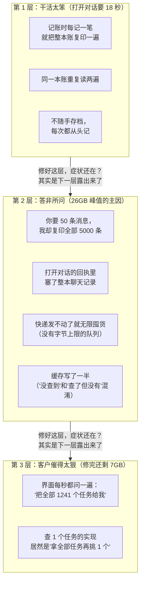
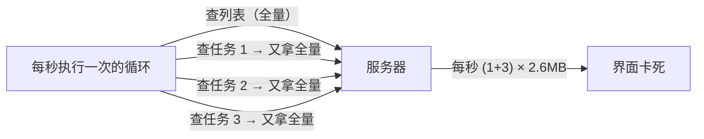
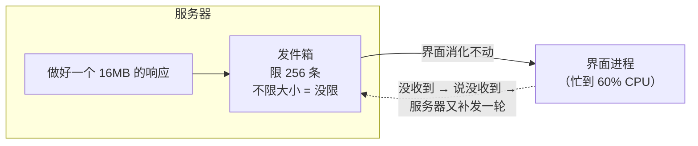

# 服务端内存最佳实践 — 从一次 26GB 内存事故中学到的事

> **这是一个真实故事**：2026 年 10 月，我们的 AI 编程助手桌面版出了个怪事——用户只是打开几个对话，服务器进程的内存就冲到 **26GB**（一台普通笔记本的全部内存），整个应用卡死。
>
> 我们花了三天、分三批才修干净。不是修了三次没修好，而是**这件事其实是三个不同的问题叠在一起**，每修掉一层，下一层才露出真面目。
>
> 这份文档把我们学到的 8 条经验写下来。**你不需要懂我们项目的细节**——只要写过一点代码（任何语言都行），就能看懂。每条经验都配着当时的真实代码和真实数字。

---

## 先讲清楚：服务器到底在干什么？

我们的服务器存着用户和 AI 的**对话历史**。想想一个聊天记录文件夹：

- 每个**会话**是一个文件夹，里面有一本**流水账**（`wire.jsonl`）——对话中发生的每一件事（你说了什么、AI 回了什么、执行了什么命令）都按顺序记一行；
- 想重新打开一个旧对话？服务器要**从第一行读到最后一行，把整本账"重演"一遍**，恢复到当时的现场（这个动作我们叫 fold，就像按账本记账）；
- 手机/桌面的界面（客户端）通过网络向服务器**要数据**（"把历史消息给我"、"把后台任务列表给我"）。

**内存事故的本质**：服务器在很短时间内制造了海量临时垃圾（对象），垃圾虽然会被清掉，但清理的速度跟不上制造的速度，内存就被撑爆了。

## 事故全景：三层洋葱

用户报修"服务卡死、内存 16.5GB"。调查发现是三层问题——每层单独看都"不算大错"，叠在一起就是灾难：



**最重要的一条心法**：内存峰值是个乘法——

> **内存峰值 ≈ 单次响应的大小 × 调用的频率 × 同时进行的数量 × 中间加工的浪费（3~5 倍）**

任何一项砍到零就安全；全部都不小就爆炸。下面 8 条经验，每条都在砍其中一项。

---

## 经验 1：别人"列个清单"，你别把整个仓库搬过去

**场景**：界面想显示一个任务列表——每行显示任务名、状态、一句话摘要就够了。

**我们犯的错**：服务器把每个任务的**全部数据**都塞进响应——包括每个任务最多 **1MB 的完整输出日志**。我们实测了一个重度使用的会话：攒了 **1241 个后台任务**，一次列表响应 **2.6MB**。而界面根本没渲染那些输出。

```rust
// ❌ 坏：把完整实体直接端出去
serde_json::to_value(session.tasks().list())
// 每个任务都带着最多 1MB 的 output 一起上路

// ✅ 好：列表给摘要，想要完整数据请单独来取
for task in tasks {
    row.output       = task.output 的最后 2048 字符;  // 日志看尾部才有用
    row.被截断了吗   = true;                          // 明确告诉客户端"还有更多"
    row.完整长度     = task.output.len();             // 让界面能显示「共 N 字节」
}
```

**生活比喻**：图书馆的检索卡片应该写着书名和位置，而不是把每本书的全文复印一份挂在墙上。

**怎么自查**：写列表接口时数一数——响应里有多少字段是界面**真的画出来**的？剩下的全是白搬。

---

## 经验 2：没有"查一个"的接口，早晚会出事

**场景**：界面想看**某一个**任务的最新输出。

**我们犯的错**：服务器没有"按 ID 查单个任务"的接口，于是客户端的代码这么凑合：

```typescript
// ❌ 坏：想查 1 个 → 把全部 1241 个都拿来 → 从中挑 1 个
async getTask(sessionId, taskId) {
  const tasks = await this.listTasks(sessionId);  // 全量！2.6MB！
  return tasks.find(t => t.id === taskId);
}
```

任务只有 10 个时，这段代码毫无问题——**这是它最阴险的地方**。但它被一个每秒执行一次的循环调用（见经验 7），而且循环里每个任务都调一次它：



30 分钟下来，服务器向界面发了 **24GB** 数据。全部是浪费。

**为什么 code review 没拦住**：代码审查时任务只有 3 个，一切正常。**这个坑的大小不取决于代码怎么写，而取决于数据会涨到多少**——review 时是看不出来的。

**怎么自查**：看到 `list().find()` 这种"拿全部再挑一个"的写法就要警觉；设计接口时先问一句"**将来会有人只想查一个吗？**"会就提前提供 `getOne(id)`。

---

## 经验 3：分页要"真的"分页

**场景**：聊天记录 5000 条，界面一页只显示 50 条。

**我们犯的错**：服务器为了给你那 50 条，**先把 5000 条全部复制了一份**，然后切 50 条出来，把剩下 4950 条扔掉。用户每往上翻一页，服务器就完整地复印一遍整个会话再撕掉 99%：

```rust
// ❌ 坏：先全量复制，再切窗口
let history = 所有消息.to_vec();        // ← 全量复制 5000 条！
serve(&history[第4950条..第5000条]);     // 只用 50 条

// ✅ 好：只碰需要的那 50 条
let history = 借用消息列表;             // 不复制，只是"看一眼"
serve(&history[那50条的范围]);          // 只加工这 50 条
```

**生活比喻**：顾客想看菜单第 10 页，你把整本菜谱复印一遍再撕下第 10 页给他——每来一个顾客就复印一次。

**怎么自查**：分页相关的代码里出现 `to_vec()` 或 `clone()`（复制）时，问一句：**这个复制跟着"一页的大小"走，还是跟着"全部数据"走？**

---

## 经验 4：限制发件箱，既要数"件数"，也要数"斤两"

**场景**：服务器往外发数据（比如推给界面），发不出去的先排在"发件箱"队列里。

**我们犯的错**：队列限制了"最多 256 条消息"，看起来很安全。但**一条消息可以任意大**——一个 16MB 的响应也算"一条"。真实事故现场：界面的渲染进程来不及消化（CPU 60% 在解析），网络层说"别发了"（TCP 窗口收缩到 254 字节），服务器的 256 条大消息**全部堵在手里**——理论上限 256 × 16MB = **4GB**，就堵在这一个连接上。



更糟的是图里那条虚线——**恶性循环**：界面处理不过来 → 告诉服务器"我跟丢了" → 服务器又重发一大波 → 界面更处理不过来。我们实测抓到过每秒 3 次、持续 12 秒的自激循环。

**修法**（两个都要）：
1. 给单条消息加**字节上限**（超过就报错说"这响应大得不对劲"，而不是默默排队）；
2. 给"补发"加**冷却时间**——"跟丢了"的信号照发（界面确实需要知道），但补发停一停，让节奏缓下来。

**怎么自查**：看到任何"限 N 条"的队列就追问：**每条最大多大？总字节上限是多少？** 只答得出第一个的，等于没限。

---

## 经验 5：查过了"没有"，也是查过的结果——别忘了记下来

**场景**：打开对话时，服务器会把磁盘上的账本读一遍。读的过程中顺带能算出好几种结果，算完存进缓存，后面的人直接来取。

**我们犯的错**：代码里写了这么一个"看起来很合理"的判断：

```rust
// ❌ 坏：只在"查到了东西"时才写缓存
if !result.is_empty() {
    cache.put(result);
}
// 后果："我查过了，确实没有"这个信息没有被记住。
// 下一个需要同样数据的人一看缓存是空的，以为"没人查过"，
// 只好把整本账再从头读一遍。
```

而"查了没有结果"是**绝大多数情况**。也就是说这个缓存对 99% 的请求都不生效，大家都在傻乎乎地重读账本。

```rust
// ✅ 好：无条件记录——"没有"也是一条有价值的结果
cache.put(result);  // 哪怕是空的结果，也记下"这事查过了"
```

**生活比喻**：你去仓库找过东西没找到，应该**留个字条"找过了，没有"**，而不是什么都不留——不然下一个来找的人还得再翻一遍仓库。

**怎么自查**：所有"有条件写缓存"的代码都要过堂一次：**"查过且为空"走到哪条路？它和"从来没查过"有区别吗？** 没区别的话，缓存就是坏的。

---

## 经验 6：流水账很厚时，"每记一笔都复印"是平方级灾难

**场景**：恢复对话 = 从头到尾"重演"账本（fold），每记一笔就更新一次当前状态。

**我们犯的错**：记账函数的写法是**先复印当前的全部状态，在复印件上记这一笔**——这是纯函数式风格，代码干净、好测试。但账本会越记越厚（状态是累积的）：

- 记第 1 笔：复印 1 份（很小，没事）
- 记第 100 笔：复印 1 份（这已经是 100 笔的厚度）
- 记第 7000 笔：复印 1 份（7000 笔的厚度）

总代价 = 1 + 2 + … + 7000 ≈ **3500 万**。术语叫 O(N²)（平方复杂度）。实测：7000 条日志的账本，恢复要 **18.5 秒**。

```rust
// ❌ 坏：每一步都复印整个状态
fn 记账(当前状态的引用, 新的一笔) -> 新状态 {
    let mut s = 当前状态.clone();   // ← 复印！越到后面越厚
    在 s 上记录新的一笔;
    s
}

// ✅ 好：直接在原件上记（就地更新）
fn 记账(当前状态: &mut 状态, 新的一笔) { 在原件上记录 }
```

修完之后：同样的账本，**9.4 毫秒**——快了约 2000 倍。

**为什么这种错很常见**：它**在测试里完全看不出来**（测试数据才几十条），代码风格还很"优雅"。炸弹只在对数据规模敏感的人眼里可见。

**怎么自查**：循环处理"会累积的东西"时，看循环体内有没有复制动作——**累积 × 循环 × 复制 = 平方爆炸**。

---

## 经验 7：轮询要克制——能等通知就别反复问

**场景**：界面想知道后台任务的状态变化。

**我们犯的错**：界面每秒问一次服务器"把**全部**任务列表给我"（1241 个任务、2.6MB）。而且这个会和经验 1、2 复合——列表是全量的、查详情又是"全量再挑一个"。三个坏习惯在一秒内同时发作。

**正确姿势是分层的**：

| 时机 | 该做什么 | 代价 |
|---|---|---|
| 打开对话时 | 拉一次全量（**摘要版**，见经验 1） | 一次，几十 KB |
| 之后每秒 | 只问"**正在运行的**有哪些"（通常 0~3 个） | 每秒，几百字节 |
| 状态变化 | **等服务器主动通知**（我们本来就有事件推送通道） | 零轮询 |
| 看某个详情 | 单独查那一个（见经验 2） | 按需 |

另外：界面**切到后台时应该停掉轮询**（用户根本看不见，白问）。

**生活比喻**：快递到了快递员会打电话给你，不需要你每分钟打给他问"到了吗"——尤其是手上还有 1241 个包裹的时候。

**怎么自查**：每写一个定时轮询，填一张四格表：**问什么 / 多久一次 / 每次多少数据 / 什么条件停止**。四格填不全，就说明还没想清楚。

---

## 经验 8：跑分通过了 ≠ 内存没问题

这次最扎心的一个事实：

| 验收手段 | 结果 | 内存实际 |
|---|---|---|
| 性能基准测试（记账提速） | 18.5s → 9.4ms ✅ 通过 | 峰值照样 26GB ❌ |
| 全部自动化测试 | 5725 个全绿 ✅ | 峰值照样 7GB ❌ |

**每个测试只测它测的那个维度。** 跑分测的是速度，测试测的是功能正确性——它们都不测"内存峰值"。所以：

- 涉及"读取数据 / 序列化 / 传输"的改动，验收标准里必须写**数字化的内存目标**（我们最终用的标准是：重度会话活跃使用，内存峰值 < 1GB）；
- 给自己两个便宜的体检命令（macOS，跑在测试机上就行）：

```bash
# 看进程内存峰值（干完活后查一眼）
vmmap --summary <进程号> | grep "Physical footprint"

# 看进程总共发了多少网络数据——数字大得离谱 = 有轮询在放大，不用看代码就知道
nettop -P -l 1 -p <进程号>
```

第二条尤其好用：**一个看起来很闲的功能，出站流量却是 GB 级——这本身就是判决书**。这次正是它（24GiB 出站）把我们指向了真正的凶手。

---

## 一页速查（贴在 review 模板里）

| # | 一句话自问 | 如果答不上来… |
|---|---|---|
| 1 | 列表响应里，有多少字段是界面真的会画出来的？ | 白搬了一堆数据（经验 1） |
| 2 | 有没有"拿全部再挑一个"的代码？ | 迟早被数据量引爆（经验 2） |
| 3 | 分页里的复制，跟"一页"走还是跟"全部"走？ | 假分页（经验 3） |
| 4 | 这个队列每条最大多大？总字节上限呢？ | 只限条数=没限（经验 4） |
| 5 | 有没有"越慢越忙、越忙越慢"的循环？冷却在哪？ | 恶性自激（经验 4） |
| 6 | "查过了但没有"和"没查过"，代码分得开吗？ | 缓存白建了（经验 5） |
| 7 | 循环里在复制"越滚越大"的东西吗？ | 平方爆炸（经验 6） |
| 8 | 这个定时轮询：问什么/多久/多大/何时停？ | 轮询失控（经验 7） |
| 9 | 本次改动的内存验收**数字**是什么？ | 测试绿≠内存好（经验 8） |

---

## 尾注

本文是**教程层**（讲道理、带例子）。本文的**方针层**（正式架构决策记录，review 的执行依据）：`docs/specs/server-read-face-architecture.md`（ADR-R1 读面投影 / ADR-R2 消费驱动 API / ADR-R3 热路径成本显性化）。

本次事故的完整证据链与调查过程：`docs/specs/reports/26g-peak-analysis-20261016.md`；
三层修复的代码级复盘：`docs/specs/reports/26g-peak-retrospective-20261016.md`；
可复用的调查方法论（面向 agent 的 skill）：`.agents/skills/server-memory-peak-investigation/SKILL.md`。
