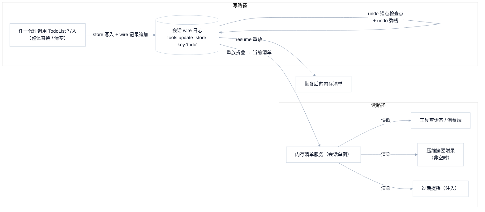

# 任务清单域（todo）— 架构文档（设计机制）

> 状态：v1 · 2026-10-22 ·
> 本文描述任务清单域的**终态设计**：状态载体、记录协议、恢复与回退机制、注入器装配、消费端水合——是设计文档，不是代码清单。现状事实（G1–G7 及代码锚点）一律归 [todo-management-context.md](todo-management-context.md)，本文只在必要时以一句话指向。
> 需求侧（用户可感知行为）见 [todo-management-requirements.md](todo-management-requirements.md)。工具的模型可见契约（描述/参数/输出/错误文案/上限）归 tool-calling 域 [tool-calling-builtin-tools.md](../tool-calling-builtin-tools.md) §4.4，本文不重复。

## 0. 总体形态

清单是**会话级、wire 持久、undo 检查点化**的共享状态。整条数据流只有一份事实源：

两侧引擎遵循同一形态；差异只在各环节的实现载体（TS = wire 模型 + checkpointed reducer；Rust = 见 §2）。

## 1. 状态与记录协议（跨引擎共用语义）

### 1.1 记录载体

- 清单写入映射为既有的通用 store 记录：`tools.update_store`，`key = "todo"`，`value = 完整清单数组`（每次写入携带全量，语义天然幂等替换）。
- 记录归属**主代理 journal**（清单是会话状态，journal 路由按会话目标记录——既有路由已覆盖该记录类型，无需新增路由项）。
- **不引入清单专属记录类型**（见 ADR-1）：新增 `todo.set` 之类的专用 op 意味着三端协议、TS 折叠模型、Rust reducer、web 投影四处同步扩面，而通用 store 记录已满足全部需求语义。

### 1.2 形状与校验

- 清单项 = `{ title: string(非空), status: "pending"|"in_progress"|"done" }`。校验策略**入口严格、重放宽容**：工具入参处严格校验（非法 status 拒绝，与 tool-calling 域错误契约一致）；重放/折叠处对脏数据整条跳过而非逐项过滤（任一项损坏 → 跳过整条记录、保留恢复前的旧值；单条坏记录不拖垮整个会话恢复）。
- Rust 侧 status 解析保持大小写不敏感宽容（既有行为，向 TS 严格形态收敛的项照旧在工具入口收紧）。

### 1.3 undo 检查点化

- 清单状态随对话回退联动，机制为**检查点栈**：对话记录追加命中 undo 锚点（真实用户输入）时，把当前清单压栈；`context.undo(n)` 弹出对应深度恢复；压缩发生时清空检查点栈（压缩边界即回退边界）。语义与 TS `Checkpointed` 模型一致（见 context §1.1）。
- 回退后消费端读到的清单 = 检查点恢复值，内存服务与折叠态同步。

## 2. Rust 引擎落地形状

### 2.1 写路径（闭环 G1）

- `TodoListTool` 的写入执行体在 `todo_list.set()` 之外，同时向主代理 wire recorder 追加一条 `ToolsUpdateStore { key: "todo", value }` 记录。工具需要持有 wire recorder 句柄（会话作用域注入，与任务工具族的句柄注入方式一致）。
- 写入顺序：先落记录、后改内存（记录是事实源，内存是缓存）。

### 2.2 折叠与恢复（闭环 G2）

- `mirri-proto` reducer 增加 `ToolsUpdateStore` 折叠分支：`key == "todo"` 时校验后替换 `ToolsState.store["todo"]`（`ToolsState` 增加通用 store map 字段：`HashMap<String, serde_json::Value>`，只增字段不动既有三字段；`ToolsState::is_default()` 同步纳入新字段）。`value` 整体非数组时跳过该条保留旧值——与 §1.2 的坏记录容忍一致。
- `restore_session_scoped_state` 增加清单恢复：从折叠态读取 `store["todo"]`，逐项宽容校验后 `todo_list.set()`。坏项跳过并告警，不失败恢复（与 cron 恢复的容忍策略一致）。
- **resume 响应补面**：rust 的 `resumed_session_summary` 从折叠态组装 per-agent `toolStore['todo']`（终端恢复渲染器的既有读取点；当前该字段被声明为诚实缺口而整体省略）。
- 恢复以内存清单为缓存、wire 折叠态为源：`SessionTodoService`（若后续引入）只读折叠态，不自持第二份副本。

### 2.3 压缩摘要保留（闭环 G3）

- `post_process_summary` 调用点从硬编码 `None` 改为传入压缩发起时刻的清单快照渲染（非空才附）。清单快照来源 = 会话作用域 `Arc<TodoList>` 的 `get()`；压缩 round 的入参增加该句柄（沿 `set_todo_list` 同形的注入通道传入）。

### 2.4 undo 检查点（闭环 G4）

- `TodoList` 内部增加检查点栈（对齐 §1.3 语义）：`ContextAppendMessage` 命中 undo 锚点 → 压栈；`ContextUndo` → 弹栈；`FullCompactionComplete` → 清栈。reducer 侧的折叠分支同样维护检查点（折叠态即权威，内存栈只是运行缓存）。
- undo 落地后内存清单重同步：undo 事件处理路径读取折叠态的 `store["todo"]` 写回 `todo_list`（等价 TS 的 `context.undone` 订阅重同步）。

### 2.5 提醒注入装配（闭环 G5/G6）

- **主代理装配**：嵌入式主 agent 的 turn flow 组装序列增加 `set_todo_list(agent.todo_list())`（与子代理 host 的既有接线对称）。
- **激活门控**：`TodoListReminderInjector` 的判定时点为**每次注入调用时**（而非构造时快照）——注入器持有工具管理器弱引用（或经注入调用传入当轮工具面快照），`inject` 执行时实时判定 `TodoList` 是否激活。这覆盖"工具中途被禁用"的验收（构造时快照无法感知中途变化）。
- 阈值与去重逻辑保持既有（10/10 回合、查询不重置写入计数、注入 origin 识别），与 TS 逐字一致（US4.3 可复制基线）。

## 3. 消费端水合

消费端分两类路径，**零消费端改动只对 TS v2 会话成立**；rust 会话的网页面需要引擎侧补数据源（ADR-3）。

- **终端（两引擎同路径）**：resume 响应的 per-agent 快照携带 `toolStore['todo']`（终端恢复渲染器的既有读取点）。rust 引擎当前在 resume 响应组装处整体省略 `toolStore`（诚实缺口声明）——**落地点：rust 的 `resumed_session_summary` 从折叠态组装 `toolStore['todo']`**，终端消费端零改动。
- **网页（TS v2 会话）**：冷快照的 `readColdSnapshot` 折叠 `tools.update_store` 记录恢复清单（既有逻辑），引擎侧落记录后自动包含。
- **网页（rust 会话）**：数据路径与 TS 会话不同——面板从会话消息历史里最后一条带清单参数的工具调用派生。该路径在压缩后失真（调用明细被折叠出历史，面板变空）。**落地点：rust server 的会话快照读面携带从 wire 折叠的清单**，网页端在快照可用时优先采用、消息派生退化为兜底（消费端小改：派生函数的输入源切换，不新增请求面）。

## 4. 决策表（需求 → 设计映射）

| 需求项 | 设计承载 | 闭环缺口 |
|---|---|---|
| US1.1 / US1.2 会话共享 | §1.1 记录归属 + §2.1 共享 `Arc`（两侧已达基线） | — |
| US2.1 写入留痕 | §1.1 通用 store 记录 + §2.1 双写 | G1 |
| US2.2 恢复 | §2.2 reducer 分支 + restore + resume 响应补面 | G2 |
| US2.3 回退联动 | §1.3 / §2.4 检查点机制 | G4 |
| US2.4 幂等与归属 | §1.1 主代理 journal + §2.2 全量替换语义 | G2 |
| US3.1 压缩保留 | §2.3 summary 附录 | G3 |
| US3.2 压缩后网页不空 | §3 rust 会话快照携带清单 | G7 |
| US4.1 主代理提醒 | §2.5 装配补线 | G5 |
| US4.2 可用性门控 | §2.5 注入时点判定 | G6 |
| US4.3 可复制基线 | §2.5 阈值/文案/去重语义冻结（与 TS 基线一致） | G5/G6 修复时验收 |
| US5.1 终端恢复面板 | §3 resume 响应补面 + 终端零改动 | G2（同源） |
| US5.2 网页冷快照 | §3 TS 会话零改动 / rust 会话快照携带 | G2/G7（同源） |

## 5. 风险与边界

- **记录放大**：清单写入频率低且全量替换（几十项 × 每任务几条），记录体积可忽略；不设数量上限的既有裁决不变。
- **subagent 写入顺序**：子代理写清单经共享 `Arc` 直写内存 + 落主 journal 记录（`JournalTarget::Session` 路由既有）；写入顺序以落记录顺序为准，恢复按记录序折叠即恢复真实顺序。注意主 journal 是单文件交错序——子代理的对话上下文落各自的 agent journal、不进主 journal 折叠，清单记录却全落主 journal：undo 检查点的压栈锚点（真实用户输入）按主 journal 的折叠序判定，与 TS 的锚点分类（按消息 origin 过滤）须保持同构。
- **undo 锚点分类**：reducer 侧压栈触发条件须复刻 TS 的锚点语义——仅"真实用户输入"消息压栈，注入/合成消息不压（否则注入密集的会话检查点栈虚高，undo 深度错位）。
- **冻结约束**：TS 侧（v1/v2）为维护冻结，全部落地在 rust core；TS 现有行为即规格基线，不需 TS 改动（网页端对 rust 会话的派生源切换除外，见 §3——属消费端适配非引擎冻结面）。

---

## ADR 决策记录

### ADR-1 清单持久化复用 `tools.update_store` 通用记录，不新增专用 wire op（2026-10-22 裁决）

- **背景**：Rust 侧清单写入需落 wire 记录（SDR-001）。候选载体两种：既有通用 store 记录（TS 同款）或新增 `todo.set` 专用记录。
- **决策**：复用 `tools.update_store(key:'todo')`。
- **理由**：① TS 侧已有同款记录，跨引擎会话记录格式零分叉（同一份日志两引擎都能读）；② 三端投影对**TS v2 会话**已实现对该记录的折叠，TS 会话零消费端改动（rust 会话的网页数据路径不同，见 ADR-3）；③ journal 路由已有该记录类型的会话目标路由，零路由改动。
- **被否决方案**：专用 `todo.set` op——类型更"语义化"，但四处扩面（协议枚举、TS 模型、Rust reducer、web 投影）换不来任何能力增量；通用 store 记录 + 固定 key 已是自描述契约。
- **影响**：§1.1 / §2.1 / §2.2 / §3；proto 仅需 reducer 分支与 `ToolsState.store` 字段，无 wire 枚举变更。

### ADR-2 undo 检查点收在折叠态，内存栈只是运行缓存（2026-10-22 裁决）

- **背景**：清单回退联动需要检查点。候选：只在内存 `Arc<TodoList>` 维护栈，或折叠态权威 + 内存镜像。
- **决策**：reducer 折叠态维护检查点（`context.append_message` 压栈 / `context.undo` 弹栈 / 压缩清栈），内存 `TodoList` 在 undo 落地事件时从折叠态重同步。
- **理由**：恢复/回退/冷快照都从折叠态读，折叠态权威保证三者一致；纯内存栈在恢复后会丢失（进程内状态不可回放）。与 TS `Checkpointed` 模型同构，行为基线直接复用。
- **被否决方案**：纯内存栈——实现最小，但恢复后 undo 即失效，US2.3 只在进程存活时成立，不成其为终态。
- **影响**：§1.3 / §2.4。

### ADR-3 rust 会话的网页清单数据源：快照携带，消息派生降级为兜底（2026-10-22 裁决）

- **背景**：网页端清单面板的数据路径对两类会话不同。TS v2 会话走冷快照折叠（从持久记录推导）；rust 会话的 web 后端没有冷快照读面，面板实际从**会话消息历史**里最后一条带清单参数的工具调用派生。该派生在压缩后失真——调用明细被折叠出历史，面板变空，即使引擎侧已落记录（G1 修复后）也无济于事，因为派生源不读记录。
- **决策**：rust server 的会话快照读面携带从 wire 折叠的当前清单；网页端在快照数据可用时优先采用、消息历史派生降级为兜底。
- **理由**：快照携带是单一权威源（与终端 resume 的 `toolStore` 同源同构），一次供给解决"冷打开"与"压缩后"两个场景；消息派生保留为零成本的运行中兜底（不依赖任何引擎改动即可工作于事件流）。
- **被否决方案**：
  - **为 rust 会话补建 transcript 冷路径**（镜像 TS 的 readColdSnapshot）：工程量大（新读面 + journal 布局适配），且只解决冷场景、不解决压缩后失真——压缩后冷路径同样依赖读 wire 记录，快照携带一步到位。
  - **只修引擎落记录、不改网页端**：落记录只对 TS 会话的冷路径生效，rust 会话的网页面板压缩后仍然变空——US3.2 不成立。
- **影响**：§3（网页 rust 会话路径）；US3.2 / US5.2 的验收面。
