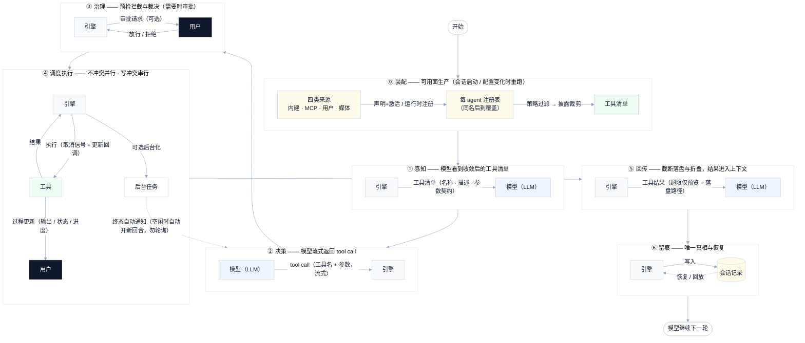
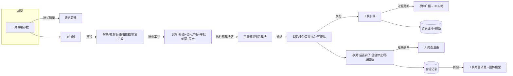

# 工具调用 — 架构文档（设计机制）

> 状态：v2 · 2026-09-10 ·
> 本文描述工具调用域的**终态设计**：契约形状、执行机制、决策规则、数据流——是设计文档，不是代码清单。TS 实现的现状事实（文件、行号、内部符号、逐字文案）一律归 [tool-calling-context.md](tool-calling-context.md)，本文只在必要时以一句话指向，不重复。
> 需求侧（用户可感知行为）见 [tool-calling-requirements.md](tool-calling-requirements.md)。审批流 UX 归 approval 域，此处只记录集成点。

## 0. 总体架构总览（全生命周期）

工具调用域的整体形态是一条纵向生命周期链：**装配（可用面生产）→ 感知 → 决策 → 治理 → 调度执行 → 回传 → 留痕**。执行节奏分两态：同步批内并发、批间阻塞（模型等待本批全部结果）；模型可选后台化（命令 / 子代理），后台任务终态经**自动通知**注入——有活动回合时并入后续步骤，空闲时自动开新回合（§5）。各阶段的展开设计见后续章节（§3 注册与激活、§4 执行管线、§5 取消/超时/截断/任务通知、§6 事件面）。

## 1. 契约模型

工具域的基础契约，全部工具与工具域共享。以下为接口形状（字段与语义），实现见 context §1.1。

- **静态元信息**：工具定义含名称、描述、参数契约（JSON Schema，缺省默认值仍为可选）、来源（内置/用户/MCP）与披露方式（随集合静态可见 / 需显式加载）。
- **执行契约**：工具把"输入 → 可执行形态"的解析推迟到调用时——解析阶段可做路径安全检查、构造审批刻面、声明资源访问；解析结果为"可执行"或"直接失败"二态。可执行形态携带：资源访问声明、描述、结构化输入展示、回合停止提示、审批刻面与规则匹配谓词、执行函数。
  - 执行上下文含：回合标识、调用标识、取消信号、过程更新回调、前台任务通知回调。
  - **结果**：成功/失败二态判别，字段含输出（文本或媒体内容块）、失败标记、截断标记、回合停止提示、附带说明、旁路投递通道（供"顺带问"等承载，投递机制归会话管理域 G4）。
  - **过程更新**：五类——标准输出 / 标准错误 / 数值进度 / 状态行 / 自定义（携带结构化数据，如授权链接）。
- **资源访问声明**：文件访问（读/写/读写/搜索 × 路径 × 是否递归）或"全部"；冲突判定规则：任一方声明"全部"即冲突；文件访问**任一方为写且路径重叠**即冲突（递归为树前缀匹配，路径做大小写与分隔符规范化、不解析 `..` 段）；读-读、读-搜索不冲突。工具可声明空访问（无冲突）或最保守的"全部冲突"。
- **MCP 工具名谓词**：以 `mcp__` 前缀命名（命名规约见 mcp 域）。

### 1.1 参数命名规约（设计约束）

> 面向所有实现（含 Rust 内核）的接口设计约束，与工具契约同阶。目的是从源头降低模型侧"参数名幻觉"——模型对直觉命名的遵从度远高于造作命名，反直觉命名是幻觉与无效调用的结构性诱因；用运行时容错（别名表）为反直觉命名打补丁是治标，此约定是治本。

- **领域直觉命名**：工具公开参数名必须与该工具动作和领域常识的直觉表述一致——全写、不言不达意的略写；同一语义在全部工具间用同一参数名（如行偏移全系统统一为直觉形态，不因工具而异）。
- **命名即契约**：发布即定型，不保留"历史别名"双名形态；命名确需偏离直觉时（如歧义消解所需），必须在参数描述中显式说明语义，且仍保持**单一权威名**。唯一例外是**参数名别名机制**（见 ADR-1）。
- **禁治标豁免**：命名规约不为"已存在的反直觉命名"网开一面——宁可改名违约，不改名配别名表；参数契约对未知参数的严格拒绝不因任何容错机制松动。**参数名别名机制除外**（ADR-1）：别名是独立的设计决策，覆盖改名过渡与实证支撑的参数名幻觉两类场景，并承担单项迁移兼容——但**不以别名替代直觉命名**（别名只承载已知等价名，不承担反直觉命名的长期续命；命名规约仍是治本路径）。
- **与容错机制的关系**：运行时参数名别名机制不作为**TS 对齐基线**引入；Rust 侧作为独立机制落地（ADR-1，六条护栏），首例：Read 的 `n_lines`→`limit`。参数**值**的类型宽容是独立机制，见需求 US2.10。

## 2. 参数面机制

调用参数从"模型发出"到"进入执行"的四道加工，均为确定性规则：

1. **契约渲染**：工具声明的参数契约渲染为 JSON Schema，并强制"未声明字段一律拒绝"（对象节点补全"不允许额外属性"）。渲染保证带默认值的字段仍可选。
2. **解析**：参数文本按 JSON 解析；解析失败归一为空参数并标记解析失败（区分"模型发了空对象"与"发了坏文本"），交由后续校验兜底。
3. **值宽容（US2.10）**：契约声明为数字的字段，接受数字形态的字符串并按数值接收（如 `"42"`、`"3.14"`）；无法按数字解读的原样保留，交给校验按类型拒绝。宽容发生在校验**之前**——宽容通过的字段不再因类型不符被拒。非数字字段不做任何宽容。
4. **校验**：按契约方言选择校验器，错误全部聚合为一条模型可读的明细文案（点名缺失属性/非法属性/违规值）。校验器可按工具复用缓存。

**路径访问策略**（文件类工具共用）：先做敏感文件判定（环境变量文件、凭据、SSH 私钥等命中即拒绝，文案点明敏感类别；样板/公钥类文件豁免），再做路径规范化（含用户目录展开与纯词法归一，不解析符号链接），最后按工作区边界判定：相对路径越界拒绝并要求绝对路径，绝对路径越界放行但标记供审批；越界守卫可配置关闭（仅解除边界判定，敏感文件检查不受影响，见 US4.1）。伪前缀逃逸防护（相邻目录名不得偷换进白名单目录）。技能目录根并入文件可达域。

**结果构建**：工具侧缓冲式构建输出，带总量上限与单行上限（超限截断并标记），成功/失败形态统一产出。**规则匹配**：工具在解析阶段生成审批刻面（按工具与主体生成字面/通配规则串，支持否定前缀），供权限规则判定"该调用是否被用户规则覆盖"（审批面见 approval 域）。

## 3. 注册与激活

- **作用域**：注册表按会话内的 agent 实例隔离——每个 agent 一张表，提供注册（带来源与披露方式）、按名解析、按序列表。**同名注册后到者覆盖先到者**，实现确定性可预期。与装配层"冲突跳过"（见下）是两层不同语义：装配层先行去重——命中同名即跳过、该声明**根本不进入注册流程**；注册表层的覆盖只发生在两个声明都成功注册之后（后到者生效）。
- **贡献面**：工具经"贡献声明"登记——声明携带可激活期过滤的元信息（名称、描述、来源、披露方式、生效谓词、能力标签），构造是**惰性**的（满足条件才实例化）。贡献来源四类：内建工具各自声明、MCP 服务器（连接成功或需授权时按 `mcp__服务器__工具` 命名注册，冲突跳过并记录）、宿主注册的用户工具、媒体工具（按绑定模型能力门控注册/撤销）。
- **激活**：从贡献声明装配到运行时注册表的一次遍历——按 角色工具面（允许/禁用）→ 工作区级否决 → 生效谓词 的序逐个判定，通过才构造并注册；同时把声明的能力标签登记，供角色"按能力"反查工具。装配在会话恢复与角色绑定后显式执行一次，并在角色/配置变化时重跑（新允许的工具即时进入集合）；**从不注销已激活工具**——收紧可见性由请求期策略承担（§8）。
- **模型可见表**：每步请求的工具列表 = 注册表全量 → 策略过滤（§8）→ 渐进披露裁剪（§7）→ 延迟披露条目从最终请求滤除（只在下游需要时才出现）。

## 4. 执行管线

**批（batch）的定义**：一次模型响应中返回的全部工具调用构成一个批，是调度与中止的执行单元——批内调用按资源冲突并行或排队，批间模型需等待本批全部结果回流后才继续。下述生命周期以"一次批调用"为单位。

一次批调用的生命周期分五个阶段，决策规则如下：

1. **预检**：解析参数 → 按名解析工具 → 各拦截点（未知工具 / 参数校验失败 / 策略禁用 / 渐进披露未加载，各自产出确定性的模型可见拒绝文案）→ 通过才进入下一步。预检被拒的调用**到达执行后钩子**（钩子总能看到"被拒但曾请求"的事实）。
2. **解析**：调用工具解析函数获得可执行形态或直接失败结果；触发"执行前"裁决链（见 §11）——裁决者可拒绝（携带模型可见原因）、可改写参数（改写后**重新解析**）、可等待异步就绪（如 MCP 首次装载）；通过后发布"调用开始"事件（含描述与结构化展示）。
3. **调度**：多个调用按资源访问冲突与否并行/串行执行——**不冲突立即并行，冲突排队等待**（后到者等先到者，按提交序排队、按完成序放行）；结果按**完成序**逐个回流。未声明访问范围的调用按最保守（与一切冲突）处置。
4. **执行**：调用执行函数收到取消信号与过程更新回调；过程更新经事件面实时广播（§6）。用户中断或系统异常时按 §5 收束。
5. **收尾**：按注册序跑"执行后"钩子（失败与成功都触发；invoke 前有长度上限）；合并回合停止提示（§5）；结果截断（§5）；发布"调用结果"事件；结果写入会话记录，由上下文折叠为模型可见的工具角色消息（错误带失败标记）回传模型。

**回合内停止**：两处提示语义不同——"停止整批"提示在**直接失败结果**路径回退为"停止回合"，而**可执行结果**的"停止回合"提示不自动跳过同批其余调用（只影响本步收尾方式）；"停止整批"提示一旦出现，同批后续未执行调用不再执行，收到"因前一调用停止而跳过"的说明。

### 4.1 错误反馈设计规约（模型自修正闭环）

失败不是终点而是**修正指令**：模型发出调用 → 失败结果回传 → 模型依据错误信息修正（改参数 / 换路径 / 先做前置 / 换工具）或停止（勿重试类）——闭环不依赖用户干预。错误文案须满足四要素：

1. **类别定位**：失败类别可区分（参数校验 / 未知工具 / 策略禁用 / 执行失败 / 中止），同类失败形态一致；
2. **具体原因**：点名违规属性、退出码、断连的服务器名——不复述笼统的"failed"；
3. **下一步指引**：可修正类必须给动作（先 Read 再 Edit、先 select_tools、提供绝对路径、按 output_path 取回全量）；不可修正类必须给行为约束（勿重试、勿猜测、等待用户）；
4. **确定性**：同因同文案，不随机措辞——模型按错误文本建立稳定映射。

**可修正性分类**（决定第 3 要素的形态）：参数校验（可修——点名属性）；未知工具（可修——按未加载/已禁用给区分指引）；路径越界（可修——要求绝对路径）；执行失败（视情况——退出码/超时指引读取落盘）；大输出截断（可修——给路径与读取参数）；用户中断（**不可修**——明示勿重试、等待指示）；MCP 断连（**延迟可修**——明示勿立即重试）；策略禁用 / 敏感文件（**不可修**——拒绝并说明，指引询问用户）。

**闭环终止保护**：模型陷入无效修正循环时，由重复调用抑制（§10）递进提醒并强制结束——闭环必须有界。全部内建工具的错误面按本规约收录于 builtin-tools 规格的各错误面表。

## 5. 取消、超时、截断与任务通知

- **取消**：取消信号为**回合级**——一次用户中断产生一个信号，传入批执行器与批内每个工具的执行上下文；作用面为当前回合全部在途执行（不限于同一批），已后台化的任务不在该信号面内（由任务管理域的停止操作管理）。取消信号在工具执行前短路；执行中取消给工具短暂宽限（秒级），超时按中止收尾。**用户主动中断**与**系统错误中止**产出可区分的确定性文案——前者明确"用户有意动作、非错误/非超时/非容量、不得自动重试、等待用户指示"，后者仅陈述中止事实。未执行调用在被记录时立即合成"未执行"的失败结果（保证记录合法、模型知情）。
- **超时**：超时责任在工具自身；命令类工具前台超时**默认转后台继续**（可配置为杀灭），杀灭时结果带原因。
- **截断（两级）**：工具内缓冲截断（总量+单行上限）→ 执行链末端对超大纯文本输出**全文落盘**并只回传"头部说明 + 预览 + 读取指引"（含唯一输出路径）。落盘文件存放于会话的工具结果存储域，文件名由调用标识派生；无自动清理，长期保留、随会话数据一并处置（跟踪见 ROADMAP F-11）。截断只改呈现，不丢数据、不阻塞会话。
- **后台任务自动通知（再开）**：后台（脱离前台）任务到达终态时，引擎构建完成通知（任务标识·终态·摘要·输出尾部）并以用户侧消息注入步骤队列——有活动回合时并入后续步骤送达（不打断当前步骤），空闲时**自动开启新回合**驱动模型继续；通知按"任务 × 终态"幂等（重复触发与恢复重放只投一次；恢复时对未投递的终态任务补发），可显式抑制；仅后台任务在通知面（前台任务按同步路径回传）。工具结果说明明确告知模型"完成自动通知、勿轮询"。

## 6. 事件面（wire 契约）

工具调用的全程以四类事件对外广播，消费端（终端/网页/审批）各自投影：调用开始（参数+结构化展示）→ 参数流增量（供流式呈现）→ 过程更新（五类载荷，含授权链接类自定义更新）→ 结果（输出/失败标记/合成标记）。另有：工具集合变化通知（消费端可显式忽略）、子代理生命周期事件族（调用侧投影）、瞬态命令输出事件（供终端旁路命令与转后台脱管，不持久化、不重放）。结构化展示形状（输入侧十余类判别 + 结果侧呈现判别）为协议级共享契约，审批面板与结构化渲染共用（输入展示**不驱动**卡片本体渲染——卡片以工具名+参数为准，展示提示只决定"怎么更好呈现"）。

## 7. 渐进披露（工具选择）

- **原则**：不做自动选择——模型始终自行决定；引擎只管理**披露**。被标记为"可动态加载"（MCP 工具或延迟披露工具）未加载时**不进**模型视野；模型经 `select_tools`（唯一 snake_case 名工具）显式加载。
- **加载**：加载请求按名解析，成功/已在集合/未知给出逐项反馈；全部未命中视为失败。加载把工具契约注入模型上下文，并追踪未落地加载（压缩后清空）。
- **历史整形**：已移出集合的动态工具从其历史消息中剥离契约（防"旧工具仍可用"幻觉）；未加载调用与已加载但被策略关闭的调用给出**区分性**拦截文案与指引。
- **公告**：每回合首步（或压缩边界）以增量文本告知模型工具集合变化（增/删），无变化零成本。
- **开关**：整套能力受实验开关控制，默认不生效（关闭时全部可用工具直接可见、无公告、无历史整形）。

## 8. 工具可用性策略（强制面）

- **强制点**：在预检阶段施行（§4 阶段 1）——被禁工具**执行前**被拒，产出"被当前工具策略禁用"的模型可见原因；与审批面的关系：策略决定"工具是否在集合内"（建模层强制），审批决定"本次调用是否放行"（approval 域），两阶段串行、职责分离。
- **多层叠加**（序即优先级）：工作区级禁用（最高）→ 角色工具面（允许/禁用）→ 全局工具配置（未配置与空列表均为不约束）→ 会话级禁用；任一来源禁用即整体禁用，收紧即时生效、放宽即时可见。
- **匹配语义**：内置/用户工具精确名；MCP 工具按带前缀的规则且支持通配。**误配静态检测**：永远匹配不到的模式（非 MCP 工具使用通配符、残缺 MCP 名、指向未知工具；通配符在允许列表场景会把全部工具禁掉、在禁用列表是空操作）在配置生效时提示，不静默采纳。
- 会话级禁用需先绑定角色，否则请求失败并说明。

## 9. 用户自定义工具（宿主代理）

- **形态**：宿主运行时时注册（名称/描述/参数契约/披露方式），**不是配置文件**；注册通道是宿主侧的进程内服务接口——非对话通道，模型不能自行注册工具；注销经同一接口。注册即入当前集合并激活（同名覆盖）；可查询与注销。
- **持久化**：注册/注销随会话记录持久化，会话恢复时重建注册表（可继续调用，无需宿主重注册）。
- **执行**：用户工具是**纯代理**——调用转发给宿主进程，宿主结果原样回传（失败标记保留）；取消信号随转发绑定，宿主不响应时按"已中止"收尾；宿主返回畸形结果时产出确定性兜底文案。
- **继承**：派生子代理继承主 agent 注册的用户工具。

## 10. 重复调用抑制

- **同批内**：完全相同（工具+参数）的重复调用被否决，只执行首次，重复方收到合成占位说明。
- **跨批**：不静默，向模型注入**递进式**提醒（首次轻、持续升级）；连续重复达到上限时**强制结束回合**。

## 11. 钩子面（执行前后裁决策略链）

"执行前"点位是多监听者的**两段式裁决链**：第一段按注册序同步裁决（先到先得的拒绝 / 放行终结 / 首次参数改写生效）——保证审批这类慢往返**不会在别的监听者本会拒绝时启动**；第二段才启动慢就绪等待（审批往返、异步装载）。同一事件面的消费方还包括目标服务、计划审批、批量派发、顺带问、去重与外部钩子；MCP 首次装载另挂专用就绪点。外部钩子（PreToolUse/PostToolUse 及失败变体）的能力：拒绝并给模型可见原因、改写参数、附加上下文、执行后回调（输出带长度上限交付）。

## 12. 消费端接线（机制）

- **终端**：事件投影为工具卡片（头部状态动词 进行中/成功/失败/截断 + 关键参数摘要 + 结果数字摘要 + 结果渲染器 + 默认折叠可展开）；过程更新投影为实时尾窗/状态行/进度；流式参数投影为边流边现；交互面：全局展开/折叠、Esc 或 Ctrl+C 中断（取消当前回合全部在途调用）、把前台长执行转后台（命令运行超短阈值后提示、子代理即时提示）、旁路命令卡片。结构化展示提示只转交审批适配器，不驱动卡片。历史经会话记录回放还原（转录全量）。
- **网页**：事件投影为端内方言（开始/增量/过程/完成四类槽位，完成含耗时字段）；按工具名解析渲染器（媒体/编辑/子代理/批量/提问/通用）；状态指示 进行中脉冲/成功/失败/挂起 + 数字摘要 + 展开；同一回合连续工具堆叠为组（聚合状态）；**运行中刷新/重连经快照恢复**（在途工具状态不丢）；回合结束仍悬空的"运行中"工具须收敛为明确终态（端差距跟踪见 ROADMAP F-10，现状记载见 context §6）。流式参数增量在网页端为显式忽略（参数在开始事件已全量）。
- 两端共享"错误不走单行摘要、截断可展开、状态永远有终态"的呈现原则（需求侧 E3）。

## 13. 数据流总览（执行管线视角）

> 与 §0 全生命周期总览互补：本图聚焦一次批调用在引擎内部的细粒度数据流。

## 14. 关联文档

- 现状与代码事实（文件/行号/内部符号/逐字文案）：[tool-calling-context.md](tool-calling-context.md)
- 需求（用户可感知行为）：[tool-calling-requirements.md](tool-calling-requirements.md)
- 执行状态与开放项：[tool-calling-ROADMAP.md](tool-calling-ROADMAP.md)
- 遗留路径（legacy）工具面的事实性记载仅在 context §2，本设计文档不承载现状对照。

## 15. 设计裁决记录（ADR）

### ADR-1 参数名别名机制（2026-09-10 裁决，独立设计决策）

1. **背景与动机**：参数名有两类"旧名仍会出现"的场景：① **改名过渡**——Read 的行数参数 `n_lines` 为"n_"略写形态，违反 §1.1 直觉命名（实证：v1 曾被迫为它挂别名表，见 context §2），裁决 Rust 改名 `limit`（与 TaskList 统一"取多少"语义）；② **参数名幻觉**——部分模型对参数名存在稳定的书写幻觉（v1 实证：模型天然写 `offset`/`limit`），当幻觉名与权威名构成已知等价名时，静默兼容不出问题且省一轮无效调用。另承担**单项迁移兼容**：整库会话存储隔离，但存在单项迁移通道（单条会话/记录/调用轨迹从 TS 迁入 Rust），迁移内容可能携带 TS 侧参数名。
2. **决策**：参数名别名是**独立的设计决策**，不是改名的附属品——引擎内置封闭别名表，命中的参数名静默映射为权威名后执行；别名**永不**进入参数契约、描述或任何模型可见面。别名条目分两类来源：改名过渡类（新名必须为直觉命名）与实证幻觉类（须有遥测或历史实证支撑，不凭空预设）。
3. **与 §1.1 的关系**：§1.1 原禁令针对"为反直觉命名打补丁的别名表"（别名让坏名字续命）；本机制的别名以直觉命名为前提（改名类）或以实证为依据（幻觉类），不承担反直觉命名的长期续命——治本路径仍是命名规约。本裁决亦修订了同日早前"笔误宽容不引入"的初判（ROADMAP F-6），采纳 P-1 残余兜底的无歧义归位原则。
4. **六条护栏**：① 别名条目须逐条归入改名过渡类（新名为直觉命名）或实证幻觉类（有遥测/历史实证），两类都不允许"为让某反直觉命名续命"而设；② 别名永不进入任何模型可见契约面；③ 别名与权威名并传即拒绝并报明确冲突（别名源必须不是该工具的合法参数、映射目标必须唯一合法——无歧义归位）；④ 映射位置固定在解析后、校验前（§2 加工链）；⑤ 别名命中必须可观测——改名类以迁移潮结束为移除参考，幻觉类以命中率衰减为参考；⑥ 别名表为封闭清单，新增须逐条 ADR 裁决。
5. **被否决的备选**：① 别名仅作改名附属（不设独立机制）——幻觉容错与迁移兼容无法归入"改名"语义，两类场景由同一机制承载更简；② 不做兼容、改名即断——单项迁移内容与既有提示词失效，破坏"调用可靠往返"承诺；③ 把旧名保留为公开双名——违反"单一权威名"，模型将学会依赖两个名字；④ 权威名改为裸 `offset`（模型天然书写形态、`(offset, limit)` 分页习语）——丢失 "line" 的单位语义教学信号（行 vs 字节偏移），且与 Grep 的 `offset`（0-based 跳过条数）同名异义，跨工具迁移心智有 off-by-one 风险。
6. **已知风险与兜底**：静默兼容使"碰巧写对旧名"的调用得不到纠正；因别名不在任何 Rust 契约中且为封闭精确匹配清单（无模糊归位），误映射风险由护栏③的无歧义构造排除；预期命中来源为单项迁移内容、共享提示词与模型残余习惯，以护栏⑤的观测决定移除时机。
7. **首例与候选**：改名过渡类首例 = `Read.n_lines → Read.limit`（已裁决）；实证幻觉类首例 = `Read.offset → Read.line_offset`（已裁决，2026-09-10）——证据：v1 别名配置的历史实证 + 同日 TS 侧实录报错（`Invalid args for tool "Read": must NOT have additional property 'offset'`——schema 明示 `line_offset` 后模型仍持续写 `offset`，持续幻觉即生态先验）。**`line_offset` 维持权威名的裁决理由**（用户确认）：名称中的 "line" 向模型传递单位语义（行、而非字节偏移）；且模型幻觉 `offset` 时其意图几乎总是按行——别名吸收后语义正确。该别名预期**长期命中而非衰减**：命中率稳定说明别名持续履职，不构成移除压力（护栏⑤的"衰减"参考用于判定命中来源消失，而非要求归零）。其余同语义参数名（如 Grep 的 `head_limit`、`offset`）是否跟进统一**不在本裁决范围**——改名候选须逐条另行裁决，本裁决不隐含批量统一。
### ADR-2 Rust 面：Glob/Grep 的 `path` 入参纳入路径守卫（2026-09-14）

1. **背景与动机**：会话审计 session-30c0d8bb（P0-2）证实：`path_security` 沙箱仅接入 Read/Edit/Write，Glob/Grep 的显式 `path` 参数无任何校验——子代理用 `Glob(path=<home>/.mirri-code, pattern=**)` 成功枚举引擎自身存储（其他会话 wire、workspaces.json、credentials 目录布局）。§0.5"路径守卫（文件类工具共用）"与需求 US4.1 已规定守卫覆盖文件类工具；搜索类工具属于同一威胁面（写被封、列表可穿，隔离不自洽）。
2. **决策**：Glob/Grep 的 `path` 入参经同一 `WorkspacePaths` 校验（相对路径按工作区根解析、`..` 词法归一、越界拒绝；additional dirs 白名单放行），错误文案复用工具层包裹惯例（`Glob refused '{path}': …` / `Grep refused '{path}': …`）。**Rust 面维持既有裁决**：绝对路径越界同样拒绝（安全默认全拒——`plan/rust-tool-calling.md` 已登记"绝对越界放行+审批标记"为登记不实施项）；与 TS 需求语义（§0.5：绝对越界放行交审批）的分叉不在本轮扩大，留待统一迁移时在 path_security 单点收敛。
3. **被否决的备选方案**：a) 为 Glob/Grep 设计更宽松的守卫（如仅拦截敏感目录）——威胁模型割裂，白名单语义失去一致性；b) 仅对子代理生效——主代理同样可枚举引擎存储，同一漏洞不因调用者身份而改变性质；c) 完全放开并在文档声明（TS 语义）——放任任意目录枚举，与已实施的 Bash/Write 沙箱裁决冲突。
4. **影响范围**：§0.5（Rust 面执行口径）；`tools/glob.rs`、`tools/grep.rs`、`tools/mod.rs` 构造面；沙箱测试面。

### ADR-3 Rust 面：tools_added 尾注按渐进披露状态输出（2026-09-14）

1. **背景与动机**：会话审计 session-30c0d8bb（P1-3）证实：`<tools_added>` 提示无条件追加"Use the select_tools tool with exact names to load full tool definitions before calling them…"尾注，而渐进披露默认关闭时 `select_tools` 调用必然报错（`select_tools is not configured for this agent`）——每个 turn 固定浪费一次模型调用并持续误导模型（提示与工具注册表状态自相矛盾）。
2. **决策**：`ToolsDiffInjector` 构造时携带披露开关（取 `ToolManager::disclosure_enabled()`）；未启用渐进披露时，announcement 只列工具增减（added/removed 清单照常），**不输出** select_tools 操作指引尾注——模型直接调用全部已注册工具；启用时维持原文不变。
3. **被否决的备选方案**：a) 把 select_tools 注册为永久可用工具——把"加载定义"变成无操作，模型仍会浪费一次调用，语义虚假；b) 披露关闭时完全不注入 tools_added——丢失工具面变化信号（工具启用/禁用/重注册的上下文提示）；c) 尾注改为"无需调用 select_tools"的反向说明——纯噪音，无行动价值。
4. **影响范围**：§7（渐进披露）；`turn_flow/injection/tools_diff.rs`、`turn_flow/mod.rs` 组装点；注入测试面。
- **修订记录（2026-09-18，ADR-3-R2，用户裁决）**：公告范围收窄为 TS 对齐——装配点（turn_flow 注入器组装）加披露门禁：渐进披露关闭时**完全不注入** tools_added（取代本 ADR 决策中"未启用渐进披露时 announcement 只列工具增减"的保留，被否决方案 b 重裁为采纳——工具面变化信号对静态表不成立：静态表的完整定义在每次请求里，模型本就可见；静态工具被禁用时直接体现于下次请求的工具表变化，接受一次缓存重算）；披露开启时公告范围从"全部启用工具"（含内建）收窄为**可加载动态（MCP）工具**（`ToolManager::loadable_dynamic_tool_names()`，对齐 TS `loadableDynamicToolNames`：MCP 名单、白名单准入、含未加载项）。触发证据：session-16f65edc——生产部署渐进披露默认关闭且无非测试启用点，导致每段对话首回合注入纯重复的内建工具清单（TS 同场景零注入）。注入器（`ToolsDiffInjector`）保持纯函数不动，策略收在装配点。

### ADR-4 Rust 面：Bash 前台超时撤销直接杀灭，对齐规格的自动转后台（2026-10-13）

1. **背景与动机**：规格（builtin-tools §2.1 输出契约/非功能）已定义 Bash 前台超时的默认行为为**自动转后台并重布防后台超时**（完成经自动通知送达，可配置为杀灭）。Rust 实现此前选择了"超时直接杀灭、不转后台"（实现层的既有行为，见 bash.rs 模块注释的内部标记，非本域正式裁决记录），形成规格偏离。动机层面的抽象问题：长命令按指引正确发起（前台、设置了超时）仍会在时限处丢失全部进度——进程被杀、输出只有部分、模型只能整体重跑；这对耗时任务（全量测试、构建）是重复的、可避免的浪费，且与模型可见的描述文案（"moved to the background instead of being killed"）自相矛盾——描述承诺了引擎不做的行为，模型据错误承诺规划，失误重复发生。
2. **决策**：Rust Bash 前台超时的处理对齐规格：超时不杀进程，转为后台任务——任务标识不变、前台已捕获输出并入任务记录、模型收到"已自动转后台 + 完成将自动通知 + 继续当前工作，不要轮询"的引导消息（与后台启动消息同口径）；转后台后重布防后台超时（默认 600s、上限 86400s、`disable_timeout` 豁免），第二个时限到期才杀灭并按超时失败定局。任务三件套不可用的 agent（后台能力被裁撤）不适用本裁决的转后台——超时仍直接杀灭（后台化前提失败时无从转后台）。
3. **实现约束（裁决的构成部分，非实现自由度）**：① **第二时限的强制路径必须随本裁决交付**——引擎当前没有周期性超时 sweeper，转后台后的 deadline 强制必须由后台续跑循环自身承担（独立的超时 arm，到期杀灭并按超时失败定局），不得依赖尚不存在的全局清扫机制；② **超时交接与用户主动转后台的并发互斥**——超时转后台与用户/工具触发的转后台可能同时到达，交接必须 first-wins（单一原子转换点，第二次到达视为已转后台直接返回），不得产生双续跑循环或双重定局。
4. **被否决的备选方案**：a) 维持既有直接杀灭——与模型可见描述自相矛盾，长任务进度全损，规格偏离无收益；b) 超时后重新发起为后台命令——已运行的进程必须先杀，60s 进度丢失，与"不杀"目标背道而驰；c) 超时消息中引导模型主动查询任务状态——与"完成自动通知、不要轮询"的既有消息口径冲突，会诱导轮询行为，正常路径通知机制已保证送达；d) 引入全局任务超时清扫器统一强制——超出本裁决范围，且会把 Bash 专属的超时策略耦合进任务管理器的通用面。
5. **影响范围**：builtin-tools §2.1（规格本就如此，无文本变更）；Rust 前台执行路径的超时分支与后台续跑交接；转后台消息面（复用既有 moved-to-background 模板，附超时原因行）；Bash 工具的静态描述文案（现述"timed-out commands are killed"须同步为转后台语义，含三件套不可用时的杀灭回退分支）；配置开关 `bashAutoBackgroundOnTimeout` 的 Rust 面接线（杀灭开关）登记为 ROADMAP F-17——本裁决先落常开行为，配置面接入另批裁决。
6. **已知偏差登记**：转后台后的任务 id 前缀，规格要求 `bash`，Rust 现行任务 id 形态与之不同——属既有偏差，是否对齐另行裁决，本 ADR 不隐含变更。
7. **裁决关系**：`!` 用户命令通道的前台超时转后台（SHELL_FOREGROUND_TIMEOUT_SECS）是独立既定行为，与本裁决无耦合。Rust 内核域内部的 B7 系列编号（bash.rs 注释引用）属实现层标记，非本域裁决记录。

### ADR-5 Rust 面：Grep 能力升级——块状输出、多路径、排除过滤、默认收紧（2026-10-22 裁决，源自 [tools/grep-design.md](tools/grep-design.md) v1.1）

1. **背景与动机**：实测调研（159 个 v3 会话、41,755 次 Bash、5,505 次 Grep）证实 agent 的真实检索单元是"定位 → 顺带看清周边 → 只要我要的部分"——87% 的搜索绕过 Grep 直接用 Bash 管道（65% 带 `| head -N`），搜索后 3 步内跟读文件的概率 95%。Grep 只完成第一步，且扁平 `path:line:content` 输出单次大小是 Bash 搜索的 4 倍（按条计数不限字节）。
2. **决策**（G-ADR-1~4 并入）：
   - **G-ADR-3 块状输出**：content 模式渲染为块——按 path 分组（组序 = `paths` 数组序，稳定）、组内按行号聚类（上下文窗口重叠或相邻即 `start <= prev_end + 1` 合并），块头 `display:start-end`、行 `  {line}│{text}`、命中行尾 ` ← match`。`SearchMatch` 增 `is_match` 标记（serde default 保旧快照反序列化），行号在解析层保真（`-n:false` 仅丢弃显示前缀，块头范围保留）。备选：保持扁平行列表（拒绝：现状即 95% 链式跟读的根因）、JSON 结构化结果（拒绝：纯文本协议，JSON 增大 token）。
   - **多路径**：`path` 收 string 或 string[]（anyOf，maxItems 32，工具层显式长度复查）；`SearchParams.path` 类型变更 `PathBuf → Vec<PathBuf>`。rg 并行多路径 `--json` 输出顺序不稳定（实验证实），组序稳定化在后置 pass 做最长前缀匹配归属 + 稳定排序——不用 `-j 1`（牺牲全部并行性不划算）。glob 含 `/` 且多路径时公共祖先钉 cwd（F11 原理消除静默零命中回归）。沙箱逐元素：escape 任一整体拒绝、outside 逐一生成 access、元素不存在报错点名。
   - **exclude_pattern**：结果层过滤（rg 的 `-g` 是文件名 glob 不可用）——全量收集 → exclude 过滤（孤儿上下文经窗口裁剪清除）→ 命中口径 offset/head_limit 分页。files/count 模式 + exclude 时强制走 `--json` 归并。非法正则报错不静默回退（排除是精确意图）。备选：静默回退子串（拒绝：让 LLM 误信结果完整性）。
   - **G-ADR-4 默认收紧**：content 模式默认 head_limit 250 → **30**（口径从"行条目"改为"命中数"）；新增 4,096B 块字节软预算（块边界截断、单块超预算仍完整输出、`head_limit: 0` 时不适用）。依据：Bash 搜索 65% 带 `| head -N`（p50=10、p90=40），实测传了 head_limit=30 的调用输出仍是 Bash head-10 的 ~3 倍（长行不限字节）。备选：保持 250 靠模型自觉（拒绝：58% 调用根本不传 head_limit）、默认 10（拒绝：过紧频繁触发重查，翻页成本反噬）。
3. **被否决的备选方案**：见各子项。总备选：通用管道/任意 shell 组合（拒绝：那是 Bash 的领地，Grep 是结构化工具）、搜索结果语义排序（拒绝：保持可预期性）。
4. **影响范围**：builtin-tools §1.5（参数表 13→15、输出契约块格式）；`rust/crates/mirri-core/src/tools/grep.rs` + `rust/crates/mirri-os/src/search.rs`；契约快照。
5. **裁决关系**：描述工程（G-ADR-2，"One call answers the whole question" 管道习惯映射 + 实现指涉降级为方言指涉）属描述文案层，随 Rollout 阶段 2 单独落地，不在本裁决的实现范围。

### ADR-6 Rust 面：Glob 能力升级——filter/limit 双参数、计数头、全量收集（2026-10-22 裁决，源自 [tools/glob-design.md](tools/glob-design.md) v1.1）

1. **背景与动机**：同源调研中 Glob 调用 332 次（占 Bash 41,755 的 0.8%）近乎消失——模型在 Bash 里写了 118 次 `rg --files | rg -i 'x'` 式过滤、~960 次 find/ls：文件发现的真实需求是"列出 → 按我的条件筛 → 控制量"，Glob 只有第一步且 100 条硬截断不可调。
2. **决策**（GL-ADR-1~4 并入）：
   - **GL-ADR-3 filter 做在结果层（工具层）**：对 `GlobResult.matches` 应用二次过滤——纯文本不区分大小写子串、正则元字符触发集合（`\ + * ? ( ) [ ] { } | ^ $`，**刻意不含 `.`**——路径中扩展名点极常见）切正则、编译失败回退子串（与 Grep exclude_pattern 的报错语义刻意不同：过滤是收窄意图误伤面小，排除是精确意图静默回退危险）、`!` 前缀取反。备选：下沉 walker 过滤回调（拒绝：分层职责——walker 管匹配文件、过滤是呈现意图；遍历性能差异可忽略）。
   - **limit 参数化 + 后置截断**：默认 200（GL-ADR-2），截断在 filter **之后**（"过滤后取前 N 条最新"的正确语义——先截后滤会在"最新 N 条恰好被滤光"时返回 0 条）；`0` 不限。备选：保持 100（拒绝：拍脑袋值）、默认无限（拒绝：大目录打爆）。计数头让"被截断"不再是黑洞。
   - **计数头**：未传 filter `N matches — most recent first`；传了 `N matches (of M matching before filtering, K after filter) — most recent first`；M/K 口径为敏感文件过滤后（防计数头泄漏被滤敏感文件的存在性）；滤光时仍走完整模板（与"模式无匹配"的 `No matches found` 区分）。无单复数变形（恒 `matches`）。
   - **搜索层全量收集 + 敏感过滤下沉**：`GlobParams.limit` 语义为 walker 软停点（非结果截断——引擎工具层恒传 `limit: 0` 全量收集，双硬上限 10,000 条 / 1 MiB 相对路径字节兜底）；`GlobResult.total_matched` 为敏感过滤后口径（收集时用 `PathAccess::is_sensitive` 过滤，工具层保留二滤）；mtime 降序 + 显示路径字典序次级键（测试可复现、翻页稳定）。
   - **GL-ADR-4 `include_dirs` 移除现状确认**：已由 commit `5ec0ba4b1` 落地（schema 无该属性 + `additionalProperties: false` + 测试锁定）。
3. **遗留裁决记录（walker 停点口径）**：搜索层 `GlobParams.limit` 非零时，walker 停点即 `total_matched`（"够数了"语义）——limit 足够大或 0 才有精确全量。**引擎工具层现行实现恒传 `limit: 0`**（全量收集），故用户面（计数头 M）不受该近似影响；该口径仅约束直接消费 `GlobParams.limit` 的非引擎调用方。
4. **影响范围**：builtin-tools §1.4（参数表 +2、输出契约计数头/截断尾行）；`rust/crates/mirri-core/src/tools/glob.rs` + `rust/crates/mirri-os/src/glob.rs`；契约快照。
5. **裁决关系**：rg 二进制解析顺序 PATH → `<MIRRICODE_HOME|~/.mirri-code>/bin/rg` 缓存回退为搜索层基础设施改动，同时惠及 Grep/Glob（完整下载兜底独立立项）。
