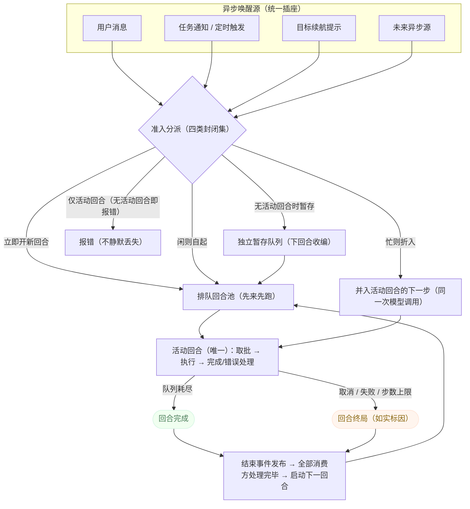

# 回合调度与循环控制 — 架构设计（面向 Rust 核心）

> 状态：v1 基线 · 2026-09-13 · 待需求评审后校准 ·
> 本文是回合调度域设计侧的唯一事实源（内部规格文档，不进文档站构建，中文单语）。
> 需求契约：见 [turn-scheduling-requirements.md](turn-scheduling-requirements.md)；现状证据见 [turn-scheduling-context.md](turn-scheduling-context.md)。
> 引擎分层锚点：`rust-core-design/00-overview.md`（mirri-core 内核 / mirri-server 接线）。
> 术语规范：回合（S7）、异步唤醒源（L1）、准入策略（L2）、回合结局（L3）见 [glossary.md](glossary.md)。

## 1. 目标与设计原则

本设计描述**终态**：Rust 核心中回合调度域的完整架构（TS 引擎现行行为为参照基线）。

设计原则：

1. **单一插座**：一切"消息变工作"的路径都经同一个准入入口——异步源不发明调度（需求 N4）。
2. **合并且不丢内容**：可合并请求折入同一次模型调用，省调用不省内容（需求 N3）。
3. **单活动回合不变量**：同一代理至多一个运行中回合，其余 FIFO 排队（需求 N1）。
4. **结束有序**：回合结束事件消费完毕才启动下一回合（需求 N2）。
5. **机制与产品分离**：本域只管调度机制；目标、任务、定时的产品语义在各自域。

## 2. 域模型

- **回合（Turn）**：引擎的最小调度单位——一次从入队请求到结局的完整执行，含独立的工作队列与取消控制器；同一时刻至多一个活动回合（对齐 glossary S7 的会话域定义，本域是它的调度视角）。
- **回合种子（TurnSeed）**：开新回合所需的初始输入与来源标识。
- **步骤请求（StepRequest）**：进入回合队列的工作单元——消息、续步、通知、插话等；携带三个关键属性：**准入类别**（四选一）、**可合并性**（能否折入其他请求的批次）、**回合作用域**（随回合终止还是跨回合存活）。
- **异步唤醒源（Wake Source）**：任何"晚到的、要以消息形态送达模型"的来源——任务通知、定时触发、目标续航、未来的异步工具/外部事件（glossary L1）。
- **挂起（本域视角）**：目标续航这一类回合驱动源的**暂停发放**；唤醒 = 唤醒源经既有准入自起回合。挂起不新增回合类型或准入类别（承接后台任务域 ADR-008 的机制侧）。

## 3. 准入类别（封闭集，四类）

| 准入类别 | 语义 | 典型使用者 |
|---|---|---|
| 立即开新回合 | 必然创建新回合（进 FIFO 排队） | 用户消息、重试、目标续航提示 |
| 忙则折入 / 闲则自起 | 有活动回合则并入其队列；无则自起新回合 | 任务通知、定时注入 |
| 等待下一回合 | 无活动回合时暂存独立队列，下个回合创建时收编 | 无消息续步、停止钩子续步 |
| 仅活动回合 | 无活动回合即报错 | 插话（默认） |

新异步源接入时从四类中选择，不得发明第五类（需求 N4 的架构表达）。

## 4. 组件结构

```
回合调度（引擎内核）
 ├─ 回合服务（loop service）
 │   ├─ 入队入口：为每个请求建分配凭证；排他窗口期间扣留、释放后按序放行
 │   ├─ 准入分派：按四类准入路由（创建回合 / 并入活动回合 / 暂存独立队列 / 拒绝）
 │   ├─ 回合池：pendingTurns（FIFO）+ activeTurnJob（唯一）
 │   ├─ 回合驱动：step 循环（取批 → 执行 → 完成/错误处理）
 │   └─ 结束时序：结算 → 释放活动位 → 发布结束事件 →（全部消费方完毕）→ 启动下一回合
 ├─ 步骤请求队列（每回合一个）
 │   ├─ 批次折叠：首个不可合并请求为驱动，全部可合并请求折入同一步
 │   └─ 头部插入：失败重试/恢复路径的优先插入位
 ├─ 独立暂存队列：无回合期间"等待下一回合"类请求的居所，回合创建时收编
 ├─ 错误恢复注册表：按序匹配的回合级错误处理器（压缩恢复、步级重试），首个命中者负责续跑
 └─ 挂起接口：目标续航发放的暂停/恢复开关（目标域持有状态，本域执行暂停）
```

**总览图**（准入与回合生命周期）：



### 4.1 回合驱动循环

- 一个回合的步数无固有上限，工作队列耗尽即"已完成"。
- **空响应守卫**：一步收场但正文/思考/工具调用三者全空、且停止形态对外渲染为"已完成"（自然结束/未知/截断/暂停）时，该步是异常步——不得作为"已完成"的依据；先按步级重试处理（受每步/每驱动预算约束），耗尽后以"失败"定局并在对话中留下可见标记（US1.4 / ADR-002）。取消、中止与内容过滤路径不适用本守卫。
- 步数上限（可配，缺省不限）到达时以"步数上限"编码的失败定局——错误码可被消费方（目标续航）识别为非异常。
- 回合级错误先经恢复注册表匹配（压缩恢复、步级重试），命中者自行续跑；未命中才失败定局。

### 4.2 结束时序（不变量）

```
结算 → 释放活动位 → 发布回合结束事件 → 全部订阅方同步处理 → 启动下一排队回合
```

订阅方（目标续航、生命周期钩子、活动视图、钩子通知、群组退出、中断提醒）在同一事件总线上按订阅顺序同步执行。该不变量是"目标续航先于通知入队"等时序行为的根源（需求 N2）。

### 4.3 插话机制

- 插话请求**可合并 + 代理作用域**：折入当前驱动请求的同一次模型调用；设计意图为跨回合存活（队列头注意图），但**异常终止路径的残留插话会被回合结束时无条件终止**——正常完成时队列已耗尽、承诺空转成立（现状缺口与裁决记录见 ROADMAP O6，需求 US3.2 已按现状如实化）。
- 入队回执可撤销：撤单步、撤排队回合、撤被扣留的请求三种路径。

### 4.4 排他窗口

撤销等排他操作进入静默期：新入队请求被扣留而非拒绝；窗口结束按原顺序重新准入并启动回合。

### 4.5 僵死看门狗（ADR-006 的正文形态；ADR-004 与 ADR-005 的历史形态见文末附录）

回合驱动方的兜底保护：**拉模式判据**——回合的每个等待点在执行循环中登记 WaitKind（等待类别），看门狗到期时按类别向被等待对象的 owner（资源或登记处）拉取活体事实；判据方向是"查询被等待对象"，不是"等待点推送信号"。**覆盖范围**：经统一回合执行循环的全部直驱回合（消息/任务/定时驱动）登记 WaitKind；子代理前台直驱回合不在此列——由父回合的 `WaitingSubagent` 登记与子代理域生命周期（成员超时等）兜底，结局语义另属子代理域。

- **WaitKind 登记与 owner 查询（判据）**：封闭枚举（`InStep` 模型流式响应中 / `WaitingProvider` 等模型首响应 / `WaitingTool` 前台工具执行中 / `WaitingTask` 等后台任务 / `WaitingSubagent` 等子代理 / `WaitingGate` 等用户决策 / `Unknown` 未登记）；嵌套/并发等待登记为等待集合，任一元素推进即重置计时。owner 查询的返回域是四态——**Advancing**（被等待对象仍在推进——owner 的推进判定，"运行态存在"不是活体）重置计时；**Settled**（已正常结算）不重置计时、不介入自然结算，等待方即将返回，若因框架 bug 未返回则计时继续累积；**Stalled**（资源存在但推进停滞——owner 推进判定失守）按类静默窗计时；**QueryFailed**（查询通道故障）连续 N 次降级为 Unknown（`WaitingGate` 豁免降级——门登记是进程内无锁读）。查询只在到期时发生，不进热路径；拉取是非阻塞状态查询，不做跨进程往返。
- **各类判据**：`InStep`/`WaitingProvider` 的模型侧死亡归 HTTP 读空闲超时（上游静默 → 读错误 → 重试/失败路径），引擎侧死锁归第三层长窗；`WaitingTool` 有界者归工具超时参数，无超时且静默者维持存在性保活 + 类静默窗（该类无现成推进事实源，现状判据即最优可得）；`WaitingTask`/`WaitingSubagent` 走四态返回域（owner = 任务生命周期 / 子代理宿主的复合事实）；`WaitingGate` 未决登记存在即续期（ADR-005 语义不变）。
- **双窗结构**：类静默窗（数量级即历史静默窗）适用于 owner 报 Stalled 的等待与前台静默工具的存在性保活——沿用两级收尾，资源保护与推模型等价；第三层长窗（兜底窗口，量级见配置）适用于 Unknown、查询降级与所有 WaitKind 的公共底（引擎侧死锁——含读超时不触发的 keep-alive 掩盖形态）。两窗不串联。
- **取消来源标记**（继承 ADR-004）：看门狗的取消在取消载体上携带"系统无进展"来源标记；回合收尾按来源映射结局——带看门狗标记的取消收场（无论回合带步骤收场还是空手收场，含取消与活体信号同时就绪的竞态）结局为"已停滞"；用户来源维持"已取消"。
- **两级收尾**（继承 ADR-004）：任一窗口超时先发协作式取消（携带来源标记；等待点即刻让路）；取消后仍不收场的回合（不可协作的等待——死锁对协作取消同样不响应），再等一个窗口后硬丢弃——硬丢弃是引擎故障语义，记"已失败"并携带错误载荷。
- **触发可见**（继承并扩展）：兜底触发先 dump 诊断（回合状态、当前 WaitKind、任务表快照、按 WaitKind 差异化字段），再收尾；两级收尾各留一条服务端告警日志，含回合标识、窗口时长、等待对象命名。
- **判据边界**（继承）：看门狗只回答"引擎是否僵死"，不裁决"任务该不该等"（那是工具参数与用户的事）。
- **兜底窗口约束**：Unknown 窗不得短于历史静默窗（600 秒）——短于它则未登记等待的误杀带重新打开（ADR-006 裁决约束）。

## 5. 统一异步唤醒源契约

任何异步源的接入面 = 入队入口 + 准入类别 + 来源标识：

| 唤醒源 | 准入类别 | 来源标识 |
|---|---|---|
| 任务终态通知（三任务类） | 忙折入/闲自起（可合并） | 后台任务（含任务号/终态/通知号） |
| 定时触发/错过补发 | 忙折入/闲自起（可合并） | 定时任务（含任务标识/计划/合并计数/过期标记） |
| 目标续航提示 | 立即开新回合 | 系统触发·目标续航 |
| 目标终态同回合续步 | 等待下一回合 | 无消息（空续步） |
| 用户插话（折入运行中回合） | 仅活动回合（默认）/忙折入 | 用户·插话（独立变体，"真实用户输入"家族成员——见 ADR-003） |
| 用户消息（含插话在无运行中回合时自起） | 立即开新回合 | 用户 |
| 停止钩子续步 | 等待下一回合（可合并） | 系统触发·停止钩子 |
| 重试 | 立即开新回合 | 重试 |
| 压缩恢复 | 不入队——错误恢复路径原地重插驱动请求 | 压缩摘要（摘要本体） |

契约要素（新异步源接入时逐项对齐）：

1. **准入**：从四类中选择，多数异步通知选"忙折入/闲自起"。
2. **来源标识**：结构化、可回放、消费端（模型/界面）可辨识来源家族。
3. **合并**：可合并请求折入批次不丢内容；通知类默认可合并。
4. **挂起联动**：目标挂起期间，唤醒源是唯一的回合驱动来源（目标续航暂停）。
5. **撤销对账**：来源方负责与排他窗口对账（如任务通知的已投递登记回滚）。

## 6. 非功能设计

- **单活动回合**：活动位唯一性是调度器的核心不变量；状态查询暴露"空闲/运行中"。
- **持久化边界**：回合池与活动位持有运行资源，不持久化；回合 id 单调序号与请求追踪号持久化以保证重启后 id 连续。
- **可观测**：回合开始/结束事件携带来源、时长、结局、中断原因分类（用户取消/中止/步数上限/过滤/错误/系统无进展——最后者即"已停滞"结局，见 ADR-004）。消费端对结局词汇做**非穷尽归并**时，未知结局值必须落入"非完成"族（而非默认"空闲"），保证新词汇引入不丢失终止信号。
## 7. 与相邻设计的关系

- **目标域（goal）**：目标续航是本域的最大消费方（立即开新回合同步入队）；等待挂起 = 本域暂停该消费方的续发（状态在目标域，机制在本域）。
- **后台任务域（background-tasks）**：任务通知与定时注入是唤醒源的两个既有实例；其通知幂等/信封格式属该域，接入面属本域。
- **会话管理域**：回合（S7）的术语权威定义在该域；撤销的排他窗口语义与本域的静默期联动。
- **压缩域**：压缩恢复经本域的错误恢复注册表接入，不直接入队。

## 附录：架构决策记录（ADR）

### ADR-001 建域与统一唤醒源契约正式化（2026-09-13）

1. **背景与动机**：准入/合并/插话机制此前散落在相邻域文档中（后台任务域 ADR-003/005 等），没有单一事实源；新异步源接入缺乏契约约束。
2. **决策**：建立本域并正式化统一异步唤醒源契约（§5）——四类准入封闭集、来源标识规范、合并规则、挂起联动、撤销对账五要素；既有源（任务/定时/目标）的接入面以此为准收编；目标等待挂起的机制侧（续航发放暂停、唤醒走既有准入）落位本域 §4 挂起接口。
3. **被否决的备选方案**：a) 契约留在后台任务域——该域管"任务"，用户消息/目标续航/未来外部事件都不属于任务，落点不中立；b) 不做正式契约、维持惯例——Goal 等待轮询问题的根因分析已经证明惯例式接入的代价。
4. **影响范围**：§3 准入封闭集、§5 契约五要素；目标域（消费方）；后台任务域 ADR-008 机制侧（引用收编）；glossary L1/L2。

### ADR-002 空响应守卫：结构化检测 + 步级重试 + 显式失败收尾（2026-10-09）

1. **背景与动机**：主 agent 循环中，一步以自然结束（EndTurn）收场但正文/思考/工具调用全空时，收尾逻辑不追加任何内容事件、直接按"回合完成"定局——真实会话中出现过模型消耗了输出 token 却零内容、回合仍记为 completed 的情况，用户无从知晓（现状证据见 [turn-scheduling-context.md](turn-scheduling-context.md) §3）。
2. **决策**：
   - **检测点**：步收尾处、用量记账与响应观察钩子（post_llm_request，保证观测方看到每次尝试）之后、内容事件之前做纯结构性判定——非中断（取消路径自有收尾）、停止形态属于"对外渲染为已完成"的集合（自然结束/未知/截断/暂停，工具调用与内容过滤除外——前者本就续步，后者自有 filtered 结局）、且 text/think_text/tool_calls 三者全空 → 返回专用错误 `EngineError::EmptyLlmResponse`（错误码沿用 provider 通用错误，不新增 wire 码），并在引擎日志留 warn。
   - **重试接入**：步级重试服务将该错误视为**结构性可重试**——绕过消息子串模式匹配（重试性不依赖用户配置的模式串），仅受每步/每驱动既有预算约束；与配额耗尽的结构性终态互为镜像。宿主预算钩子已判定"停止回合"时仍可能发生有界的空响应重试（每步/每驱动预算封顶）——空响应属于异常形态，优先于预算停止的判定是已知且接受的交互。
   - **耗尽收尾**：重试预算耗尽（或未接步级重试服务）时，回合驱动循环在返回错误前向记忆与 wire 追加一条合成提醒（system-reminder 机制，与工具结果注入的 wire 形态逐字节一致，满足 ADR-009 回放等价；未选用挂在步上的中断锚点——失败尝试没有任何可挂靠的内容事件），文本告知"模型返回了空回应"；回合经既有失败路径定局（活动视图记 failed、StopFailure 钩子、错误上抛），`turn.ended` 的 reason 不为 completed。
   - **缓存友好**：空响应步不向上下文追加任何内容，重试复用同一请求前缀，provider 前缀缓存仍然命中——重试成本只有空响应本身的输出 token。
   - **无记录内容的不变量**：空响应步在 wire 上表现为 step.begin + usage.record（无 step.end、无内容事件），与既有 provider 错误重试的 wire 形态一致。
3. **被否决的备选方案**：a) 用消息子串模式（如 "empty response"）标记可重试——重试性依赖用户配置的模式串，脆弱且语义不可判定；b) 新增 StepStopReason::EmptyResponse 让循环自续——绕开步级重试服务的预算与遥测，重试次数不受控；c) 只在 wire 上记标记、结局照旧 completed——违背需求 US1.2/US1.4 的结局如实。
4. **影响范围**：§4.1 回合驱动循环（空响应守卫条目）；`rust/crates/mirri-core` 步收尾（finalize_step）、回合驱动（run_turn）、步级重试服务（should_retry）、错误枚举；需求侧 US1.4/SDR-002。

### ADR-003 插话折入运行中回合时来源标识独立为"用户·插话"（2026-10-13）

1. **背景与动机**：插话消息折入运行中回合后与回合开启消息同用"用户"来源标识，下游消费方（转录折叠器、界面渲染）无法区分两者，只能按"用户消息即回合边界"切割——运行中的回合被渲染成两片（呈现侧缺陷见对话渲染域 ADR-010 / SDR-001）。来源标识契约（§5）要求"结构化、可回放、消费端可辨识来源家族"，插话恰好是这一要求的未兑现实例。
2. **决策**：来源标识枚举新增"用户·插话"变体（无载荷、形状与既有变体同构）。打标点在准入侧：插话折入运行中回合（park 进插话缓冲）时打标，随冲刷原样落进上下文与记录，冲刷路径不理解插话语义；插话在无运行中回合时自起新回合的路径维持"用户"标识（语义上就是下一回合的开启消息）。引擎侧消费方（压缩保留、撤销可达）按"真实用户输入"家族对待该变体，与"用户"同待遇。
3. **被否决的备选方案**：a) 维持共用"用户"标识、由消费端按位置结构推断插话——时序竞态下误判不可控，且违反"来源可辨识、消费端不猜"（US4.2）；b) 标识携带回合号载荷——呈现只需身份，冲刷记录已含回合上下文，载荷超需求。
4. **影响范围**：§3 准入表、§5 契约表的插话行；来源标识枚举（引擎与协议契约）；对话渲染域 ADR-010 的呈现契约（消费端）。

### ADR-004 僵死看门狗重设计：活动信号判据、取消直达等待点、结局词汇拆分（2026-10-15）

1. **背景与动机**：引擎以"回合静默时长"为唯一判据的僵死看门狗在真实会话中两次误杀健康回合（证据快照见 [turn-scheduling-context.md](turn-scheduling-context.md) §3.2）：代理阻塞等待后台任务结果期间无内容事件，静默达到 300 秒阈值后看门狗取消回合——但取消对阻塞中的任务等待不生效，回合又僵尸存活约 5 分钟直到任务自然结束；全程无日志、结局记为 cancelled 与用户取消同词。四层缺陷：判据把"工具等 IO"当"引擎僵死"；取消信号不达等待点；触发无日志；结局词汇一个词盖三种含义（用户取消/看门狗/系统中止）。
2. **决策**：
   - **判据升级**：看门狗的静默计时以"活动信号"为基准——引擎内容事件（模型增量、工具起讫、重试通知、工具进度更新）与**被等待对象的活体信号**（任务心跳推进——经既有工具进度通道由等待方转发）都重置计时；僵死判定 = 静默超时 × 无任何活动信号。活体信号以**被等待对象在推进**为准（任务心跳），不以"等待方仍在轮询"为准——轮询看到的运行态不证明存活，挂死任务的心跳断了就不再产生活体，一个静默窗口后照常终止，资源保护不削弱。上报节律 ≤ 静默阈值一半（窗口内至少两拍）；任务类等待与既有心跳转发节律（心跳窗口四分之一）取较小者。**覆盖范围**：直驱回合（主回合与嵌入式任务/定时驱动回合）；子代理回合不纳入（父回合工具转发 + 任务生命周期心跳兜底，结局语义属子代理域）——本次不扩展，待子代理域提出需求再裁决。
   - **取消直达等待点 + 来源标记**：任务等待是协作式取消的参与方——阻塞等待期间回合取消令牌一旦触发，等待即刻中断、回合按取消收场。**看门狗取消在取消载体上携带"系统无进展"来源标记**：带标记的取消收场（含取消与活体信号同时就绪的竞态、带步骤收场）结局一律"已停滞"；用户来源取消维持"已取消"。看门狗自身的取消路径同走此通道，消灭"已取消仍等 5 分钟"的僵尸期。参与方全集：所有经"轮询任务状态直到终态"的阻塞等待（当前即任务输出读取；前台子代理等待已由工具层活动转发覆盖）。
   - **触发可见**：看门狗两级收尾（协作取消、硬丢弃）各留一条可检索的服务端告警日志——含回合标识与静默时长（调用方传入）、最近一次未完成工具调用的命名（从回合活动事件追踪）。
   - **结局词汇拆分**：回合结局（wire `turn.ended` 的 reason 与对外呈现）区分——"已取消"（用户发起，含通过各入口的用户语义取消）与"已停滞"（系统看门狗判定无进展的终止、协作收场）与"已失败"（硬丢弃——引擎故障语义，携带错误载荷）。"中止"（interruptReason）是**取消类结局的原因细分字段**而非独立结局——系统中止的回合对外仍归"已取消"族，由原因字段标注系统来源（与 US1.2"已取消携带原因"的既有口径一致）。消费端（界面悬停、会话列表）以词汇直呈原因，无需反查日志。
3. **被否决的备选方案**：a) 静默阈值调大——阈值永远存在误杀带，不解决判据缺陷；b) 移除看门狗——真僵死失去兜底，资源保护倒退；c) 在工具指引层强化"不要等待"——等待是合理业务语义，提示词劝阻已被实证无效（两天两次无视）；d) 只加日志不改判据——可见性补齐但误杀照旧。
4. **影响范围**：§6 可观测（结局分类）；`rust/crates/mirri-embedded` 僵死看门狗（活动信号基准 + 取消来源标记 + 告警日志）、任务等待实现（取消参与方）；wire 契约 turn.ended reason 枚举（新增 stalled）；glossary「回合结局」条目；需求侧 US1.2/US5.3/US5.4/US5.5/SDR-003；对话渲染域（Stopped 呈现文案按新词汇归因——**跨域待办，暂无对应域条目承接**，落地时在该域登记 ADR/变更记录）。覆盖范围：直驱回合；子代理回合不纳入（父回合工具转发 + 任务心跳兜底，结局语义属子代理域——待其提出需求再裁决）。

### ADR-005 等待用户决策的无限等待：看门狗豁免未决用户决策（2026-10-16）

1. **背景与动机**：ADR-004 把"等待任务"从看门狗的误杀带里救出来，但"等待用户"仍暴露在同一个判据缺陷下：代理提问或请求权限批准时，等待对象是**人**——人在回应之前不会有任何活动信号，看门狗视之为引擎静默。两类真实表现：权限审批等待被判定为引擎停滞、回合被杀且被错误归因为"用户取消"（归因缺陷与 ADR-004 的词汇问题同源）；IDE 集成模式（ACP）的权限请求在固定的短超时后无人回应即按超时拒绝（证据快照见 [turn-scheduling-context.md](turn-scheduling-context.md) §3.3）。与 ADR-004 同族的判据错误——把"合法等待"当"引擎僵死"，这次等待对象是用户本人。需求侧裁决见 SDR-004 / US5.6。
2. **决策**：
   - **不变式**：引擎侧等待用户决策的时长是无限的——唯一能结束等待的是用户的回应（回答/批准/拒绝/关闭问询）或用户主动取消；客户端断连按连接失败收场（连接语义，不是超时裁决）。
   - **看门狗豁免（判据补全）**：静默到期时，看门狗先查询会话的未决用户请求登记——审批门与提问门（会话内"用户决策请求"未决登记的唯一事实源，两门的未决计数；门即权限审批与结构化提问的登记处，审批门承接一切"请求用户批准"语义的等待）：任一门有未决请求，本窗口不判僵死、计时重置、继续等待。豁免判定以门登记为准，**不依赖投递通道是否成功**——投递失败时请求仍在门上等用户经其余决策入口回应，这正是既有兜底语义。豁免查询只在静默到期时执行（一个静默窗口至多一次），不在热路径。**判据边界不变**：无未决请求且无活动信号照常判僵死——引擎真卡死（如模型无响应）的兜底不削弱。**隐含依赖**：门登记清理的及时性（用户已回应的登记必须即刻移除）是资源保护不失效的前提；多入口决策通道中至少一个可达即不悬挂。
   - **ACP 用户决策请求不设超时**：ACP 集成模式中语义为"请求用户决策"的请求（权限请求、用户征询）移除固定超时，改为无限等待——客户端断连时经通道失败走既有的拒绝兜底，不悬挂。非用户决策类的机器间请求（文件、终端等）维持既有超时，不在本决策范围。
   - **归因终态**：看门狗取消路径的对外归因一律为引擎停滞语义（ADR-004 来源标记的既有词汇），不使用"用户取消"词汇。
3. **被否决的备选方案**：a) 在每个等待点复制保活心跳（工具层对提问工具已这样做）——逐点打点治标不治本，新增等待点靠自觉，看门狗语义未修；b) 静默阈值调大——用户思考可远超任何阈值，误杀带永远存在（与 ADR-004 否决 a 同理）；c) 豁免判定依赖"投递通道活跃"而非门登记——通道失败≠用户不回应，投递失败时门上仍有请求、用户仍可经其他入口回应，以门为准才与既有兜底语义一致。
4. **影响范围**：§4.5 新增"未决用户决策豁免"条目；`rust/crates/mirri-embedded` 看门狗（豁免查询）、`rust/crates/mirri-acp`（用户决策请求超时移除）；需求侧 US5.6/SDR-004；工具层已有的提问保活心跳保留（纵深防御——仅接线 `mirri-core` 的多引擎宿主仍受保护，与豁免叠加无害）。

### ADR-006 僵死看门狗三代架构：推模型心跳改拉模式探活（2026-10-18）

1. **背景与动机**：ADR-004 重设计落地后 48 小时内，推模型活动信号判据又连续三起新形态误杀（等待模型首响应、等待转后台进程、fork 链路喂狗错位——证据快照见 [turn-scheduling-context.md](turn-scheduling-context.md) §3.5），全部落在"喂线缺失"的新等待点上。结构性根因："健康但安静"的等待点是开放集合（新工具类型、新协作机制、新集成形态都产生新等待点），推模型下每个新等待点都是新的"忘记喂信号"缺陷源——补丁清单不收敛；且喂线代码自身也是缺陷源（已发生：接线无操作、喂到错误会话的看门狗）。误报史为零正确捕捉，判据覆盖面被逐点修复蚕食（模型挂死已由读空闲超时覆盖、用户决策已由 ADR-005 豁免覆盖）。
2. **决策**（完整设计含三张架构图、As Is/To Be 对照、四态返回域细节见提案文档，本条只记决策要点）：
   - **判据方向反转**：从"等待点向看门狗推送活动信号"改为"看门狗按登记的 WaitKind 向被等待对象的 owner 拉取活体事实"。owner 及其事实：模型响应 → HTTP 读空闲超时；后台任务 → 任务生命周期（心跳推进 + 进程存在复合）；子代理 → 子代理宿主（推进 + 运行态复合）；用户决策 → 门未决登记（ADR-005 设施复用）；前台工具 → 工具超时（无超时且静默的长进程维持存在性保活 + 类静默窗——该类无现成推进事实源，现状判据即最优可得）。
   - **WaitKind 封闭枚举 + 等待集合**：执行循环的每个 await 点经等待框架登记（封闭集，扩枚举走 ADR）；嵌套/并发等待登记为集合，任一元素推进即重置计时。
   - **四态返回域**：Advancing（重置计时）/ Settled（不重置不介入，框架 bug 未返回则计时累积）/ Stalled（类静默窗——数量级即历史静默窗，资源保护等价）/ QueryFailed（连续 3 次降级 Unknown；WaitingGate 豁免——进程内无锁读）。
   - **双窗结构**：类静默窗（Stalled 判定与前台静默工具）+ 第三层长窗（Unknown、降级、所有 WaitKind 的公共底——含读超时不触发的 keep-alive 掩盖形态）。两窗不串联；两级收尾共用。
   - **继承 ADR-004**：推进语义（owner 侧事实判定标准）、取消直达等待点、来源标记、两级收尾、结局词汇全继承。
   - **覆盖语义的三处显式变化**（明码标价）：keep-alive 掩盖上游挂死的终止从 600 秒变第三层长窗（变慢，换误杀消除）；滴流响应判据连续化（间隔 ≤240 秒确定存活、>240 秒读错误重试）；前台静默工具类维持现状判据。
   - **裁决参数**：兜底窗口 30 分钟（统一，不按 WaitKind 分窗——实践驱动再分）；QueryFailed 降级 N=3；诊断 dump 落 tracing 日志（结构化字段）；ACP 同架构不同配置；子代理前台直驱维持不纳入；WaitKind 六类 + Unknown 起步；**Unknown 窗 ≥ 600 秒**（裁决约束——短于它误杀带重新打开）。
   - **落地约束**：第二层等待框架落 mirri-core 回合执行循环层（多引擎宿主同获保护——提问保活心跳退役的前提）；迁移期推拉双判据并存（无害叠加），新架构验证后推喂线设施（首响应心跳、双路径任务心跳、活动转发、提问保活）同批退役。
3. **被否决的备选方案**：a) 继续推模型打补丁——等待点集合开放、补丁不收敛（ADR-004 后 48 小时三起已证）；b) 只调大静默窗口——误杀带永远存在（ADR-004 否决 a 同理）；c) 移除看门狗——真死锁失去兜底（ADR-004 否决 b 同理）；d) owner 事实降级为存在性判定（不要求推进）——挂死但资源存活的等待永久续期，违反 US5.5 第二验收，资源保护被削弱。
4. **影响范围**：§4.5 正文重写（ADR-004/005 活动信号推送判据、上报节律推导被取代；门豁免转形为 owner 查询特例；其余继承）；`rust/crates/mirri-core`（等待框架/WaitKind 登记）、`rust/crates/mirri-embedded`（看门狗判据改造）、`rust/crates/mirri-kosong`（读空闲超时为 owner 事实源，参数面）；需求侧 US5.5（措辞"活动信号"→"被等待对象仍在正常推进"，覆盖面扩到全部 WaitKind）、US5.6（"真正僵死"扩展等待状态机降级失守形态）——SDR 修订同批；glossary 登记「owner」「WaitKind」「推进」「类静默窗」；agent-supervision 域（owner 查询接口影响）、background-tasks 域（心跳职责收缩）、对话渲染域（长窗语义呈现文案）登记影响；喂线设施退役清单（验证后执行）。
