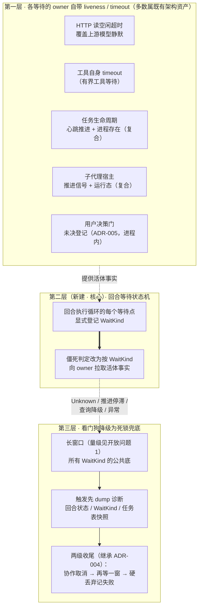
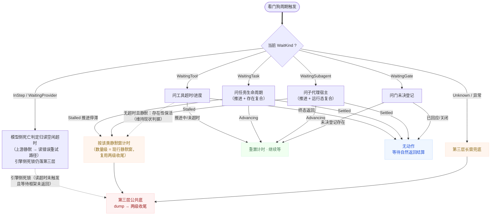
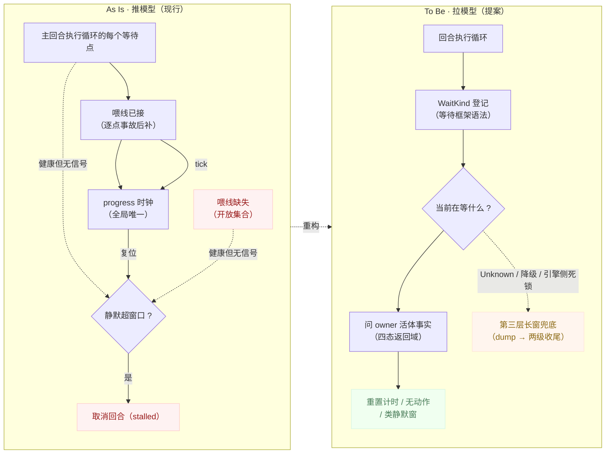

# 回合调度与循环控制 — 僵死看门狗三代架构提案（推模型 → 拉模型）

> 状态：**已裁决通过（2026-10-18，用户裁决 1-A；裁决参数 2 全采纳）**。设计已沉淀为 [turn-scheduling-architecture.md](turn-scheduling-architecture.md) ADR-006（§4.5 正文同步改写为拉模式形态）、需求侧 SDR-005（US5.5/US5.6 措辞修订）、glossary v24（L4–L7）。本文档按治理口径 §8-a 注册为域内 design subclass（先例：`tool-calling-builtin-tools.md`），保留为 ADR-006 的完整设计载体（三张架构图、四态返回域细节、继承/取代矩阵、风险表）。**实现未排期**——进度跟踪见 [turn-scheduling-ROADMAP.md](turn-scheduling-ROADMAP.md) O10。

## 1. 背景与要解决的问题

### 1.1 问题陈述（抽象形态）

引擎回合执行中存在一类合法状态：**健康但安静**——回合正在等待一个外部对象（模型响应、后台进程、子代理、用户决策、审批门），等待期间引擎自身不产生任何内容事件。当前僵死看门狗用"全局静默时长 + 活动信号"判定引擎僵死：静默超过窗口且无活动信号即取消回合。

活动信号是**推模型**：每个"健康但安静"的等待点必须**主动**向看门狗的进度时钟喂信号（心跳、转发、豁免登记）。推模型的失效模式：

1. **开放集合税**："健康但安静"的等待类别随功能增长（新工具类型、新协作机制、新集成形态都会产生新等待点），每个新等待点都是一个新的"忘记喂信号"缺陷源。每补一处喂线，只消灭该处的事故面，不消灭事故类。
2. **误报史**：该看门狗迄今的每次真实触发都是误杀——等待任务（SDR-003 两起）、等待模型首响应、等待转后台进程、（修复前）等待用户决策。零次正确捕捉。判据的覆盖面还在被逐点修复蚕食（模型挂死已由 HTTP 读空闲超时覆盖、用户决策已由豁免登记覆盖）。
3. **复杂度棘轮**：每轮修复都在增加喂信号代码（首响应心跳、双路径任务心跳、活动转发、取消来源标记）。这些代码自身也是缺陷源（已发生：转发接线写成无操作、喂信号接到错误会话的看门狗——fork 子代理的活动喂到了源会话的看门狗上）。
4. **补丁不收敛的结构证据**：ADR-004（2026-10-15）是一次完整的判据重设计，其后 48 小时内连续三起新形态误杀（等待模型首响应、等待转后台进程、fork 链路喂狗错位），全部落在 ADR-004 未覆盖的等待点上（证据快照见 [turn-scheduling-context.md](turn-scheduling-context.md) §3.5）。等待点集合是开放的，推模型的补丁清单永远不会闭合。

### 1.2 核心洞察

每个等待类别都有一个比看门狗更了解其生死的 **owner**——等待所依赖的资源或登记处，持有该等待的精确活体事实：

| 等待类别 | owner 及其持有的精确事实 |
|---|---|
| 模型响应 | HTTP 连接（**逐次读空闲超时**——健康的 SSE 流按秒级 keep-alive 不会被切，上游静默 240 秒量级则读错误；属既有架构资产） |
| 后台进程 | 任务生命周期（心跳推进 + 进程存在——**复合事实**，归后台任务域持有） |
| 子代理 | 子代理宿主（**推进信号 + 运行态**复合事实，归代理监督域持有） |
| 用户决策 | 审批门/提问门的未决登记（ADR-005 建立，进程内登记表） |
| 前台工具执行 | 工具超时参数（有界）；无超时且静默的长进程**无现成推进事实源**（见 §3.2 该类的如实处理） |

**多数健康等待不需要靠"约定喂信号"来自证活着**——模型连接、任务心跳、门登记、子代理运行态的探活信息已在运行时中；前台静默进程是例外（仅有存在性事实），其判据维持现状形态（见 §3.2）。推模型的存在只是历史原因：LiveEvent 流本来就在，挂一个 watch channel 最便宜。

**关键限定（与推模型的一致性）**：owner 事实的判定标准**继承 ADR-004 的"推进"语义**——"资源存在/运行态为 Running"不是活体，"仍在推进"才是。拉模型改变的是**谁发起查询、向谁查询**（看门狗按登记类别向 owner 拉取，而非等待点向看门狗推送），**不降级活体判据本身**（前台静默工具类除外——该类本就无推进事实可降级，维持现状判据）。owner 侧的推进判定（任务心跳、子代理活动钟）继续由 background-tasks / agent-supervision 域持有与维护——拉模型下这些设施从"喂看门狗的义务"变为"响应查询的事实源"，职责不变、方向反转。

## 2. 设计目标

1. **多数健康等待结构上无误杀路径**——模型响应、任务、子代理、门四类等待的误杀路径结构性消除；前台静默工具类维持现状判据（本就无更优事实源）。
2. **新增等待点低负担**——实现者新增一种等待时，漏做保活接线的后果是"落入兜底窗口"，不是"一个静默窗口内被误杀"。**不承诺绝对安全**：超出兜底窗口的合法未登记等待仍被终止（见风险 #1）。
3. **真僵死仍有兜底且必然落地**——引擎死锁（锁序 bug、future 永不 poll）仍被终止；触发时先落完整诊断再取消；取消不收场的回合有硬丢弃终局（继承 ADR-004 两级收尾）。**所有** WaitKind（含 `InStep`）都通向第三层兜底。资源保护不削弱：有推进事实源的等待维持"推进"判据，挂死但资源存活的等待照常在一个窗口后终止（兑现 US5.5 第二验收）。
4. **看门狗代码量收缩**——推模型的全部喂线设施（心跳转发、活动转发、双路径心跳）在此架构下不再是看门狗的必要组件。

## 3. 目标架构（To Be）

### 3.1 三层结构

**各层职责**：

- **第一层（owner 层）**：每类等待的资源自身持有 liveness 判定或 timeout（其归属：任务生命周期归后台任务域、子代理运行态归代理监督域、门登记归本域 ADR-005 建立）。缺口是接线问题而非新建问题。
- **第二层（等待状态机，本次核心改造）**：回合执行循环的每个 await 点显式声明自己在等什么（`WaitKind` 封闭枚举：`InStep` 模型流式响应中 / `WaitingProvider` 等模型首响应 / `WaitingTool` 前台工具执行中 / `WaitingTask` 等后台任务 / `WaitingSubagent` 等子代理 / `WaitingGate` 等用户决策 / `Unknown` 未登记）。看门狗的判据从"全局静默 + 推送信号"变为"按 WaitKind 的状态不变量"——各类的判据见 §3.2。
- **第三层（兜底看门狗）**：长窗口死锁兜底，**所有 WaitKind 的公共底**（`InStep` 也不例外——引擎侧死锁无类豁免）。**继承 ADR-004 两级收尾**——先协作取消（携来源标记）；取消后仍不收场的回合（死锁对协作取消同样不响应）再等一个窗口后硬丢弃、记"已失败"并携带错误载荷。第三层触发的结局映射沿用 ADR-004 词汇：协作收场记"已停滞"、硬丢弃记"已失败"。触发路径先 dump 诊断（回合状态、当前 WaitKind、任务表快照、按 WaitKind 差异化的上下文——模型等待附连接态、任务等待附任务行），再执行取消。

### 3.2 运行控制（判定流程与各类判据）

**owner 查询的返回域（四态）与看门狗动作**：

| 返回态 | 含义 | 看门狗动作 |
|---|---|---|
| **Advancing（推进中）** | 被等待对象仍在推进（owner 的推进判定，非存在性判定） | 重置计时，继续等 |
| **Settled（终态）** | 被等待对象已正常结算（进程退出、任务完成、门已回应） | 无动作——等待方即将自然返回，结算走 owner 自身的正常路径。看门狗不重复介入自然结算；**Settled 不重置计时**——若等待方因框架 bug 未返回，计时继续累积，一个长窗后落第三层 |
| **Stalled（推进停滞）** | 资源存在但推进停滞（挂死任务、死锁子代理——owner 的推进判定失守） | 按**该类的静默窗口**（数量级 = 现行静默窗口，非第三层长窗——见下"双窗结构"）计时，一个窗口后走两级收尾——资源保护不因拉模式削弱 |
| **QueryFailed（查询失败）** | 查询通道自身故障（非"死亡"） | 连续 N 次失败（N 待裁决，建议 3）后降级为 `Unknown` 进第三层长窗计时——查询通道故障不能造成无限等待（也不能单次失败就误判）。**`WaitingGate` 豁免降级**：门登记是进程内无锁读，故障面与跨进程查询不同（通道故障即引擎自身异常），不适用降级路径，直接落第三层 |

**双窗结构（关键裁决点，回应资源保护）**：

- **类静默窗**（短窗，数量级 = 现行静默窗口）：适用于 **owner 明确报 Stalled** 的等待（任务心跳断、子代理推进停滞）与**前台静默工具的存在性保活**——这类"资源存在但推进失守/不可知"的等待，沿用现行窗口量级与两级收尾，资源保护与现行**等价**。
- **第三层长窗**（长窗，量级见开放问题 1）：适用于 `Unknown`（未登记等待）、QueryFailed 降级、以及**所有 WaitKind 的公共底**——包括 `InStep` 的引擎侧死锁（读超时未触发、等待框架未返回）。长窗是兜底死锁的窗口，不是资源回收的窗口。
- 两窗关系：类静默窗先满 → 走两级收尾（不进长窗）；长窗只在"类判据不适用/失守/未知"时计时。**两窗不串联**——报 Stalled 的等待不会先等短窗再等长窗。

**各类判据的如实刻画**：

| WaitKind | 死亡判定 | 备注 |
|---|---|---|
| `InStep` / `WaitingProvider` | **模型侧**：HTTP 读空闲超时（240 秒量级，per-read）——上游静默超窗 → 读错误 → 既有重试/失败路径收场。**引擎侧**：第三层长窗（等待框架死锁）。 | 读超时是逐次读空闲超时：健康 SSE（秒级 keep-alive）不被切；中间代理发 keep-alive 而上游挂死时读超时**不触发**——该形态由第三层长窗兜底（原由静默判据覆盖，新架构从"短窗误杀带"换为"长窗兜底"，是覆盖语义的显式变化，见风险 #5） |
| `WaitingTool` | 有界工具：超时参数（owner 事实）。无超时且静默的工具：**存在性保活 + 类静默窗**（维持现状判据——进程存在即续期，静默超类窗后两级收尾）。 | 前台静默进程无现成推进事实源（§1.2 例外），现状判据已是该类最优可得判据，本设计如实继承 |
| `WaitingTask` | 四态返回域（owner = 任务生命周期复合事实） | 心跳断 → Stalled → 类静默窗（与现行等价） |
| `WaitingSubagent` | 四态返回域（owner = 子代理宿主复合事实） | 同上 |
| `WaitingGate` | 未决登记存在即续期（ADR-005 语义不变）；登记清除 → Settled → 自然返回 | 进程内查询，豁免 QueryFailed 降级 |

**运行不变量**：

- **WaitKind 登记是回合执行循环的语法**：等待状态由 await 点的包装结构（等待框架函数）登记与清理，不是散落在各工具里的自觉行为。枚举是**封闭集 + `Unknown` 兜底**（新等待类别经 ADR 扩枚举，不开放注册——与 ADR-002 空响应守卫的"封闭集准入"同一设计姿态）。**嵌套/并发等待**（工具内同时等任务与门、hooks 层审批等待）登记为**等待集合**而非单值——看门狗对集合内每个元素独立拉取，任一元素 Advancing 即重置计时（最宽容判据，与推模型下"任一信号重置"语义一致）。
- **覆盖矩阵（第二层落点，回应代码事实）**：现行 `run_engine_turn` 的全部调用方——主回合（message.send wait/fire、message.steer fire）、任务驱动回合（task_driver）、定时驱动回合（cron_driver）——**同在第二层登记 WaitKind**（这些路径共享同一回合执行循环，登记是循环内语法，不依赖调用方）；子代理宿主直驱路径（`run_one_turn` 直调，不经 `run_engine_turn`）**不登记**，维持"子代理前台回合由父回合 `WaitingSubagent` + 子代理域自身生命周期兜底"的现行裁决（子代理的**任务/定时驱动回合**走 task_driver/cron_driver，与主回合同列——三起事故之一正是该路径）。第二层等待框架落点为 mirri-core 的回合执行循环层（`run_engine_turn` 所包装的 turn_flow），多引擎宿主（多引擎接线 mirri-core 直驱）由此获得同架构保护——这是提问保活心跳可退役的前提（§5）。
- **owner 拉取是非阻塞查询**：判据查询以"资源当前状态"为准（进程推进、登记存在、连接开断），不做跨进程往返。查询只在看门狗到期时发生（沿用 ADR-005 的"到期才查"节律，不进热路径）。
- **双信号不可互换**：owner 说 Advancing 只重置计时，不产生内容事件（不影响 UI 呈现、不触发上下文行为）；owner 的终态/死亡走 owner 自身的结算路径（任务结算、模型错误、子代理终局），结局词汇不经看门狗。
- **取消直达等待点**（沿用 ADR-004）：用户取消与兜底取消都直达等待点，等待即刻让路——拉模型下等待点已在状态机登记，取消投递更直接。

### 3.3 As Is → To Be 对照

**判定语义的根本转变**：

| 维度 | As Is（推模型） | To Be（拉模型） |
|---|---|---|
| 死亡判据 | 无推送信号（否定证据） | owner 查询返回停滞/降级，或引擎侧长窗（owner 的推进判定失守） |
| 新等待点的默认命运 | 一个静默窗口内被误杀（默认危险） | 落入第三层长窗兜底（延迟兜底，非绝对安全——见设计目标 2） |
| 喂线责任 | 每个等待点自觉实现（开放集合） | 无（结构性消除） |
| 模型上游静默 | 静默判据（600 秒） | 读空闲超时（240 秒，更快且更准） |
| 模型侧 keep-alive 但上游挂死 | 静默判据覆盖（600 秒） | **第三层长窗兜底**（变慢——从 600 秒变为数十分钟，语义变化见风险 #5） |
| 挂死但资源存活的等待 | 心跳断 → 一个窗口后终止 | owner 报 Stalled → 类静默窗（**数量级等价，不削弱**） |
| 前台静默工具 | 静默判据（存在性喂线） | **维持现状判据**（存在性保活 + 类静默窗） |
| 误杀路径存在性 | 存在（每条未接线喂线都是） | 四类结构性消除；前台静默工具类维持现状（无更优事实源） |
| 兜底收尾 | 协作取消 → 硬丢弃（ADR-004） | 继承（dump 诊断前置） |

## 4. 难点与风险

| # | 难点/风险 | 等级 | 缓解方案 |
|---|---|---|---|
| 1 | **第三层窗口短于合法长等待的残余误杀带**：未登记等待（或查询降级）超过兜底窗口（30–60 分钟量级）仍被终止——长构建、长批处理等合法等待若无 WaitKind 登记且超出窗口即误杀 | 高 | 这是从"一个静默窗口误杀"到"长窗兜底"的净改善而非绝对安全（设计目标 2 如实措辞）；兜底触发前的 dump 诊断会暴露"这是合法长等待"的证据（工具调用名、进程状态），人工可归因；兜底窗口取值与按 WaitKind 分窗在开放问题 1 裁决 |
| 2 | **owner 推进判定的失守面转移**：推模型下心跳断 → 看门狗终止；拉模型下 owner 的推进判定（任务心跳、子代理活动钟）若自身有 bug 报假 Advancing，看门狗永不终止 | 高 | owner 判据失守的影响域从"全引擎"收缩到"该等待类别"（bug 只延长该类等待的兜底，不再误杀）；第三层长窗 + dump 诊断仍在，假 Advancing 超窗后兜底照常触发并留下归因；owner 推进判定的正确性由其归属域（后台任务/代理监督）的测试资产保障 |
| 3 | **owner 查询通道的故障形态**：查询自身失败（非"死亡"）的处理不当会造成无限等待或误杀 | 高 | 四态返回域显式定义 QueryFailed：连续 N 次失败降级为 Unknown 进第三层计时（单次失败不降级——通道抖动不误判）；查询失败不计入死亡判据；`WaitingGate` 豁免降级（进程内查询，见 §3.2） |
| 4 | **模型侧 keep-alive 掩盖上游挂死**：读空闲超时对"中间代理发 keep-alive、上游真挂死"的形态不触发——该形态从现行 600 秒静默判据覆盖退化为第三层长窗兜底，终止变慢数十分钟 | 中 | 覆盖语义的显式变化（现行该形态在误杀带内被偶然覆盖，但同一判据也制造了三起误杀——本设计以误杀消除换该形态的终止延迟）；dump 诊断在该形态兜底触发时给出完整归因；如需更快终止，读空闲超时的 keep-alive 甄别（内容 keep-alive vs 注释 keep-alive）属 kosong 域改进，不属本判据 |
| 5 | **滴水型模型响应**：`InStep` 下极慢但持续的增量流（间隔分钟级的滴流，>240 秒）会被读空闲超时当流错误终止——这是新引入的终止路径（现行静默判据对 600 秒内滴流同样终止，>600 秒滴流存活） | 中 | 读空闲超时是**逐次读**间隔判据：间隔 >240 秒的滴流终止、≤240 秒存活——与现行 600 秒静默判据（任何窗口内无内容即杀）相比，短间隔滴流从"可能误杀"变为"确定存活"，长间隔滴流从"600 秒后存活（心跳喂线）"变为"读错误重试"——净效果是滴流判据更连续、无悬崖；该参数本身可调（kosong 域） |
| 6 | **双判据并存期的可观测性**：迁移期同一系统内推喂线与拉查询并存，诊断需区分两套判据来源 | 中 | 迁移期告警日志标注判据来源（push-model / pull-model）；全量切换后推喂线退役 |
| 7 | **诊断 dump 的信息收集成本**：兜底触发时收集任务表快照、回合状态等可能涉及跨锁访问 | 中 | dump 内容限定为无锁可读快照（原子计数、枚举状态、登记表拷贝），按 WaitKind 差异化字段（模型等待附连接态、任务等待附任务行、门/模型类不附工具调用）；不可收集的字段以"不可用"占位，不为 dump 引入新的死锁面 |
| 8 | **看门狗兜底窗口变长期间的资源占用**：真死锁回合的存活时间变长 | 低 | 真死锁是引擎 bug（罕见路径），dump 诊断的价值（可归因、可修复）远超提前终止的资源节省；用户取消始终即时可用 |

## 5. 对现行决策的继承与取代清单

裁决通过后追加 ADR-006，以下矩阵是改写 §4.5 时的处置依据：

| ADR-004/005 决策项 | 处置 | 理由 |
|---|---|---|
| 活动信号判据（推送式：等待点转发活体） | **取代**——改为 owner 查询（四态返回域） | 开放集合缺陷的结构性消除（§1.1） |
| 判据的"推进"语义（Running 非活体、心跳推进才是） | **继承并强化**——成为 owner 侧事实判定的标准（前台静默工具类除外——该类无推进事实源，维持存在性判据） | US5.5 第二验收（资源保护不削弱）的兑现机制 |
| 静默窗口对模型响应类的判据 | **取代**——模型侧归读空闲超时，引擎侧归第三层长窗 | "连接活着但长时间无内容"是合法慢响应形态，静默判据是该场景的误杀路径；覆盖语义变化（keep-alive 掩盖形态变慢）见风险 #4 |
| 上报节律推导（≤ 阈值一半等） | **随推送判据退役（新架构验证后）** | 拉模式无上报节律；查询节律沿用"到期才查"；迁移期推喂线仍在用节律推导，退役时点与提问心跳行同批 |
| 取消直达等待点 + 来源标记 | **继承** | 与判据方向正交，且在拉模型下更直接 |
| 两级收尾（协作取消 → 硬丢弃记失败） | **继承**（类静默窗与第三层共用该收尾程序） | 死锁对协作取消同样不响应，硬丢弃终局不可丢 |
| 结局词汇（stalled/cancelled/failed 拆分） | **继承** | 两类窗口的收尾沿用全套映射 |
| 未决用户决策豁免（门登记查询） | **继承并转形**——豁免查询即 owner 查询在 WaitingGate 上的特例 | 语义不变，从"豁免机制"变为"owner 事实源" |
| 触发可见（两级告警日志） | **继承并扩展**——前置诊断 dump | 兜底窗口变长，诊断价值更高 |
| 提问工具保活心跳（ADR-005 保留项） | **退役（新架构验证后）**——前提已满足：第二层等待框架落在 mirri-core 回合执行循环层，多引擎宿主（mirri-core 直驱）与嵌入式宿主同获 WaitingGate 保护，ADR-005 的保留论据（"仅接线 mirri-core 的宿主不受保护"）不再成立 | 迁移期保留双保险（无害叠加，与 ADR-005 保留它时同一先例），验证后与喂线设施同批退役 |
| 子代理回合不纳入看门狗 | **继承**（前台直驱路径）——子代理的任务/定时驱动回合经 task_driver/cron_driver 与主回合同列第二层（现状即如此，见覆盖矩阵） | 覆盖裁决不变（开放问题 5 留重审入口） |

**需求侧联动**：US5.5"活动信号"措辞是推模型词汇——拉模型裁决后 US5.5 语义等价改写为"被等待对象仍在正常推进"（验收行为不变：推进中不误判、真停滞兜底仍生效），且覆盖面从"任务"显式扩展到全部 WaitKind（现状文本只点名任务类），随 ADR-006 同批落 SDR 修订。US5.6 需**同步 SDR 修订**：QueryFailed 降级路径对门等待不适用（进程内查询豁免，§3.2），但"查询通道持续故障 + 门上无未决登记 + 引擎未僵死"的复合极端形态下第三层仍可终止——US5.6 的"真正僵死"措辞需扩展为"或等待状态机降级失守"，避免需求文本落后于新终止路径。

## 6. 与相邻设计的关系

- **§4.5 僵死看门狗**：本提案是其三代形态。ADR-005 的门未决登记直接复用为第一层 owner 事实源。
- **agent-supervision 域**：子代理运行态与推进事实（`WaitingSubagent` 的 owner）由该域持有；拉模式查询接口是该域的**新增对外接口**——本提案裁决时需在该域登记影响并确认接口形态（当前运行态可查，推进信号需从其活动钟暴露）。
- **background-tasks 域**：任务心跳与生命周期是该域资产；拉模型下心跳的看门狗喂线语义退役，心跳收缩回"stale 报警 + owner 事实源"双职责——归属该域裁决。
- **kosong 域**：读空闲超时是 `InStep`/`WaitingProvider` 的 owner 事实源；其参数（240 秒量级）与 keep-alive 甄别能力是该域资产（风险 #4/#5 的参数面）。
- **glossary**：「owner」「WaitKind」「推进」「类静默窗」为跨域新术语（横跨本域、代理监督域、后台任务域、kosong 域），随 ADR-006 落地同批登记 glossary 条目。
- **对话渲染域**：`stalled` 结局词汇与呈现（ADR-004 落地词汇）不变；兜底触发的呈现文案需更新为长窗口语义（跨域待办，落地时在该域登记）。

## 7. 开放问题（裁决时需定夺）

1. **第三层兜底窗口的具体值**：30 分钟还是 60 分钟？是否按 WaitKind 分窗（等待子代理可以更长）？**约束**：Unknown 窗不得短于现行静默窗（600 秒）——短于它则未登记等待的误杀带重新打开。
2. **QueryFailed 降级的 N 值**：连续多少次查询失败降级为 Unknown（建议 3，需结合查询周期定）？
3. **诊断 dump 的落点**：tracing 日志（现状可检索）还是独立诊断文件（信息更全）？倾向前者 + 结构化字段。
4. **ACP 集成模式**：ACP 宿主的回合是否同享拉模式判据（其等待点集合与嵌入式宿主不同）？倾向同架构不同配置。
5. **子代理回合的纳入时机**：前台直驱路径的排除裁决维持；若子代理域未来提出自己的看门狗需求，是否复用同一状态机架构？
6. **WaitKind 粒度**：六类 + Unknown 的初始粒度是否够用（如是否区分"等待单任务"与"等待任务批"）？实践驱动扩枚举，每扩一次走 ADR。

## 8. 治理口径确认（裁决前置动作）

本文件是提案期工作载体，其类型身份需在裁决时一并定夺（二选一）：

- **a)** 注册为域内 design subclass（先例：`tool-calling-builtin-tools.md`、`skills-builtin-skills.md`）——提案期保留独立文件，裁决后内容沉淀为 ADR-006 时退役归档；
- **b)** 内容压缩进 `proposals.md` P-029 明细，裁决时直改 architecture 落 ADR-006。

倾向 a（内容量与 subclass 先例相当，proposals.md 明细载不动三张架构图与判据矩阵）。
