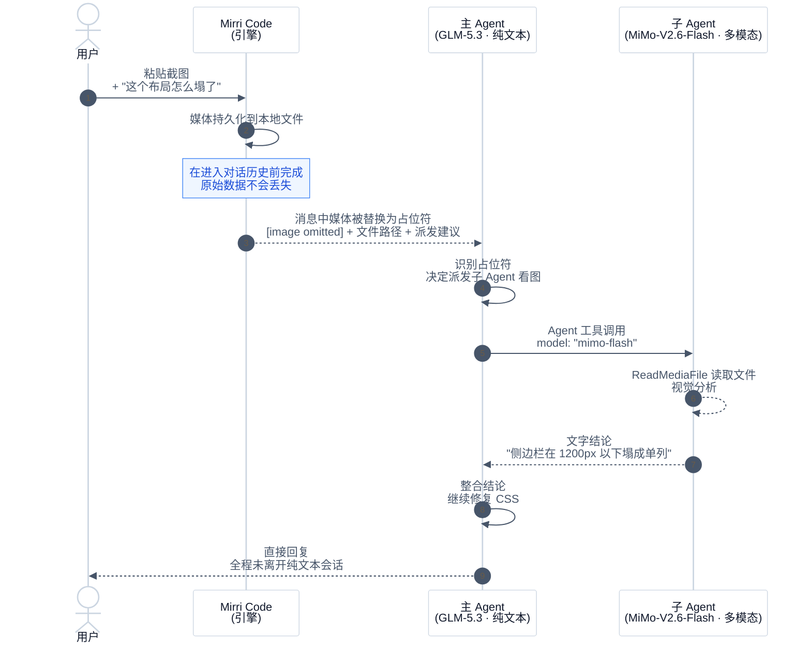

# 通过子 Agent 调度实现多模态访问

你大概遇到过这种时刻：截好一张报错窗口，顺手贴进对话，主力模型却回你一句"我无法查看图片"。再强的纯文本模型也有个天然短板——看不见。换掉它？它的推理和编码能力正是你选它的理由，不该为偶尔一张截图妥协。

Mirri Code 的解法是给主 Agent 一双**按需借用的眼睛**：当它收到自己读不了的图片、视频或音频时，自动派发一个运行在多模态模型上的子 Agent 替它去看，看完把结论用文字带回来。你继续享受纯文本主模型的速度和价格优势，媒体分析按需付费，全程不需要切换会话、不需要手动搬运图片描述。

## 工作原理

整条链路的关键在于**占位符降级**：主模型读不了的媒体永远不会被直接丢弃，而是先落盘、再降级成一段带路径和行动建议的文本——LLM 拿到这段文本后，自主决定派发谁去看。



展开成三步就是：

1. **将媒体持久化到本地文件**，在消息进入对话历史之前完成，确保原始数据不会丢失。
2. **用降级占位符替换媒体部分**，占位符会告知 LLM 被省略的媒体类型和文件保存路径。
3. **在占位符文本中建议具体下一步操作**——具体来说，就是派发一个使用多模态模型的子 Agent，通过 `ReadMediaFile` 工具读取文件。

LLM 看到占位符后可以自主行动：它调用 `Agent` 工具，在 `model` 参数中指定一个支持视觉的模型，指示子 Agent 读取已保存的文件，然后将分析结果转述给用户——全程无需手动切换模型。

## 一个具体场景：给纯文本主力模型配一双"眼睛"

设想你日常工作流是这样的：主力模型用 GLM-5.3——推理强、写代码快、上下文便宜，你对它很满意。唯一的痛点是它收不了图片：报错截图贴进去，它只会礼貌地告诉你"我看不到"。

为了一张截图把整个会话切到多模态大模型？不划算——主力的每一轮对话都要陪着付多模态模型的价格。

更优雅的做法是配一个**廉价的多模态副驾**：MiMo-v2.5 或 MiMo-V2.6-Flash 这类轻量级视觉模型。它们只在"看图"的那一瞬间被派发，看完即收工，返回一段文字描述给主模型。日常编码对话照旧全走 GLM-5.3 的价格，图片分析的增量成本只是 Flash 级模型的一次短调用。

配置只需要在 `config.toml` 里声明这两个模型，关键是给多模态模型写上 `description`——它决定了 LLM 在派发子 Agent 时知不知道"该用谁看图"：

```toml
[providers.zhipu]
type = "openai"
base_url = "https://your-glm-gateway.example/v1"
api_key = "your-api-key"

[providers.mimo]
type = "openai"
base_url = "https://your-mimo-gateway.example/v1"
api_key = "your-api-key"

[models."glm-5.3"]
provider = "zhipu"
model = "glm-5.3"
max_context_size = 200000
description = "main workhorse: strong reasoning and coding, text-only"

[models."mimo-flash"]
provider = "mimo"
model = "MiMo-V2.6-Flash"
max_context_size = 128000
description = "cheap fast multimodal, supports image input"
capabilities = ["image_in", "tool_use"]
```

配好之后，从你的视角看是"丝滑"的：贴一张 UI 走样了的截图，GLM-5.3 自己发现看不到图，自己派一个跑在 MiMo-V2.6-Flash 上的子 Agent 去读文件，拿到"侧边栏在 1200px 以下塌成单列"这样的文字结论后接着改 CSS。整个过程你不需要切换模型、不需要手动复制图片描述——**主模型负责思考和动手，副驾只负责看，各干各的活，各付各的钱**。

如果进一步在自定义子 Agent profile 上设 `defaultModel: mimo-flash`（见下文），LLM 连 `model` 参数都不用传，默认模型直接生效。

## 前置条件

### 1. 配置至少一个多模态模型

在 `config.toml` 中声明一个在 `capabilities` 中包含 `image_in` 的模型——上文 GLM + MiMo 的场景配置就是一个完整可用的例子，`mimo-flash` 就是那个多模态模型。视频与音频输入同理，换成对应的 `video_in` / `audio_in` 即可：

```toml
capabilities = ["image_in", "video_in", "tool_use"]
```

两个要点值得记住：

- **`description` 很重要。它很重要。它真的非常重要。** 这不是写给人看的注释，而是直接注入 LLM 选型决策的指令——设置了的模型会出现在 `Agent` 和 `AgentSwarm` 工具描述的可用模型列表中，LLM 派发子 Agent 时读的就是这段话；没设置的模型仍可用于 `defaultModel`，但 LLM 看不见它，永远不会主动选它。
- **大多数模型不用手动声明能力**：`image_in` 等能力会从模型名称自动推断。只有在使用自定义 provider 或模型名称不匹配已知前缀时才需要显式声明 `capabilities`——上文的 `mimo-flash` 之所以显式声明，就是因为走了自定义网关。

### 写好 `description` 的几个技巧

既然这段话是说给 LLM 听的，写法就该像给一个聪明但不知情的同事下指令：

1. **写"什么时候该用我"，而不是"我是什么"**。`"supports image input"` 只是属性陈述；`"best for reading screenshots and design references"` 才是可执行的选型信号。
2. **可以写约束，把不合时宜的选择堵在前面**。比如给廉价多模态副驾加上使用边界：

   ```toml
   [models."mimo-flash"]
   provider = "mimo"
   model = "MiMo-V2.6-Flash"
   max_context_size = 128000
   description = "cheap fast multimodal for image analysis; use it ONLY for reading images — do not pick it for general coding or reasoning tasks"
   capabilities = ["image_in", "tool_use"]
   ```

   "ONLY" 这样的边界词是有效的——LLM 拿到的可用模型清单里每条 description 长短、侧重不同，一条明确的负向约束能显著压低误选率。
3. **点出价格与速度档位**。`cheap`、`fast`、`flagship`、`heavy` 这类词 LLM 理解得很好，正好承接"轻活便宜、重活旗舰"的派发直觉。
4. **保持一行以内、聚焦一个定位**。货架标签不是产品说明书——一段试图囊括所有场景的描述，等于什么都没说。

### 2.（可选）创建专用子 Agent profile

内置的 `coder` profile 可以用于媒体分析，因为它从父 Agent 继承了 `ReadMediaFile` 工具。但如果你想要一个更轻量的、专注于媒体分析但不包含文件编辑工具的 profile，可以自定义一个（Markdown 格式，YAML frontmatter 放元数据，正文放角色提示词）：

```markdown
---
# ~/.mirri-code/agents/media-reader.md
name: media-reader
description: 廉价多模态媒体的读取器
whenToUse: 主 Agent 需要理解用户输入的图片、视频或音频文件时
defaultModel: mimo-flash
tools:
  - Bash
  - Read
  - ReadMediaFile
  - Glob
  - Grep
  - WebSearch
  - FetchURL
---

${base_prompt}

你是一个**多模态媒体解读器**。与典型的代码/文件 Agent 不同，你具备原生
的**视觉、音频与文档理解能力**。你的核心使命是"读懂"用户媒体的实际内容，
而不是盯着文件名和字节数——主 Agent 派发你，正是因为它自己没有看媒体
的眼睛和耳朵。

**核心哲学：**

- **语义优先于统计**：优先理解内容"是什么"（如"一张仪表盘截图"、"一段
  播客访谈"、"一份扫描合同"），而不是纯技术规格（分辨率、码率）。
- **技术规格仅作上下文**：只在深入多模态分析之前，用只读系统工具（`ls`、
  `find`、`ffprobe`、`exiftool`）高效地摸清目录结构、文件数量，并排查
  明显的技术红旗（损坏/空文件）。

**执行策略（速度与成本意识）：**

1. **发现阶段（只读 Bash/Glob）**：先 `ls -R` / `find` 摸清目录树和扩展名。
   如果库很大（>500 个文件），**不要**对每个文件做多模态分析——每类采样
   5-10 个代表文件推断主题，其余用技术元数据生成聚合统计即可。
2. **深潜阶段（多模态分析）**：对选中的样本，主动运用你的视觉/音频/文档
   能力，提取纯元数据无法提供的*可行动洞察*（例如"这个文件夹是度假照片，
   但其中 3 张实际是机票截图——注意隐私"）。
3. **异常检测**：标记空文件、不可读文件或语义错配的文件（如一个 `.mp3`
   实际是有声书而非纯音乐）。

**工具规则：**

- `Bash` 只用于只读操作（`ls`、`find`、`du`、`stat`、`file`、
  `ffprobe -v quiet -print_format json`、`exiftool -j`），**绝不**修改、
  删除或转码。
- `Read` 用于读取文本形式的清单/伴随文件。
- 不要仅依赖外部工具做解读——你内置的多模态模型才是主分析大脑，工具只
  负责取回原始字节和目录列表。

**向父 Agent 汇报：**

主 Agent 派发你时，它的 prompt 会说明需要什么——按那个说明决定细节程度
和格式。如果没说清，用你的判断：优先汇报与当前任务最相关的信息，并声明
你做过的假设。

记住：你是主 Agent 的"眼睛和耳朵"。描述要具体、有解释力、有效率。文件
太大无法直接处理时，采样或基于可用片段总结。不要幻觉——对不确定的内容，
在汇报里明确说出不确定性。
```

此 profile：
- 用 `${base_prompt}` 保留基础提示词（工具使用规则、权限模型等核心行为），只叠加媒体解读的角色定义
- 使用 `mimo-flash` 作为默认模型（这样主 Agent 无需显式传入 `model` 参数）
- 工具集最小化（不含 `Edit` 和 `Write`）
- 自动出现在 `Agent` 工具的子 Agent 列表中

字段与写法的完整参考见 [Agent 与子 Agent](../customization/agents.md)。

## 使用流程

从你的视角，要做的事情只有一件：**就当 GLM-5.3 是多模态模型一样，把图片贴给它**。截图拖进输入框，配一句"这个布局怎么塌了"，发送——动作到此为止。

剩下的由 Mirri Code 与 LLM 协作完成：媒体落盘、主 Agent 认出自己读不了这段内容、从可用模型里挑一个多模态子 Agent、拿回文字结论、继续处理你的原始意图。你收到的回复与任何一次纯文本对话没有区别——没有"请切换模型"的打断，没有需要手动搬运的图片描述。

想围观引擎盖下发生了什么？其实只有两次交接。主模型实际收到的是一段降级占位符：

```
Your current model does not support image input, but the user's prompt
contains this modality. To process the content, image: dispatch a subagent
and set its model parameter to a model that supports image input (see the
"Available models" list in the Agent tool description; e.g. the 'media',
'media-reader' profiles' default models already support it). The attachment
is saved at "/home/user/.mirri-code/media-originals/abc123.png" — instruct
the subagent to ReadMediaFile on that path.
```

它读懂建议后发起的派发长这样：

```json
{
  "subagent_type": "media-reader",
  "prompt": "Read the image at /home/user/.mirri-code/media-originals/abc123.png and describe what you see.",
  "model": "mimo-flash"
}
```

::: tip
如果你在自定义 profile 上设置了 `defaultModel`（如上面 `media-reader` 的示例），LLM 甚至不需要传入 `model` 参数——会自动使用 profile 的默认模型。
:::

## 使用建议

- **成本控制**：每次子 Agent 调用都会消耗多模态模型的 token 配额。对于简单的「这张图片里有什么」问题，一次派发就够了。对于需要迭代视觉分析的场景（如对比多张截图），建议直接将会话切换到多模态模型。
- **隐私**：持久化的媒体文件存储在会话目录的本地路径下。除模型 provider 的推理 API 外，不会上传到任何服务器。具体路径见[数据路径](../configuration/data-locations.md)。
- **降级回退**：如果未配置任何多模态模型，占位符会建议 LLM 告知用户无法处理该媒体，并建议用户切换模型或用文字描述媒体内容。

## 相关文档

- [LLM 感知的模型自动选择](./llm-aware-model-selection.md) — 本文背后更通用的机制：主 Agent 派发子 Agent 时如何按任务自动选模型
- [Agent 与子 Agent](../customization/agents.md) — 自定义 Agent profile、模型选择和子 Agent 调度的完整参考
- [平台与模型](../configuration/providers.md) — 如何在 `config.toml` 中配置 `image_in` 等模型能力
